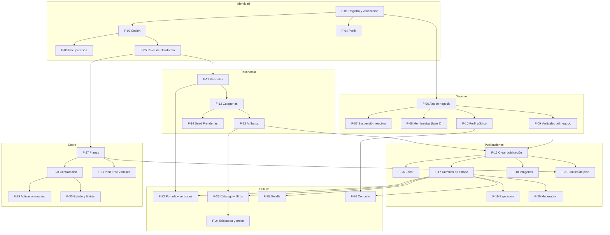

# 02 — Alcance del MVP

**Estado:** documento para revisión · **Fecha:** 2026-11-12 · **Fase:** planificación (Prompt 01)

---

## 1. Cómo se decidió el alcance

Cada funcionalidad candidata pasó por tres preguntas. Si falla la primera o la segunda, no entra al MVP:

1. **¿Sin esto el negocio no puede publicar y recibir contacto?** (núcleo del valor)
2. **¿Sin esto la plataforma no puede cobrar o controlar el acceso?** (sostenibilidad)
3. **¿Se puede operar manualmente durante los primeros 100 negocios?** (si sí, se posterga y se hace a mano)

El resultado es un MVP que demuestra **catálogo + contacto + suscripción**, no un producto completo.

---

## 2. Funcionalidades incluidas

Prioridad MoSCoW: **M** = Must, **S** = Should. No hay Could en el MVP: si algo es "Could", está en fase 2.

### 2.1 Identidad y acceso

| ID | Funcionalidad | Módulo | Prio | Depende de |
|----|---------------|--------|------|------------|
| F-01 | Registro con email + contraseña, verificación de correo | Auth, Users | M | — |
| F-02 | Inicio y cierre de sesión, sesión persistente segura | Auth | M | F-01 |
| F-03 | Recuperación de contraseña por correo (token de un uso) | Auth | M | F-01, correo |
| F-04 | Perfil de usuario (nombre, teléfono, email) | Users | M | F-01 |
| F-05 | Roles de plataforma (`USER`, `MODERATOR`, `SUPPORT`, `PLATFORM_ADMIN`) | Auth, Admin | M | F-02 |

### 2.2 Negocio y membresías

| ID | Funcionalidad | Módulo | Prio | Depende de |
|----|---------------|--------|------|------------|
| F-06 | Registro de negocio (nombre, `city` del catálogo, `addressLine` opcional, teléfono, aceptación de T&C) — queda `APPROVED` y operable al instante | Businesses | M | F-01 |
| F-07 | ~~Aprobación/rechazo de negocio por moderación~~ **Sustituida por suspensión reactiva** (Q-07): `SuspendBusiness`/`ReactivateBusiness` con `ModerationCase` | Businesses, Moderation | M | F-06 |
| F-08 | ~~Membresías: invitar, aceptar, cambiar rol, revocar~~ **Fuera del MVP** (1 miembro por negocio); el modelo `Membership` se mantiene | Businesses | S | F-06 |
| F-09 | Selección de verticales habilitadas para el negocio | Businesses, Taxonomy | M | F-06 |
| F-10 | Perfil público del negocio (nombre, descripción, `city`, `addressLine`, contacto) | Businesses, PublicCatalog | M | F-06 |

### 2.3 Taxonomía configurable

| ID | Funcionalidad | Módulo | Prio | Depende de |
|----|---------------|--------|------|------------|
| F-11 | CRUD de verticales (crear, activar, desactivar) | Taxonomy | M | F-05 |
| F-12 | CRUD de categorías y subcategorías por vertical | Taxonomy | M | F-11 |
| F-13 | Definición de atributos por vertical/categoría (tipo, obligatoriedad, filtrable) | Taxonomy | M | F-12 |
| F-14 | Seed inicial de la vertical "Prenderías" (categorías y atributos base) | Taxonomy | M | F-12, F-13 |

### 2.4 Publicaciones e inventario

| ID | Funcionalidad | Módulo | Prio | Depende de |
|----|---------------|--------|------|------------|
| F-15 | Crear publicación (título, descripción, precio, condición, categoría, atributos, ubicación) | Listings | M | F-09, F-13 |
| F-16 | Editar publicación y sus atributos | Listings | M | F-15 |
| F-17 | Publicar / pausar / marcar vendido / archivar | Listings | M | F-15 |
| F-18 | Carga de imágenes con validación (tipo real, tamaño, cantidad) | Media | M | F-15 |
| F-19 | Expiración automática de publicaciones y recordatorio de renovación | Listings, Notifications | S | F-17 |
| F-20 | Moderación **reactiva** de publicaciones (ocultar por denuncia) | Moderation | M | F-17 |
| F-21 | Límites por plan aplicados en backend (publicaciones activas, imágenes) | Subscriptions, Listings | M | F-15, F-27 |

### 2.5 Catálogo público y contacto

| ID | Funcionalidad | Módulo | Prio | Depende de |
|----|---------------|--------|------|------------|
| F-22 | Portada pública y navegación por vertical | PublicCatalog | M | F-11, F-17 |
| F-23 | Catálogo agregado con filtros por categoría, atributos, precio, ubicación y condición | PublicCatalog | M | F-13, F-17 |
| F-24 | Búsqueda por texto y ordenamiento (relevancia, precio, recencia) | PublicCatalog | M | F-23 |
| F-25 | Detalle de publicación + publicaciones del mismo negocio | PublicCatalog | M | F-17 |
| F-26 | Contacto por WhatsApp (enlace externo) y por formulario (crea `Lead`) | PublicCatalog, Leads | M | F-10, F-17 |

### 2.6 Suscripciones y cobro

| ID | Funcionalidad | Módulo | Prio | Depende de |
|----|---------------|--------|------|------------|
| F-27 | Planes con límites configurables: `Plan` + `PlanEntitlement` (Free 10 / Base 30 / Pro 50 publicaciones) | Subscriptions | M | F-05 |
| F-28 | Contratación de suscripción **manual**: plan Free al instante (`TRIALING`, 60 días); un plan de pago se activa cuando un admin registra el pago (transferencia/Nequi), sin estado intermedio de "pendiente" | Subscriptions, Billing | M | F-27 |
| F-29 | ~~Webhooks del proveedor~~ **Sustituida por activación manual auditada** (`activatedByAdminId` + `activationNote`) | Billing, Subscriptions | M | F-28 |
| F-30 | Consulta de estado de suscripción y límites en el panel del negocio | Subscriptions | M | F-28 |
| F-31 | Plan Free con 2 meses de vigencia y vencimiento automático | Subscriptions | S | F-27 |

### 2.7 Operación de plataforma

| ID | Funcionalidad | Módulo | Prio | Depende de |
|----|---------------|--------|------|------------|
| F-32 | Panel de moderación **reactiva**: denuncias, casos y suspensiones (sin cola de aprobación previa) | Moderation | M | F-20 |
| F-33 | Administración de usuarios y roles de plataforma | Admin | M | F-05 |
| F-34 | Auditoría de acciones sensibles (quién, qué, cuándo, desde dónde) | Audit | M | F-05 |
| F-35 | Notificaciones por correo (verificación, recuperación, leads, suscripción, suspensión) | Notifications | M | correo |
| F-36 | Activación manual de suscripciones desde Admin (registro de pago, nota y auditoría) | Billing, Admin | M | F-28 |

---

## 3. Funcionalidades excluidas del MVP

| Excluida | Motivo | Consecuencia |
|----------|--------|--------------|
| Checkout de artículos, carrito, órdenes | El pago ocurre fuera de la plataforma. **[APROBADA]** | No hay datos transaccionales de compra; no hay comisión. |
| Pagos entre comprador y negocio, escrow, split payments | Fuera de alcance por decisión de producto. **[APROBADA]** | Se evita cumplimiento financiero complejo. |
| Comisión por venta o por lead | Modelo es suscripción. | Ingreso no escala con GMV (aceptado). |
| Mensajería interna / chat | WhatsApp y formulario cubren el contacto. | Sin hilos de conversación; el seguimiento es externo. |
| App móvil nativa | Web responsive cubre el caso. **[APROBADA]** | Dependencia de navegador móvil. |
| Reseñas y calificaciones | Requieren verificación de compra que no existe. | Sin prueba social; se compensa con perfil verificado. |
| Favoritos, comparador, alertas de precio | No son núcleo del valor inicial. | Fase 2. |
| Envíos, logística, direcciones de entrega | La entrega se acuerda fuera. | Sin datos de envío. |
| Multi-idioma, multi-moneda | Una región, un idioma. | URLs y precios en COP/es-CO. |
| Facturación electrónica DIAN | Requiere integración y validación contable. **PENDIENTE** (Q-16). | En MVP se emite comprobante simple; validar con contador. |
| Pasarela de pago para suscripciones (Wompi, Mercado Pago) | **No en MVP** (Q-06): el cobro es manual (transferencia/Nequi) y el admin activa. | Activación manual auditada; la pasarela llega en fase 2. |
| Motor de búsqueda externo (Elastic/OpenSearch) | PostgreSQL FTS cubre el volumen inicial. | Búsqueda con límites conocidos (ver 08). |
| Automatizaciones n8n | Integración futura. **[APROBADA]** | Sin dependencia; solo se prepara el contrato de eventos. |
| Importación masiva de inventario (CSV) | No es camino crítico; se evalúa con datos de uso. | Alta manual, una por una. |
| Analítica de producto integrada (dashboards) | Se usa analítica externa o consultas SQL. | Sin panel de métricas para el negocio. |
| Denuncias con flujo legal completo | MVP tiene denuncia básica + revisión manual. | Proceso legal se define después (Q-13). |
| Verificación de identidad del negocio (documentos, RUT) | Aprobación manual al inicio. | Riesgo de negocios falsos; mitigado con revisión. |
| Subastas, regateo, ofertas | No es el modelo. | — |

---

## 4. Candidatas a fases futuras

### Fase 2 (post-lanzamiento, 3–6 meses)

- Favoritos y alertas de nuevas publicaciones por búsqueda guardada.
- Importación CSV de inventario y edición de imágenes (recorte, brillo).
- Verificación de negocio con documentos (RUT, cámara de comercio) y sello "verificado".
- Analítica para el negocio: visitas por publicación, contactos, tasa de respuesta.
- Segundo vertical activo (joyerías) usando la misma taxonomía configurable.
- Notificaciones push web (PWA) para leads nuevos.
- Integración n8n productiva: avisos, seguimiento de leads, tareas operativas.
- Facturación electrónica si la validación contable lo exige.

### Fase 3 (exploración)

- Planes con destacados y posicionamiento pagado dentro del catálogo.
- App móvil (si los datos de uso lo justifican).
- Multi-ciudad con páginas de ubicación y SEO local.
- Motor de búsqueda dedicado si el catálogo supera el umbral definido en 08.
- Programa de referidos entre negocios.

Cada elemento de fase 2/3 requiere su propio análisis; nada de esto se diseña aquí.

---

## 5. Dependencias entre funcionalidades

**Lectura del grafo:** el camino crítico es F-01 → F-06 → F-09/F-13 → F-15 → F-17 → F-23 → F-26. Todo lo demás habilita o enriquece ese camino. Si el calendario se comprime, se recorta por la derecha del grafo (F-19, F-31, F-32 parcial), no por el centro.

---

## 6. Corte vertical mínimo ("walking skeleton")

Antes de completar funcionalidades, debe existir un recorrido de extremo a extremo que pruebe la arquitectura:

1. Un usuario se registra y verifica su correo.
2. Crea un negocio y queda `APPROVED` al instante (sin revisión previa); acepta T&C.
3. El negocio habilita la vertical `prenderias`, elige el plan Free y crea una publicación con una imagen.
4. La publicación pasa a `PUBLISHED` y es visible si cumple `VisibilityPolicy`.
5. Un visitante anónimo la ve en el catálogo público, la abre y envía el formulario.
6. El `Lead` aparece en el panel del negocio.
7. Un administrador registra el pago de un plan de pago y activa la suscripción (`activatedByAdminId` + nota auditada).

Ese recorrido, con pruebas automatizadas de aislamiento, es el primer hito demostrable. Todo lo demás son incrementos sobre él.

---

## 7. Definición de terminado del MVP (nivel producto)

El MVP se considera terminado cuando:

- [ ] El corte vertical de la sección 6 funciona en un entorno de staging con datos reales de prueba.
- [ ] Un negocio real completa el flujo sin asistencia humana, salvo la activación de un plan de pago y la configuración inicial de taxonomía.
- [ ] El catálogo responde con p95 < 300 ms en la API y LCP p75 < 2.5 s en móvil 4G (ver [08](08-non-functional-requirements.md)).
- [ ] Cambiar el estado de una publicación se refleja en el catálogo público en ≤ 60 s.
- [ ] La suite de pruebas negativas cross-tenant está en verde y es obligatoria en CI.
- [ ] La activación manual de suscripciones es idempotente, exige nota y queda auditada.
- [ ] Existen backups verificados con restauración probada al menos una vez.
- [ ] La documentación operativa mínima existe: cómo desplegar, cómo migrar, cómo restaurar.
- [ ] Se cumple la validación legal mínima: términos, política de tratamiento de datos, aviso de cookies si aplica.

---

## 8. Decisiones de alcance ya tomadas

| Decisión | Estado | Motivo |
|----------|--------|--------|
| El catálogo consulta publicaciones existentes y no las copia | **APROBADA** | Evitar doble fuente de verdad y desincronización. |
| WhatsApp no crea Lead; el formulario sí | **APROBADA** | Son acciones distintas con consecuencias distintas. |
| Pago de artículos fuera de la plataforma | **APROBADA** | Evita checkout, escrow y cumplimiento financiero. |
| Suscripción como único ingreso | **APROBADA** (brief) | Alineado con no mediar la venta. |
| n8n fuera del MVP y no dependencia | **APROBADA** | La plataforma debe operar sin automatizaciones. |
| Aprobación manual de negocios en el lanzamiento | **SUSTITUIDA** por registro directo `APPROVED` | Q-07 (C-10): sin revisión previa; control reactivo por denuncia y T&C aceptados. |
| Moderación previa de publicaciones (`PENDING_REVIEW`) | **RECHAZADA en el MVP** | Q-07 (C-10): publicación directa; moderación reactiva ante denuncia. |
| Expiración de publicaciones a los 60 días | **PROPUESTA** | Evita catálogo muerto. Valor a definir con datos. |
| Plan Free de 2 meses con 10 publicaciones | **APROBADA** (C-10) | Suficiente para que un negocio pruebe el canal sin fricción de cobro. |
| Cobro manual de suscripciones (transferencia/Nequi) | **APROBADA** (C-10) | Sin pasarela, sin comisión ni cumplimiento financiero en el MVP; admin activa. |
| Precio en COP fijo, sin multi-moneda | **APROBADA** (C-10, Q-15) | Un solo mercado; `CHECK (price_currency='COP')` evita conversiones y tasas. |
| Ubicación por municipio del Valle de Aburrá, sin coordenadas | **APROBADA** (C-10, Q-16) | Filtro por `city` suficiente para el piloto; sin PostGIS ni geocodificación. |
| Un solo miembro (`OWNER`) por negocio | **APROBADA** (C-10, Q-02) | El modelo de `Membership` se conserva, pero invitar miembros es fase 2. |
| T&C y Política de Privacidad con plantilla estándar | **APROBADA** (C-10, L-01/L-02) | Sin abogado dedicado ni RNBD en el MVP; revisión formal al escalar. |

---

## 9. Control de cambios de alcance

Cualquier funcionalidad nueva durante el MVP entra solo si: (a) reemplaza algo de igual tamaño, o (b) hay decisión explícita del cliente con impacto en fecha asumido. Las propuestas se registran en [12-risks-and-open-decisions.md](12-risks-and-open-decisions.md), no se implementan por iniciativa del equipo.

---

## 10. Riesgo de alcance

El riesgo principal de esta etapa no es técnico: es **confundir el MVP con el producto final** y añadir mensajería, favoritos, reseñas o pagos "porque el usuario lo pidió". Cada una de esas piezas arrastra diseño, seguridad y soporte. La regla de las tres preguntas (sección 1) se aplica también después de aprobado este documento.
