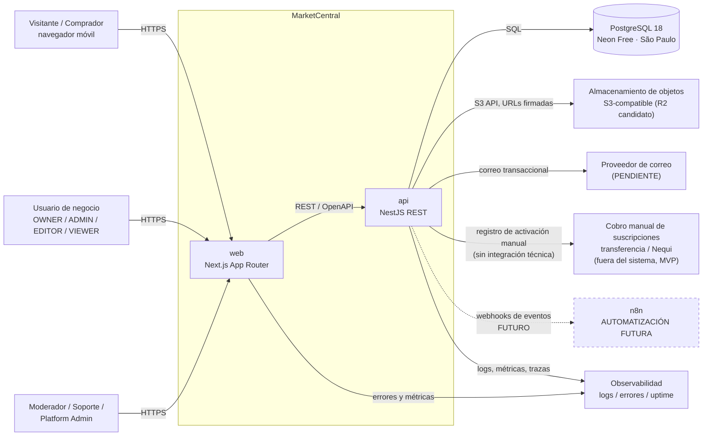
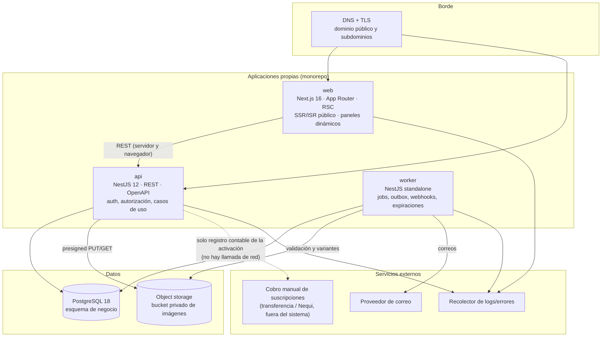
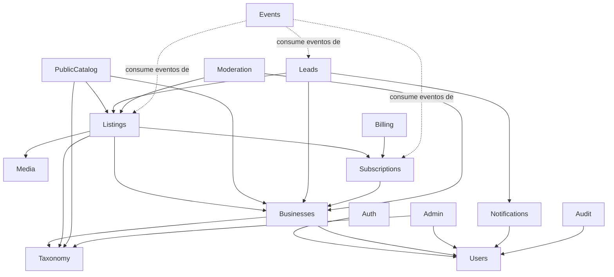
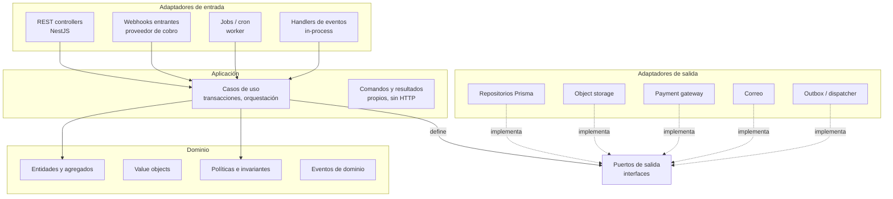
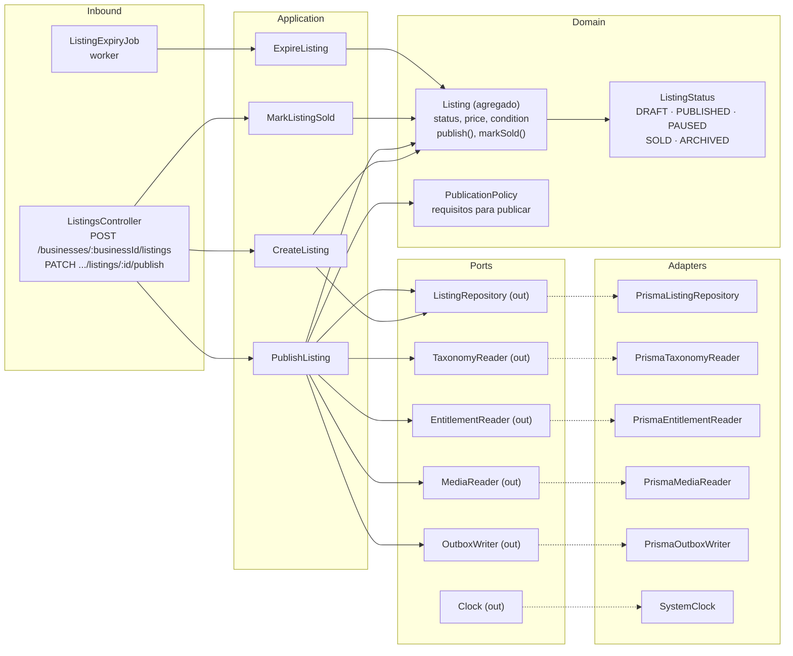

# 03 — Arquitectura del sistema

**Estado:** documento para revisión · **Fecha:** 2026-11-12 · **Fase:** planificación (Prompt 01)
**Decisiones asociadas:** [ADR-001](decisions/ADR-001-modular-monolith.md), [ADR-002](decisions/ADR-002-hexagonal-architecture.md), [ADR-005](decisions/ADR-005-postgresql-prisma-and-docker.md)

---

## 1. Principios de diseño

| ID | Principio | Consecuencia práctica |
|----|-----------|----------------------|
| P-01 | **Una sola fuente de verdad por dato.** | El catálogo público lee `Listing`; no hay tabla de catálogo. |
| P-02 | **El dominio no conoce la infraestructura.** | Sin `@nestjs/*`, `@prisma/client`, `fetch` ni SDKs dentro de `domain/`. |
| P-03 | **Un solo escritor de la base de negocio.** | Solo `api`/`worker` (NestJS) usan Prisma. Next.js nunca. |
| P-04 | **Límites explícitos entre módulos.** | Comunicación por casos de uso públicos o eventos; nunca por tablas ajenas. |
| P-05 | **Configuración antes que código para el negocio variable.** | Verticales, categorías, atributos, planes y límites son datos. |
| P-06 | **Degradación controlada.** | Si falla correo, cobro o n8n, el catálogo y la publicación siguen funcionando. |
| P-07 | **Simplicidad primero, escalabilidad después.** | Monolito modular; se extrae un servicio solo con evidencia de necesidad. |
| P-08 | **Todo lo sensible es auditable.** | Acciones de administración, moderación y cambios de suscripción dejan rastro. |
| P-09 | **Idempotencia en los bordes.** | Webhooks entrantes, reintentos de pago y despacho de eventos toleran duplicados. |
| P-10 | **La seguridad se prueba, no se declara.** | Pruebas negativas cross-tenant obligatorias en CI. |

---

## 2. Contexto del sistema (C4 nivel 1)

MarketCentral es un producto con dos caras —catálogo público y panel privado— servido por dos aplicaciones propias (`web`, `api`) y servicios externos de apoyo.



**Fronteras:**

- El **comprador nunca habla con la base de datos ni con Prisma**; solo con `web` y, a través de ella, con `api`.
- El **pago de artículos no aparece**: no hay actor "pasarela de pago de productos" porque esa transacción ocurre fuera del sistema (WhatsApp, efectivo, transferencia entre las partes). Dibujarla sería declarar una integración inexistente.
- **n8n está punteado**: es futuro y opcional. Ningún flujo del camino crítico pasa por él.

---

## 3. Contenedores y límites de despliegue (C4 nivel 2)



### 3.1 Responsabilidades por contenedor

| Contenedor | Responsabilidad | Tecnología prevista | Estado del dato |
|------------|-----------------|---------------------|-----------------|
| **web** | Renderizar catálogo público (SEO) y paneles privados. Consumir la API. Sin reglas de negocio. | Next.js 16 App Router, React, TypeScript, Tailwind CSS 4 | Sin estado propio; caché de renderizado con invalidación por tag |
| **api** | Autenticación, autorización, casos de uso, validación, acceso a datos, webhooks entrantes. | NestJS 12 (ESM), TypeScript, Prisma 7, OpenAPI | Autoridad sobre PostgreSQL |
| **worker** | Procesos asíncronos: expiración de publicaciones y trials, despacho de outbox, reintentos de webhooks, correos diferidos, limpieza de media huérfana. | Mismo artefacto que `api`, arranque distinto (`main.worker.ts`) | Autoridad sobre PostgreSQL; **no** sirve HTTP público |
| **PostgreSQL** | Persistencia transaccional de todo el negocio. | PostgreSQL 18.x | Fuente de verdad |
| **Object storage** | Bytes de imágenes; la base solo guarda metadatos y claves. | S3-compatible (Cloudflare R2 candidato) | Fuente de verdad de los binarios |

**Por qué `worker` es un proceso y no un microservicio:** comparte el mismo código, el mismo modelo de dominio y la misma base de datos. Separarlo en proceso evita que un job lento bloquee peticiones HTTP y permite escalarlo aparte. Sigue siendo **un solo despliegue lógico**: si mañana se fusiona con `api`, la arquitectura no cambia.

### 3.2 Topología de procesos

- `api` es **stateless**: la sesión vive en cookie + registro en base de datos, no en memoria del proceso. Puede correr con N réplicas detrás de un balanceador sin afinidad.
- `worker` debe correr con **una sola instancia activa por tipo de job** o usar bloqueo por fila (`SELECT ... FOR UPDATE SKIP LOCKED`) para evitar doble procesamiento. Se elige lo segundo porque permite escalar sin coordinación externa. **[PROPUESTA]**
- Ningún proceso mantiene estado en disco local: los archivos van a object storage y los temporales se eliminan.

### 3.3 Límites de despliegue

| Límite | Contenido | Se despliega junto |
|--------|-----------|--------------------|
| `web` | Interfaz pública y paneles | Independiente de `api` |
| `api` | HTTP público, casos de uso | Independiente (pero compatible con la versión de `web` en curso) |
| `worker` | Jobs y eventos | Misma versión de imagen que `api` |
| `db` | PostgreSQL | Nunca se despliega con la app; se migra con procedimiento aparte |

Regla: `web` puede desplegarse antes que `api` solo si los cambios son **retrocompatibles** (ver § 9.3). `api` y `worker` se despliegan con la misma imagen y versión de esquema.

---

## 4. Componentes del backend

El backend se organiza por **capacidades de negocio**, no por tipo técnico. Cada módulo es un paquete con sus cuatro capas internas.

```mermaid
flowchart LR
    subgraph API["api / worker"]
        subgraph M1["Auth"]
            A1["inbound: AuthController"]
            A2["application: Login, Logout, ResetPassword"]
            A3["domain: Session, CredentialPolicy"]
            A4["outbound ports: UserRepository, SessionRepository, Mailer"]
        end
        subgraph M2["Businesses"]
            B1["inbound: BusinessesController, MembersController"]
            B2["application: RegisterBusiness, InviteMember"]
            B3["domain: Business, Membership, Role"]
            B4["ports: BusinessRepository, MembershipRepository"]
        end
        subgraph M3["Listings"]
            C1["inbound: ListingsController"]
            C2["application: CreateListing, PublishListing"]
            C3["domain: Listing, ListingStatus, PricingRules"]
            C4["ports: ListingRepository, TaxonomyReader, EntitlementReader"]
        end
        subgraph M4["PublicCatalog"]
            D1["inbound: CatalogController"]
            D2["application: SearchListings, GetListingDetail"]
            D3["domain: (sin reglas; consultas)"]
            D4["ports: CatalogQueryPort"]
        end
        subgraph M5["Leads"]
            E1["inbound: PublicLeadsController, LeadsController"]
            E2["application: SubmitLead, UpdateLeadStatus"]
            E3["domain: Lead, ContactPolicy"]
            E4["ports: LeadRepository, ListingReader, Notifier"]
        end
        subgraph M6["Subscriptions / Billing"]
            F1["inbound: SubscriptionsController, AdminBillingController"]
            F2["application: RequestPlan, ActivateManually, ExpireSubscriptions"]
            F3["domain: Subscription, Plan, PlanEntitlement"]
            F4["ports: SubscriptionRepository, AuditWriter"]
        end
        subgraph MX["Transversales"]
            G1["Audit"]
            G2["Notifications"]
            G3["Events / Outbox"]
            G4["Media"]
        end
    end
    C2 --> C4
    E2 --> E4
    F2 --> F4
```



### 4.1 Mapa de módulos y dependencias permitidas



**Regla de dependencia entre módulos:** un módulo solo puede depender de otro a través de **(a)** su API de aplicación expuesta (casos de uso/servicios públicos), **(b)** un **puerto de lectura** que el consumidor define e implementa el proveedor (p. ej. `TaxonomyReader`), o **(c)** eventos de dominio. Nunca importando su repositorio ni su `PrismaService`.

**Dirección prohibida:** `Listings → PublicCatalog`, `Listings → Leads`, `Taxonomy → Listings`, `Notifications → any domain module` (solo recibe comandos de notificación). `Admin` no contiene lógica de negocio de otros módulos: compone casos de uso ajenos y registra auditoría.

**Ciclos:** el mapa anterior es acíclico. Si aparece un ciclo, se resuelve con un puerto de lectura o un evento, no con `forwardRef`.

---

## 5. Arquitectura hexagonal aplicada (pragmática)

### 5.1 Monolito modular vs. hexagonal — no son alternativas

| Concepto | Responde a | Artefacto donde se ve |
|----------|-----------|------------------------|
| **Monolito modular** | ¿Cómo se despliega y dónde están los límites funcionales? | Un solo backend desplegable, organizado en módulos con fronteras explícitas. |
| **Arquitectura hexagonal** | ¿Hacia dónde apuntan las dependencias *dentro* de cada módulo? | `domain/` y `application/` en el centro; `infrastructure/` en el borde implementando puertos. |

Un monolito modular **sin** hexagonal es una bola de barro con carpetas bonitas: los módulos existen en el árbol de directorios pero se llaman entre sí por Prisma. Hexagonal **sin** módulos es un hexágono gigante sin fronteras de negocio. Se necesitan mutuamente: los módulos dan los límites; hexagonal protege lo que hay dentro.

### 5.2 Capas y regla de dependencia



**Regla única e inflexible:** las flechas de dependencia de código apuntan hacia `domain` y `application`. `domain/` no importa nada de `@nestjs/*`, `@prisma/client`, `express`, `axios`, `sharp`, SDKs de pago ni de correo. Se verifica con regla de lint de importaciones (`no-restricted-imports` por ruta) y con revisión.

### 5.3 Cuándo hay dominio rico y cuándo basta un caso de uso

No todo merece entidad, agregado y repositorio. Criterio explícito:

| Situación | Dónde vive la lógica | Ejemplo |
|-----------|---------------------|---------|
| Hay invariantes que deben cumplirse siempre, con varias transiciones | **Dominio** (agregado + métodos) | `Listing` (no se publica sin imagen, categoría de su vertical, plan con cupo) |
| Hay reglas de negocio combinadas (cupos, fechas, estados de otro agregado) | **Dominio** como política + **aplicación** orquestando | `Subscription` + `Entitlement` |
| Es una consulta de lectura, sin invariantes | **Aplicación** con puerto de lectura (SQL/Prisma) | `PublicCatalog.SearchListings` |
| Es CRUD simple sin reglas (p. ej. editar el nombre de una categoría) | **Aplicación** directa sobre el puerto de persistencia | `Taxonomy.UpdateCategory` |
| Es integración con un proveedor | **Adaptador de salida** tras un puerto | `PaymentGateway` (fase 2; en el MVP la activación es manual y no hay proveedor) |

**Prohibiciones explícitas (anti-sobreingeniería):**

- No crear `Repository` para un agregado que solo se lee y nunca se escribe.
- No crear un caso de uso por método HTTP; se agrupan por intención de negocio.
- No mapear entidad de dominio ↔ modelo Prisma con capas de mappers triples si los campos coinciden; un mapper por agregado es suficiente.
- No definir interfaces "por si acaso". Un puerto existe porque hay **dos** implementaciones reales (producción + test) o porque cruza una frontera de infraestructura.
- No introducir buses de comandos/consultas genéricos si no hay más de un consumidor.

### 5.4 Ejemplo completo: módulo `Listings`



**Puertos del módulo y su motivo de existencia:**

| Puerto | Métodos (conceptuales) | Implementación | Por qué es puerto |
|--------|------------------------|----------------|-------------------|
| `ListingRepository` | `save`, `findByIdForBusiness`, `findByIdPublic`, `listByBusiness`, `countActiveByBusiness` | Prisma | Aísla el dominio del ORM; el método `findByIdForBusiness` **exige** `businessId`. |
| `TaxonomyReader` | `getCategoryWithVertical`, `getAttributeDefinitions`, `validateValues` | Prisma (lectura) | `Listings` no puede importar el repositorio de `Taxonomy`. |
| `EntitlementReader` | `getActiveEntitlements(businessId)` | Prisma + caché corta | Evita dependencia directa de `Subscriptions`. |
| `MediaReader` | `listReadyAssets(listingId)`, `countByListing` | Prisma | Verifica que haya imágenes antes de publicar. |
| `OutboxWriter` | `append(event)` | Prisma (misma transacción) | Los eventos se escriben **en la misma transacción** que el cambio de estado. |
| `Clock` | `now()` | Sistema | Permite probar expiraciones sin esperar. |

**Caso de uso `PublishListing` (secuencia interna):**

1. Adaptador de entrada resuelve `ActorContext` (usuario, negocio, rol) desde la sesión y la ruta — **nunca** desde el body.
2. `application` carga el `Listing` por `(id, businessId)`; si no existe → error de dominio `ListingNotFound` (mapeado a 404, no 403, para no filtrar existencia).
3. Verifica rol (`OWNER`/`ADMIN`/`EDITOR`).
4. `PublicationPolicy.assertCanPublish({listing, business, verticalEnabled, entitlements, mediaCount, attributeValues})`.
5. `listing.publish(now)` valida invariantes y cambia estado; devuelve eventos de dominio.
6. En una transacción: `save(listing)` + `outbox.append(ListingPublished)`.
7. Adaptador de salida invalida la caché de catálogo por tag (`vertical:{slug}`, `listing:{id}`).
8. Respuesta 200 con el recurso y su `ETag`/`version`.

**Ejemplo resumido: módulo `Leads`** — puertos `LeadRepository`, `ListingReader` (para resolver negocio/publicación y evitar leads a publicaciones inexistentes), `Notifier` (aviso al negocio), `RateLimiter`, `IdempotencyStore`. Dominio: `Lead` con estados y regla "un lead siempre tiene negocio y puede o no tener publicación". Entrada: `POST /public/listings/:id/leads` (anónimo con rate limit) y `PATCH /businesses/:businessId/leads/:id` (miembro).

---

## 6. Organización del monorepo

### 6.1 Estructura propuesta

```text
marketcentral/
├─ apps/
│  ├─ web/                     # Next.js App Router
│  └─ api/                     # NestJS (api + worker)
├─ packages/
│  ├─ contracts/               # esquemas y tipos generados desde OpenAPI (sin lógica)
│  ├─ config/                  # tsconfig, eslint, tailwind presets compartidos
│  └─ ui/                      # componentes visuales compartidos (sin reglas de negocio)
├─ docs/                       # esta documentación
├─ docker-compose.yml          # PostgreSQL local (+ opcional admin)
├─ turbo.json
├─ pnpm-workspace.yaml
└─ package.json
```

**Por qué `packages/contracts` y no compartir el backend:** se comparten **tipos de contrato**, no implementación. Compartir servicios del backend con el frontend acopla el despliegue y filtra reglas de negocio al cliente.

### 6.2 Estructura interna de `apps/api`

```text
apps/api/src/
├─ main.ts                     # bootstrap HTTP
├─ main.worker.ts              # bootstrap worker (sin HTTP)
├─ app.module.ts
├─ shared/                     # kernel: errors, result, ids, clock, paginación
│  ├─ domain/
│  └─ infrastructure/          # PrismaService, config, logger, outbox base
└─ modules/
   ├─ auth/
   │  ├─ domain/
   │  ├─ application/
   │  ├─ infrastructure/
   │  └─ inbound/              # controllers, guards, decorators
   ├─ businesses/
   ├─ taxonomy/
   ├─ listings/
   ├─ media/
   ├─ catalog/
   ├─ leads/
   ├─ subscriptions/
   ├─ billing/
   ├─ moderation/
   ├─ admin/
   ├─ notifications/
   ├─ audit/
   └─ events/
```

Cada módulo NestJS exporta **solo** lo que otros módulos necesitan (casos de uso o un `Reader`), nunca su repositorio. El `PrismaService` se expone desde un módulo global de infraestructura, pero **su uso está restringido por lint** a `infrastructure/`.

### 6.3 Restricciones técnicas verificadas que afectan la estructura

| Restricción | Impacto | Fuente |
|-------------|---------|--------|
| `@nestjs/core@12.5.0` declara `"type": "module"` (paquetes ESM) | El backend se configura como ESM (`"type": "module"`, `module: "NodeNext"`), no CommonJS. Afecta imports, `__dirname` y algunas librerías que aún son CJS. | Metadatos npm verificados 2026-11-12 |
| `next@16` exige Node `>=20.9.0` y TypeScript `>=5.1` | Fija el mínimo de Node del monorepo | Metadatos npm |
| `@prisma/client@7.10.1` exige Node `^20.19 \|\| ^22.12 \|\| >=24.0` y TS `>=5.4` | Fija versión de Node y TS mínimos | Metadatos npm |
| Turbopack es el bundler por defecto en Next 16 | No se configura Webpack salvo necesidad documentada | Docs Next.js 16 |

Detalle completo y fuentes en [14-version-matrix-and-sources.md](14-version-matrix-and-sources.md).

**Consecuencia de ESM en NestJS 12 [PENDIENTE de verificación en implementación]:** decoradores y `reflect-metadata` funcionan, pero el `emitDecoratorMetadata` con `NodeNext` requiere cuidado en la configuración de TypeScript. Se validará con un *spike* técnico antes de fijar la configuración; si resulta problemático, la alternativa es fijar NestJS 11 (CJS) hasta que el ecosistema madure — **decisión pendiente**, no se adopta por defecto.

### 6.4 Pipeline de Turborepo

Tareas previstas: `build`, `lint`, `typecheck`, `test`, `test:e2e`, `db:generate` (cliente Prisma), `contracts:generate` (tipos desde OpenAPI). `build` de `web` depende de `contracts:generate`; `api` no depende de `web`. El grafo se declara en `turbo.json` con `dependsOn` explícito; la caché remota es opcional y **PENDIENTE**.

---

## 7. Frontend: organización y responsabilidades

### 7.1 Grupos de rutas (App Router)

| Grupo | Rutas | Render | Sesión |
|-------|-------|--------|--------|
| `(public)` | `/`, `/v/[vertical]`, `/v/[vertical]/c/[category]`, `/buscar`, `/p/[id]/[slug]`, `/n/[businessSlug]`, `/planes`, `/legal/*` | RSC + ISR con tags; streaming donde aporte | Opcional (solo para mostrar "mi cuenta") |
| `(auth)` | `/entrar`, `/registro`, `/recuperar`, `/restablecer`, `/verificar` | Dinámico | Redirige si ya hay sesión |
| `(app)` | `/app`, `/app/b/[businessId]/*` (publicaciones, inventario, leads, equipo, suscripción, perfil) | Dinámico, `no-store` | Obligatoria + membresía verificada |
| `(admin)` | `/admin/*` (moderación, taxonomía, usuarios, auditoría) | Dinámico | Obligatoria + rol de plataforma |

**El `businessId` va en la ruta, no en el body.** Es un identificador de contexto para la UI; el backend **siempre** lo revalida contra la sesión (ver [07](07-security-and-multitenancy.md)).

### 7.2 Estrategia de renderizado y datos

- **Catálogo público:** Server Components con `fetch` a la API y `next: { tags: [...], revalidate: 60 }`. Invalidación por tag tras publicar/editar/vender (`revalidateTag`). Nunca `no-store` en catálogo.
- **Detalle de publicación:** RSC con ISR corto (60 s) + `generateMetadata` para SEO y Open Graph.
- **Paneles privados:** dinámicos, sin caché de datos de negocio. La sesión se lee de cookie en el servidor y se reenvía a la API.
- **Mutaciones:** desde el cliente, llamando a rutas proxy de Next (mismo origen) que reenvían a la API con la cookie. Esto evita CORS con credenciales y simplifica CSRF (ver § 9.4).
- **Cliente tipado:** generado desde el OpenAPI de `api` en `packages/contracts` (`openapi-typescript` + wrapper `fetch` propio). Sin `any`, sin duplicar tipos a mano.

### 7.3 Lo que el frontend NO hace

- No calcula límites de plan, cupos, precios finales ni permisos: los **muestra** y deshabilita acciones, pero la decisión es del backend.
- No accede a PostgreSQL ni a Prisma.
- No conoce reglas de transición de estados: muestra las acciones que la API declara disponibles (`availableActions` en la respuesta) o replica solo la matriz de UI, nunca la valida.
- No implementa "modo confianza": si el backend devuelve 403, la UI no lo reinterpreta.

---

## 8. Comunicación entre componentes

### 8.1 Sincrónica (REST)

| Aspecto | Decisión | Estado |
|---------|----------|--------|
| Estilo | REST + JSON, recursos en plural, verbos HTTP estándar | **PROPUESTA** |
| Contrato | OpenAPI 3.1 generado desde NestJS (`@nestjs/swagger`), versionado en `packages/contracts` | **PROPUESTA** |
| Versionado | Prefijo `/v1`; cambios incompatibles → `/v2` con periodo de convivencia | **PROPUESTA** |
| Errores | `application/problem+json` (RFC 9457) con `type`, `title`, `status`, `detail`, `code`, `errors[]` | **PROPUESTA** |
| Paginación | Keyset (`cursor`, `limit`) para catálogo; offset solo en listados pequeños de panel | **PROPUESTA** |
| Idempotencia | Cabecera `Idempotency-Key` en `POST` de leads y de activación de suscripción | **PROPUESTA** |
| Timeouts | `web → api`: 5 s (lectura), 10 s (mutación); reintentos solo en GET y en operaciones idempotentes | **PROPUESTA** |
| Autenticación | Cookie de sesión `HttpOnly` para navegador; el token **no** se guarda en `localStorage` | **PROPUESTA** |

### 8.2 Asíncrona (eventos)

Los eventos de dominio se publican en una **outbox** en la misma transacción del cambio de estado. Un despachador en `worker` los entrega a consumidores internos y, cuando exista, a webhooks externos (n8n). Detalle en [09-integrations-and-n8n-readiness.md](09-integrations-and-n8n-readiness.md). **[PROPUESTA]**

### 8.3 Webhooks entrantes

Único productor previsto: el proveedor de cobro. Requisitos: verificación de firma, tolerancia de timestamp, idempotencia por `event_id`, respuesta 2xx rápida y procesamiento asíncrono con reintento propio. **[PROPUESTA]**

---

## 9. Borde, dominios y sesión

### 9.1 Topología de dominios propuesta

| Host | Contenido |
|------|-----------|
| `marketcentral.co` | `web` público |
| `app.marketcentral.co` | `web` paneles (mismo despliegue, distinto host opcional) |
| `api.marketcentral.co` | `api` REST |
| `media.marketcentral.co` | entrega de imágenes (CDN del proveedor de objetos) |

**[PROPUESTA]** — el dominio real está **PENDIENTE** (Q-14). El diseño asume mismo sitio registrable (`marketcentral.co`) para que la cookie `Domain=.marketcentral.co; SameSite=Lax` funcione entre `web` y `api`.

### 9.2 CORS

`api` acepta únicamente los orígenes de `web` (lista explícita por entorno), con `credentials: true`, métodos y cabeceras enumerados. Sin `*` cuando hay credenciales. **[PROPUESTA]**

### 9.3 Compatibilidad de despliegue

Cambios de esquema con patrón **expand → migrate → contract**: primero se añade lo nuevo (compatible con la versión anterior de la app), se despliega, se migran datos, y solo después se elimina lo viejo. Prohibido eliminar o renombrar columnas en el mismo despliegue que deja de usarlas.

### 9.4 CSRF

Con `SameSite=Lax` y mutaciones solo por `POST/PATCH/DELETE` (nunca `GET` con efectos), el riesgo se reduce pero no desaparece (subdominios, navegadores antiguos). Se añade: validación de `Origin`/`Sec-Fetch-Site` en el backend y token *double-submit* en el formulario de mutación. **[PROPUESTA]**

---

## 10. Entornos

| Entorno | Composición | Datos | Acceso |
|---------|-------------|-------|--------|
| **Local** | `docker compose` con PostgreSQL 18 (+ volumen y healthcheck); `api` y `web` en modo dev; almacenamiento local S3-compatible (MinIO) **o** bucket de pruebas | Semilla de taxonomía + datos ficticios | Desarrollador |
| **Staging** | Mismas imágenes que producción, base de datos separada, bucket separado, proveedor de cobro en modo test | Datos de prueba; nunca datos personales reales | Equipo + cliente |
| **Producción** | `web` + `api` + `worker` + PostgreSQL administrado (Neon Free en el MVP, São Paulo) + object storage + proveedores reales | Datos reales | Operación restringida |

Reglas: **ningún entorno comparte base de datos ni bucket**; las credenciales son distintas por entorno; producción no se usa para pruebas; los secretos no viven en el repositorio.

**MinIO en local [PROPUESTA]** — permite probar el flujo de URLs firmadas sin depender de la nube; alternativa: usar directamente un bucket R2 de desarrollo. Se decide al implementar.

---

## 11. Observabilidad (ubicación en la arquitectura)

- **Logs estructurados JSON** desde `api` y `worker`, con `request_id`, `business_id` (cuando aplique), `user_id`, `use_case`, `duration_ms`, `outcome`. Sin cuerpos de request ni datos personales.
- **Errores** agregados a un servicio externo (Sentry o equivalente — **PENDIENTE**).
- **Métricas** mínimas: latencia y tasa de error por endpoint, leads creados, publicaciones publicadas, webhooks fallidos, tamaño de la cola de outbox.
- **Trazas**: se habilita OpenTelemetry solo si el equipo puede operarlo; en el MVP basta correlación por `request_id`. **[PROPUESTA]**

Detalle en [08](08-non-functional-requirements.md).

---

## 12. Evolución arquitectónica

**Cuándo se justificaría extraer un módulo a servicio propio** (no antes):

1. Un módulo necesita escalar con un perfil de recursos muy distinto (p. ej. procesamiento de imágenes) y compite por CPU con la API.
2. Un módulo tiene un ciclo de despliegue independiente por razones de cumplimiento.
3. El equipo crece a varios equipos con propiedad clara de módulos y el monolito genera contención de despliegue medible.

Ninguna se cumple hoy. Mientras no se cumplan, extraer un servicio añade latencia de red, transacciones distribuidas y complejidad operativa sin beneficio. **Microservicios y Kubernetes están fuera del MVP. [APROBADA]**

---

## 13. Riesgos arquitectónicos

| ID | Riesgo | Impacto | Mitigación |
|----|--------|---------|------------|
| RA-01 | El monolito se convierte en bola de barro por imports cruzados. | Alto (pérdida de límites) | Reglas de lint por ruta, revisión de PR, mapa de dependencias acíclico, pruebas de arquitectura. |
| RA-02 | Hexagonal ceremonial: capas vacías y mappers inútiles que frenan el equipo. | Medio (velocidad) | Criterios de § 5.3; un mapper por agregado; puertos solo con implementación real. |
| RA-03 | ESM en NestJS 12 genera fricción con librerías CJS. | Medio | Spike temprano; alternativa NestJS 11 documentada. |
| RA-04 | Prisma 8 (RC) se adopta por error al usar `latest`. | Alto (inestabilidad) | Fijar versión exacta `7.10.1`; prohibido `latest` en `package.json`. |
| RA-05 | Caché de catálogo sirve publicaciones vendidas. | Alto (confianza) | Invalidación por tag en la misma operación; TTL máximo 60 s; prueba E2E de visibilidad. |
| RA-06 | Dependencia del proveedor de base de datos por funciones propietarias (RLS, Auth, Storage). | Alto (lock-in) | No adoptar funciones propietarias; SQL estándar; migración por `pg_dump`/`pg_restore` probada. |
| RA-07 | Worker duplicando jobs al escalar. | Medio (leads/correos duplicados) | Bloqueo por fila `FOR UPDATE SKIP LOCKED`; idempotencia por clave. |

---

## 14. Decisiones registradas

| Tema | ADR | Estado |
|------|-----|--------|
| Monolito modular | [ADR-001](decisions/ADR-001-modular-monolith.md) | **APROBADA** |
| Hexagonal pragmática | [ADR-002](decisions/ADR-002-hexagonal-architecture.md) | **APROBADA** |
| Multi-tenancy | [ADR-003](decisions/ADR-003-multitenancy-strategy.md) | **APROBADA** (aislamiento en aplicación); RLS **PENDIENTE** |
| PostgreSQL + Prisma + Docker | [ADR-005](decisions/ADR-005-postgresql-prisma-and-docker.md) | **APROBADA** (motor, ORM y entorno local); versiones exactas **PROPUESTA** |
| Proveedor de BD en producción | [ADR-006](decisions/ADR-006-production-database-provider.md) | **APROBADA** — Neon Free (`aws-sa-east-1`), escalado a Launch |
| Eventos y n8n | [ADR-007](decisions/ADR-007-events-and-n8n-readiness.md) | **PROPUESTA** (n8n futuro: **APROBADA**) |
