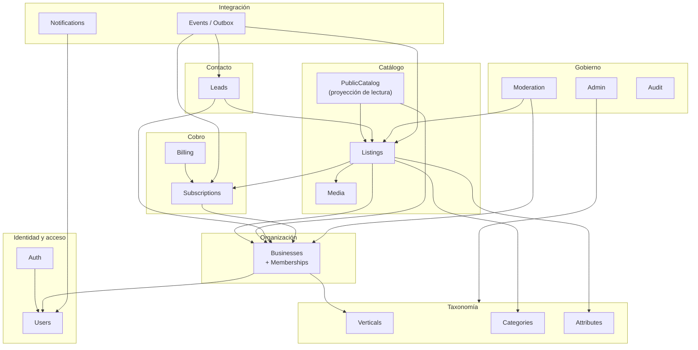
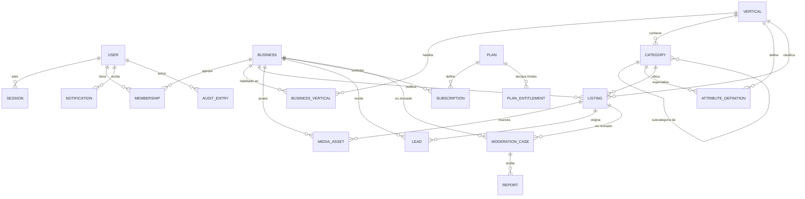

# 04 — Modelo de dominio conceptual

**Estado:** documento para revisión · **Fecha:** 2026-11-12 · **Fase:** planificación (Prompt 01)
**Aviso:** este documento es **conceptual**. No define tablas, tipos SQL, índices ni esquema Prisma. Eso corresponde al Prompt 02.

---

## 1. Contextos delimitados

El dominio se divide en ocho contextos. Cada uno tiene su propio lenguaje y sus propias invariantes; las fronteras coinciden con los módulos del backend ([05](05-modules-and-responsibilities.md)).

**Lectura:** `PublicCatalog` no posee datos; es una **proyección de consulta** sobre `Listings`, `Businesses` y `Taxonomy`. Esa es la razón estructural por la que el catálogo no puede duplicar inventario: **no tiene dónde guardarlo**.

---

## 2. Conceptos y clasificación

Se usa lenguaje de Domain-Driven Design solo donde aporta. La clasificación siguiente determina cómo se implementa cada cosa:

| Clasificación | Qué significa aquí | Cómo se implementa |
|---------------|--------------------|--------------------|
| **Aggregate root** | Puerta de entrada a un conjunto de datos que cambia junto; protege invariantes. | Entidad de dominio con métodos; se persiste completo. |
| **Entity** | Tiene identidad propia y ciclo de vida, pero vive dentro de un agregado o es raíz de uno simple. | Entidad de dominio. |
| **Value object** | Sin identidad; se compara por valor; inmutable. | Clase/objeto inmutable o tipo con validación en constructor. |
| **Projection / read model** | Datos derivados para consulta, reconstruibles. | Consulta SQL/Prisma; **nunca** fuente de verdad. |
| **Configuración** | Datos que definen el negocio variable (taxonomía, planes). | Entidades administradas por `Admin`; leídas por el resto. |

---

## 3. Entidades y agregados

| # | Concepto | Clasificación | Agregado | Dueño del dato | Identificador | Invariantes principales |
|---|----------|---------------|----------|----------------|---------------|--------------------------|
| 1 | `User` | Aggregate root | `User` | Users | `userId` (UUID) + `email` único normalizado | Email único; al menos un método de acceso; estado coherente con verificación. |
| 2 | `Session` | Entity | `Session` | Auth | `sessionId` (opaco, guardado hasheado) | Expira; se revoca; pertenece a un `User`. |
| 3 | `Business` | Aggregate root | `Business` | Businesses | `businessId` + `slug` público único | Un negocio tiene un estado; no publica si no está `APPROVED`; tiene al menos un `OWNER`. |
| 4 | `Membership` | Entity | `Business` | Businesses | `(userId, businessId)` único | Un usuario tiene **un** rol por negocio; siempre existe ≥1 `OWNER` activo. |
| 5 | `Vertical` | Aggregate root | `Vertical` | Taxonomy | `verticalId` + `slug` | Slug único; puede estar activa/inactiva; desactivarla no borra datos. |
| 6 | `Category` | Entity (árbol) | `Vertical` | Taxonomy | `categoryId` + `(verticalId, slug)` único | Pertenece a **una** vertical; jerarquía sin ciclos; profundidad máxima definida. |
| 7 | `AttributeDefinition` | Entity | `Vertical` (o `Category`) | Taxonomy | `attributeId` + `(verticalId, key)` único | Tipo de dato declarado; obligatoriedad; opciones válidas si es enumerado; `filterable`/`searchable`. |
| 8 | `Listing` | Aggregate root | `Listing` | Listings | `listingId` (UUID) + `slug` público | Un negocio, una vertical, una categoría de esa vertical; estado válido; precio > 0; al publicar, ≥1 imagen y atributos obligatorios completos. |
| 9 | `AttributeValue` | Value object (parte del agregado) | `Listing` | Listings | `attributeKey` único dentro de la publicación | Coherente con la definición (tipo, opciones, obligatoriedad). Se persiste como JSONB validado, **no** como tabla EAV (ver [10 §5](10-data-and-persistence-strategy.md)). |
| 10 | `MediaAsset` | Entity | `Listing` (o `Business` para logo) | Media | `assetId` + `storageKey` único | Pertenencia a un negocio; estado de procesamiento; MIME y tamaño verificados. |
| 11 | `Lead` | Aggregate root | `Lead` | Leads | `leadId` | Siempre tiene `businessId`; puede tener `listingId`; datos de contacto mínimos; estado válido; inmutable en su contenido original (solo cambia estado y notas). |
| 12 | `Plan` | Aggregate root | `Plan` | Subscriptions | `planId` + `code` | Límites declarados como `PlanEntitlement` (clave/valor); versión vigente; no se edita un plan con suscripciones activas (se crea versión nueva). |
| 13 | `Subscription` | Aggregate root | `Subscription` | Subscriptions | `subscriptionId` | Un negocio tiene **como máximo una** suscripción vigente; estado y fechas coherentes; toda activación manual registra `activatedByAdminId` y `activationNote`; sin referencias a proveedor de pago en el MVP. |
| 14 | `PlanEntitlement` | Entity (parte de `Plan`) | `Plan` | Subscriptions | `(planId, key)` único | Clave tipada (`maxActiveListings`, `maxImagesPerListing`, `maxMembers`, `leadsPanel`); valor con tipo declarado; los límites se leen en backend. |
| 15 | `ModerationCase` | Aggregate root | `ModerationCase` | Moderation | `caseId` | Referencia un objeto (negocio o publicación); decisión con actor y motivo; historial inmutable. |
| 16 | `Report` (denuncia) | Entity | `ModerationCase` | Moderation | `reportId` | Reportante (o anónimo), motivo, estado. |
| 17 | `Notification` | Entity | `Notification` | Notifications | `notificationId` + `dedupKey` | Un envío por `dedupKey`; estado de entrega; sin contenido sensible en logs. |
| 18 | `AuditEntry` | Entity (append-only) | `AuditEntry` | Audit | `auditId` | Inmutable; actor, acción, objeto, timestamp, origen, resultado. |
| 19 | `OutboxEvent` | Entity (técnica) | `OutboxEvent` | Events | `eventId` | Escrito en la misma transacción que el cambio; publicado una vez (at-least-once). |
| 20 | `BusinessVertical` | Entity (habilitación) | `Business` | Businesses | `(businessId, verticalId)` | El negocio solo publica en verticales habilitadas y activas. |

### 3.1 Qué NO es una entidad en este dominio

| Concepto ausente | Por qué no existe |
|------------------|-------------------|
| `Order`, `Cart`, `Checkout`, `Shipment` | El pago y la entrega ocurren fuera de la plataforma. **[APROBADA]** |
| `ProductPayment`, `Escrow`, `Payout` | La plataforma no media el pago de artículos. **[APROBADA]** |
| `Review` / `Rating` | No hay compra verificable dentro del sistema. |
| `Message` / `Conversation` | El contacto es WhatsApp externo o Lead; no hay chat. |
| `InventoryMovement` (kardex) | El MVP gestiona publicaciones, no contabilidad de inventario. Ver § 5. |
| `CatalogItem` (tabla espejo) | El catálogo es una consulta, no una copia. **[APROBADA]** |
| `PaymentProviderAccount`, `PaymentWebhookEvent`, `Invoice`, `PaymentAttempt` | **No hay pasarela de pago en el MVP** (Q-06, C-10). El cobro es manual y se registra en `Subscription` con `activatedByAdminId` y `activationNote`. Wompi/Mercado Pago son fase 2. |
| `PENDING_REVIEW`, `REJECTED` (en negocio o publicación) | **No hay moderación previa** (Q-07, C-10). El dueño publica directamente; la moderación actúa solo ante denuncia. |

---

## 4. Diagrama conceptual de dominio

**Convenciones del diagrama:** no muestra tipos ni cardinalidades de columnas; `MEDIA_ASSET` cuelga de `LISTING` y de `BUSINESS` porque un negocio tiene logo/fotos de perfil además de fotos de publicaciones. `MODERATION_CASE` es polimórfico por diseño (negocio **o** publicación), lo que en el modelo físico se resolverá con dos referencias opcionales y una restricción de exclusividad (decisión del Prompt 02).

**Valores de atributos:** los valores **no** forman una tabla EAV aparte. Viajan como JSONB validado dentro de `LISTING` y se tipan contra `ATTRIBUTE_DEFINITION` (ver [10 §5](10-data-and-persistence-strategy.md)). El diagrama omite esa relación para no sugerir una tabla de valores por atributo.

---

## 5. Publicación vs. inventario

**Decisión conceptual:** para el MVP, **la publicación es la unidad de inventario**. Un artículo usado es, en su mayoría, pieza única; no hay almacén con ubicaciones, costos ni movimientos.

- `Listing` tiene `quantity` (por defecto 1) para permitir lotes pequeños, pero **no** hay libro de movimientos.
- Marcar `SOLD` reduce la disponibilidad a cero y retira del catálogo; no genera asiento contable.
- "Gestión de inventario" en el MVP significa: ver mis publicaciones, su estado, qué está activo, qué se vendió y qué expiró.

**Consecuencia:** si en el futuro se requiere stock multi-unidad con reservas, el agregado `Listing` necesitará un `InventoryItem` o un `StockLevel` separado. No se diseña ahora.

---

## 6. Invariantes

Invariantes que el dominio debe proteger **siempre**, sin importar el punto de entrada (REST, job, webhook):

| ID | Invariante | Agregado |
|----|-----------|----------|
| I-01 | Una publicación pertenece a exactamente un negocio y a exactamente una vertical. | `Listing` |
| I-02 | La categoría de la publicación pertenece a la vertical de la publicación. | `Listing` |
| I-03 | El negocio debe estar habilitado **y** la vertical activa para publicar. | `Listing` + `Business` |
| I-04 | Una publicación no pasa a `PUBLISHED` sin al menos una imagen procesada y sin los atributos obligatorios de su categoría. | `Listing` |
| I-05 | El precio es positivo, en COP (entero en unidades menores) y `priceCurrency` es siempre `'COP'`. | `Listing` |
| I-06 | El número de publicaciones activas no supera el límite del plan vigente. | `Listing` + `Subscription` |
| I-07 | Una suscripción vigente por negocio; una sola en estado activo/trial. | `Subscription` |
| I-08 | Un negocio siempre tiene al menos un miembro `OWNER`. | `Business` |
| I-09 | Un usuario tiene como máximo un rol por negocio. | `Business` |
| I-10 | Un `Lead` siempre referencia un negocio existente; si referencia publicación, esta pertenece a ese negocio. | `Lead` |
| I-11 | Un `Lead` no se puede editar en su contenido original; solo cambia de estado y admite notas internas. | `Lead` |
| I-12 | Un negocio `SUSPENDED` no tiene publicaciones visibles públicamente (suspendido por decisión administrativa o por denuncia). | `Business` + `Listing` |
| I-13 | Una vertical o categoría desactivada no admite publicaciones nuevas; las existentes conservan su clasificación. | `Taxonomy` |
| I-14 | Los límites de plan se aplican en backend, nunca se confían al cliente. | `Subscription` |
| I-15 | Toda transición de estado deja un evento de dominio y una entrada de auditoría cuando es sensible. | Todos |

---

## 7. Reglas de negocio

Numeradas para referencia cruzada en el resto de la documentación.

### Visibilidad pública

- **R-01** Una publicación es visible en el catálogo si y solo si: `Listing.status = PUBLISHED` **y** `Business.status = APPROVED` **y** `BusinessVertical` habilitada y vertical `ACTIVE` **y** suscripción en `TRIALING` o `ACTIVE` (la prueba del plan Free cuenta) **y** no existe ocultamiento por moderación. La visibilidad es un **predicado calculado en cada consulta**, nunca un estado materializado: suspender un negocio no toca sus publicaciones (C-11.4).
- **R-02** Una publicación `SOLD`, `PAUSED`, `ARCHIVED` o `DRAFT` nunca es visible públicamente.
- **R-03** El catálogo público jamás muestra datos de contacto privados del negocio distintos de los que el negocio publicó (teléfono comercial, ubicación aproximada).
- **R-04** El detalle de una publicación no visible responde 404 (no 403), para no revelar existencia.
- **R-05** **No hay moderación previa** (Q-07, C-10): una publicación pasa de `DRAFT` a `PUBLISHED` en cuanto cumple los requisitos de R-06. La revisión solo ocurre después de una denuncia.
- **R-06** El catálogo público filtra por `Business.city`; la ciudad es un valor del catálogo de municipios del Valle de Aburrá y la ubicación de la publicación **se hereda** del negocio (Q-16, C-10).

### Publicación

- **R-07** Publicar exige: al menos una imagen `READY`, categoría válida, atributos obligatorios, precio válido y cupo de plan disponible.
- **R-08** Editar una publicación `PUBLISHED` la mantiene publicada salvo que la edición invalide un requisito (p. ej. eliminar todas las imágenes), en cuyo caso pasa a `PAUSED` con motivo.
- **R-09** Una denuncia abre un `ModerationCase`; si el moderador lo decide, la publicación o el negocio se ocultan/suspenden con motivo y auditoría (**moderación reactiva**). No existe estado `REJECTED` de publicación.
- **R-10** El negocio puede pausar y reactivar sus publicaciones libremente, dentro de su cupo.
- **R-11** Marcar `SOLD` es irreversible por el negocio (se puede duplicar como nueva publicación).

### Contacto

- **R-12** Abrir WhatsApp **no** crea `Lead` ni requiere sesión; es un enlace saliente con el número comercial del negocio. **[APROBADA]**
- **R-13** Enviar el formulario **sí** crea un `Lead` persistido, con negocio y publicación (si aplica). **[APROBADA]**
- **R-14** El formulario exige consentimiento explícito de tratamiento de datos y es resistente a spam (rate limit + verificación ligera). **[PROPUESTA]**
- **R-15** Los leads son visibles solo para el dueño del negocio; el comprador no tiene panel de "mis leads" en el MVP (Q-10, C-10).

### Negocio y membresías

- **R-16** Un negocio nace en estado `APPROVED` al completar el registro (**sin cola de aprobación**, Q-07/C-10); solo pierde la capacidad de publicar si pasa a `SUSPENDED` por decisión administrativa o denuncia.
- **R-17** En el MVP cada negocio tiene **un solo miembro**: el `OWNER` que lo registró (Q-02/C-10). El modelo de `Membership` se conserva para fases posteriores, pero el alta de miembros queda fuera del alcance.
- **R-18** No se puede revocar al último `OWNER`; se debe transferir la propiedad primero.
- **R-19** Un `PLATFORM_ADMIN` no es miembro de ningún negocio por defecto.

### Suscripción

- **R-20** Sin suscripción vigente no hay visibilidad pública, aunque la publicación esté `PUBLISHED` (queda latente y vuelve a ser visible al regularizar).
- **R-21** El estado de la suscripción lo determina el backend a partir de **fechas y de activaciones manuales auditadas** (`activatedByAdminId`, `activationNote`), nunca por un parámetro del cliente (Q-06/C-10).
- **R-22** Los cambios de plan aplican al siguiente ciclo; un downgrade que exceda límites se aplica al vencer, con aviso previo.
- **R-23** La cancelación no borra datos: al vencer, el negocio pasa a modo lectura y sus publicaciones se ocultan.

### Taxonomía

- **R-24** Añadir una vertical o categoría no requiere despliegue de código. **[APROBADA]**
- **R-25** Cambiar el tipo de un atributo con valores existentes requiere migración de datos explícita (no automática).
- **R-26** Desactivar una categoría impide nuevas publicaciones en ella, no altera las existentes.

### Integridad

- **R-27** Ningún caso de uso acepta `businessId` del cliente como autoridad; se resuelve de la sesión y se contrasta con la ruta. **[APROBADA]**

---

## 8. Límites transaccionales

| Operación | Frontera transaccional | Consistencia |
|-----------|------------------------|--------------|
| Crear publicación + valores de atributos | Una transacción | Fuerte |
| Publicar publicación + evento | Una transacción (agregado + outbox) | Fuerte local |
| Marcar vendido + evento + invalidación de caché | Transacción + invalidación **después** del commit | Fuerte + eventual (caché ≤ 60 s) |
| Crear lead + notificación | Transacción del lead; la notificación es asíncrona | Fuerte + eventual |
| Registrar activación manual de suscripción | Transacción de la suscripción + auditoría + evento; sin llamada externa | Fuerte |
| Aplicar webhook de pago | **No aplica en el MVP** (sin pasarela, Q-06); se reintroduce en fase 2 | — |
| Suspender negocio (moderación reactiva) | Transacción del negocio + caso + auditoría + evento | Fuerte |

**Regla:** nunca se llama a un proveedor externo dentro de una transacción de base de datos abierta. Se persiste la intención, se llama, se actualiza el resultado.

---

## 9. Identificadores y claves

| Concepto | Estrategia | Estado |
|----------|-----------|--------|
| Claves primarias | UUID. **UUIDv7** (ordenable por tiempo, mejor localidad de índice). PostgreSQL 18 lo genera con `uuidv7()` como `DEFAULT` de columna; alternativa secundaria `@default(uuid(7))` si el tooling lo exige. | **APROBADA** (C-11.1, D-01) |
| Identificadores públicos | `slug` legible y único para `Business`, `Listing`, `Vertical`, `Category`. El UUID no se expone en URLs públicas cuando el slug basta. | **PROPUESTA** |
| Claves de negocio | `User.email` (normalizado, único), `Membership(userId, businessId)`, `BusinessVertical(businessId, verticalId)`, `attributeKey` único dentro de los `attributes` JSONB de una publicación. | **PROPUESTA** |
| Claves de idempotencia | `Lead`: `Idempotency-Key` del cliente + huella del contenido. Webhooks: `providerEventId`. Outbox: `eventId`. | **PROPUESTA** |
| Referencias entre agregados | Por identidad (`businessId`), **nunca** por objeto navegable en el dominio. | Regla |

**Sobre UUIDv7:** se resuelve en el Prompt 02 verificando el soporte de Prisma 7; si no hay soporte nativo, se genera en aplicación. No bloquea el modelo conceptual.

**Sobre slugs:** si un negocio cambia de nombre, el slug anterior debe resolver con redirección 301 para no romper SEO. Se guarda historial de slugs. **[PROPUESTA]**

---

## 10. Propiedad de los datos (quién escribe qué)

| Dato | Escribe | Lee |
|------|---------|-----|
| `User`, `Session` | Auth / Users | Auth, Audit, Notifications |
| `Business`, `Membership`, `BusinessVertical` | Businesses | Listings, Leads, Subscriptions, Moderation, PublicCatalog |
| `Vertical`, `Category`, `AttributeDefinition` | Taxonomy (vía Admin) | Listings, PublicCatalog |
| `Listing` (incluye `attributes` JSONB) | Listings | PublicCatalog, Leads, Moderation |
| `MediaAsset` | Media | Listings, PublicCatalog |
| `Lead` | Leads | Notifications, (panel del negocio) |
| `Plan`, `PlanEntitlement`, `Subscription` | Subscriptions | Listings (entitlements), Billing, Admin |
| `ModerationCase`, `Report` | Moderation | Admin, Audit |
| `AuditEntry` | Audit (append-only) | Admin |
| `OutboxEvent` | Cualquier módulo (append en su transacción) | Events/worker |

**Nadie escribe en tablas de otro módulo.** Si un módulo necesita un cambio en datos ajenos, invoca un caso de uso del dueño. Esa es la regla que evita que el monolito modular se degrade.

---

## 11. Eventos de dominio por agregado

| Agregado | Eventos |
|----------|---------|
| `User` | `UserRegistered`, `UserEmailVerified`, `UserSuspended` |
| `Business` | `BusinessRegistered`, `BusinessSuspended`, `BusinessReactivated`, `BusinessVerticalEnabled`, `BusinessVerticalRevoked` |
| `Membership` | `MemberInvited`, `MemberJoined`, `MemberRoleChanged`, `MemberRemoved` |
| `Listing` | `ListingCreated`, `ListingPublished`, `ListingPaused`, `ListingResumed`, `ListingSold`, `ListingArchived` (con `archivedReason`: `MANUAL`, `MODERATION`, `EXPIRED`) |
| `Lead` | `LeadSubmitted`, `LeadStatusChanged` |
| `Subscription` | `SubscriptionActivated`, `SubscriptionRenewed`, `SubscriptionCancelled`, `SubscriptionExpired`, `SubscriptionPlanChanged` |
| `Moderation` | `ModerationCaseOpened`, `ModerationDecided`, `ReportSubmitted` |
| `Media` | `MediaUploaded`, `MediaProcessed`, `MediaRejected` |

Convención de nombres: `PascalCase` en pasado, sin prefijo de sistema. Contrato y envoltura en [09](09-integrations-and-n8n-readiness.md).

---

## 12. Ambigüedades de dominio

| ID | Ambigüedad | Supuesto adoptado | Impacto |
|----|-----------|-------------------|---------|
| D-13 | ¿"Condición" es un enum fijo o un atributo configurable por vertical? | **APROBADA** (C-11.3): enum fijo `NEW`, `LIKE_NEW`, `GOOD`, `FAIR`, `POOR`. La granularidad adicional se modela con el atributo `condition_detail`. | Si una vertical necesita más matices, se añade `condition_detail`, no un enum nuevo. |
| D-02 | ¿Un negocio puede tener varias sucursales? | No en MVP: un negocio = un punto de atención/ubicación. | Si hay sucursales, `Location` se separa de `Business`. |
| D-03 | ¿El comprador debe registrarse para enviar el formulario? | No. Lead anónimo con email/teléfono y consentimiento. | Si se exige registro, baja conversión pero mejora control de spam. |
| D-04 | ¿Un usuario puede tener varios negocios? | Sí, con roles distintos por negocio. | Ya soportado por `Membership`. |
| D-05 | ¿Los leads se pueden reasignar entre miembros? | No en MVP; en la práctica **solo el dueño** los ve (un miembro en el MVP). Mañana: visibles para todo el negocio. | Si se requiere asignación, añadir `assigneeId`. |
| D-06 | ¿La suscripción es por negocio o por usuario? | Por negocio. | Si fuera por usuario, un negocio con 5 miembros pagaría 5 veces. |
| D-07 | ¿Se permite duplicar una publicación? | Sí, como acción de conveniencia (copia en `DRAFT`). | Requiere límite de cupo al publicar, no al duplicar. |
| D-08 | ¿Qué pasa con las imágenes al vender? | Se conservan asociadas al `Listing` (histórico) y se puede purgar por retención. | Afecta almacenamiento y privacidad. |
| D-09 | ~~¿La ubicación es texto libre, ciudad o coordenadas?~~ **RESUELTA (Q-16, C-10)** | `Business.city` obligatorio desde un catálogo de 10 municipios del Valle de Aburrá; `addressLine` opcional; `Listing` hereda. Sin coordenadas ni PostGIS. | Sin "cerca de mí"; el catálogo filtra por `city`. |
| D-10 | ¿Se permiten publicaciones de "servicios" (reparación, etc.)? | No en MVP; solo artículos. | Cambiaría la taxonomía y el modelo de precio. |
| D-11 | ¿Se modela `ModerationPolicy` para activar/desactivar revisión previa? | **No:** no hay moderación previa (Q-07, C-10); `ModerationCase` queda solo para denuncias y suspensiones. | Si se quisiera revisión previa, habría que reintroducir estados y cola. || D-12 | ¿Se guardan facturas o intentos de pago? | **No:** el cobro es manual y se registra en `Subscription` (Q-06, C-10). | Al integrar pasarela (fase 2) se añaden `ProviderEvent` y facturación electrónica. |
Cada una se registra también en [12](12-risks-and-open-decisions.md) con su prioridad.
