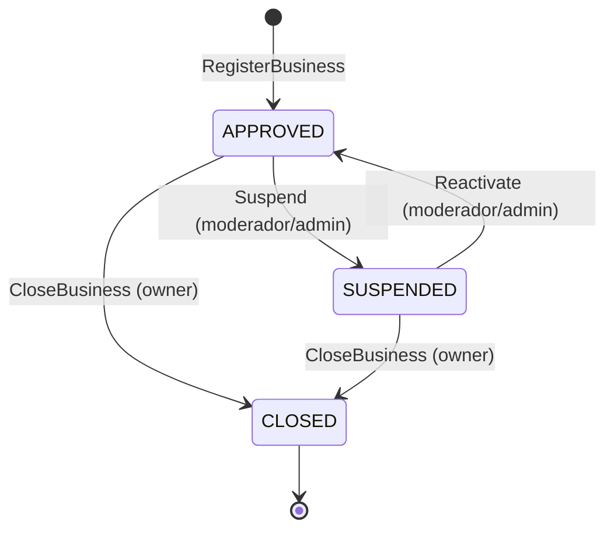
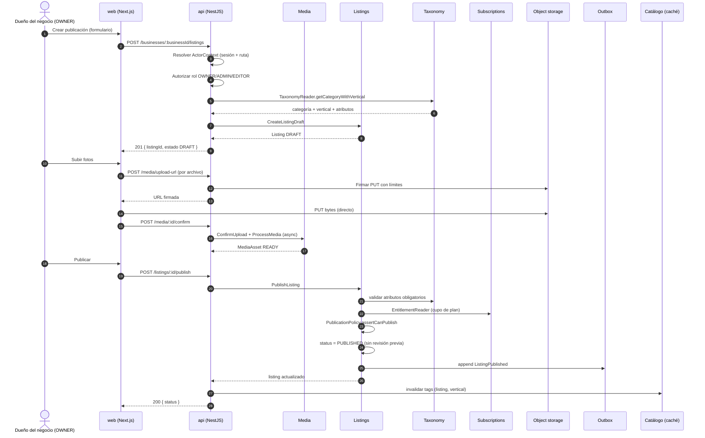
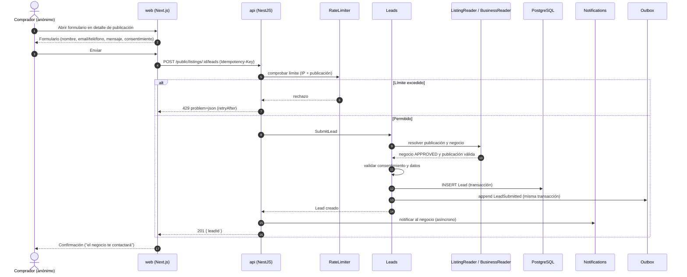
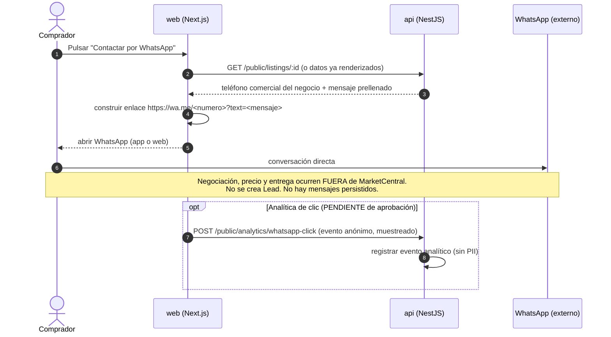
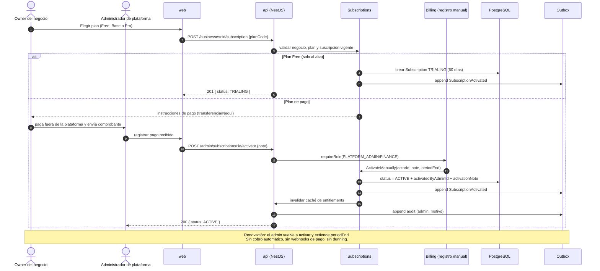
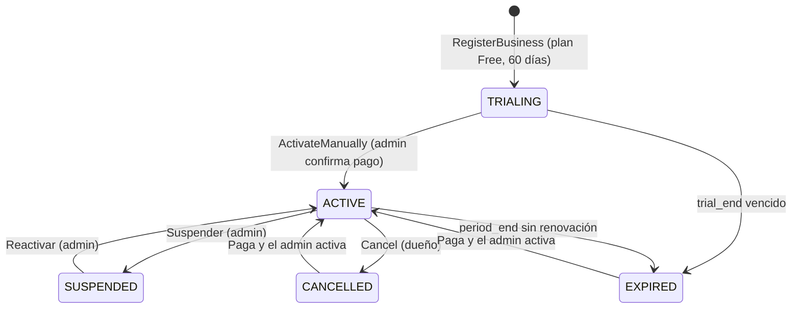
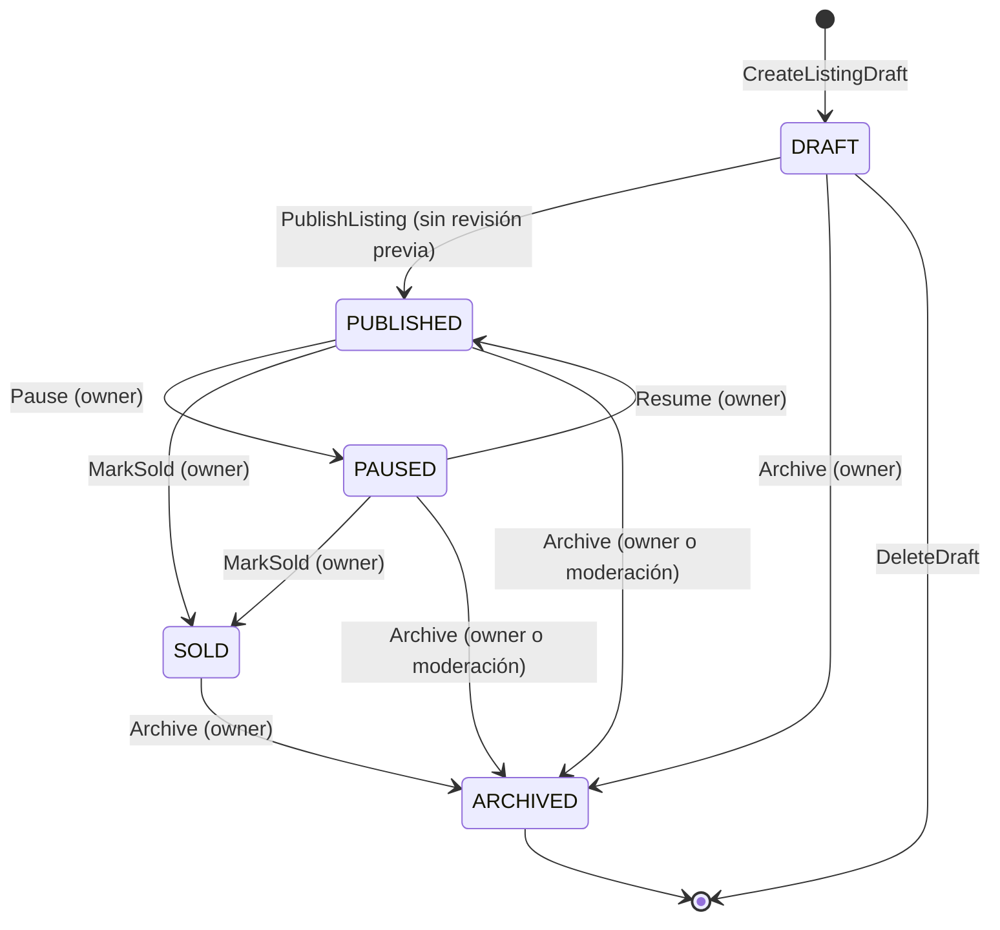
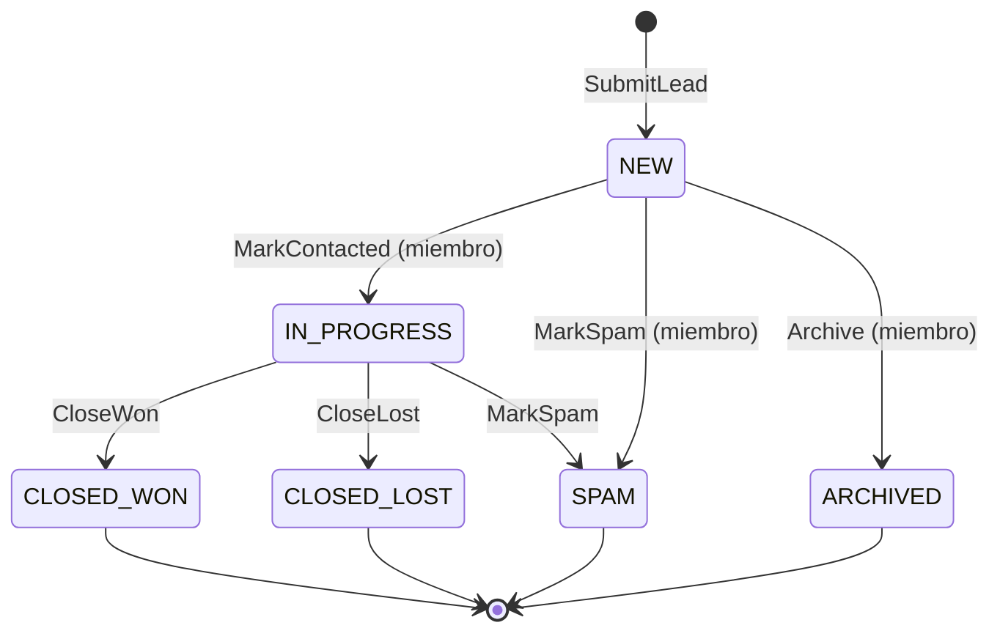

# 06 — Flujos funcionales y máquinas de estados

**Estado:** documento para revisión · **Fecha:** 2026-11-12 · **Fase:** planificación (Prompt 01)

---

## 1. Convenciones

- Las secuencias incluyen **solo** componentes existentes en el diseño. Los proveedores externos pendientes se marcan `(PENDIENTE)`.
- Todo flujo privado empieza resolviendo `ActorContext` desde la **sesión** + ruta; nunca desde el cuerpo de la petición.
- Los errores de negocio se expresan con códigos estables (`LISTING_NOT_PUBLISHABLE`, `PLAN_LIMIT_REACHED`, …) y se mapean a HTTP en el borde.
- Las transiciones de estado son **idempotentes**: repetir la misma acción sobre el mismo estado no produce efectos duplicados (responde éxito sin evento nuevo).

---

## 2. Registro de negocio (sin aprobación previa)

**Objetivo:** convertir a un usuario con cuenta en un negocio operable, sin revisión previa (Q-07, C-10).

1. El usuario autenticado envía datos del negocio (nombre, descripción, teléfono comercial, `city` del catálogo, `addressLine` opcional).
2. `Businesses.RegisterBusiness` valida unicidad de slug y datos, crea `Business` en `APPROVED` y la `Membership` del creador como `OWNER`.
3. Se registra aceptación de términos y política de datos (versión + fecha). El dueño declara ser responsable del contenido y de los datos de los compradores que lo contacten.
4. El negocio queda operable de inmediato: puede habilitar verticales, contratar plan y publicar. Se envía correo de bienvenida.
5. `PLATFORM_ADMIN`/`MODERATOR` puede suspenderlo después si hay denuncia o incumplimiento; la reactivación es manual y auditada.

**Errores y bordes**

| Situación | Comportamiento |
|-----------|----------------|
| Slug ya usado | 409 con sugerencia de slug disponible; no se crea el negocio. |
| Datos inválidos (ciudad fuera del catálogo, teléfono mal formado) | 422 con detalle por campo. |
| Términos no aceptados | 422 `TERMS_NOT_ACCEPTED`; no se crea el negocio. |
| Usuario ya es owner de 3 negocios (si se limita) | 422 `BUSINESS_LIMIT_REACHED` (límite **PENDIENTE**). |
| Suspensión repetida | Idempotente: sin segundo evento ni segunda notificación. |
| Reactivación sin caso abierto | 409 `INVALID_TRANSITION`; toda suspensión deja rastro en `ModerationCase`. |

**Máquina de estados de `Business`**

> Sin `PENDING_VERIFICATION` ni `REJECTED`: no existe moderación previa de negocios (Q-07). El control es **reactivo** (denuncia → `ModerationCase` → suspensión), y el cumplimiento se respalda en los T&C aceptados al registrarse.

| Transición | Actor autorizado | Precondiciones | Efectos | Evento | Error |
|-----------|------------------|----------------|---------|--------|-------|
| `→ APPROVED` (alta) | Usuario autenticado | Datos válidos, términos aceptados, ciudad del catálogo | Crea negocio `APPROVED` + `OWNER`; operable de inmediato | `BusinessRegistered` | 409 slug; 422 datos |
| `→ SUSPENDED` | `MODERATOR`/`PLATFORM_ADMIN` | Negocio `APPROVED`; `ModerationCase` con motivo | Oculta publicaciones del catálogo; conserva datos | `BusinessSuspended` | 409 estado inválido |
| `→ APPROVED` (reactivar) | `MODERATOR`/`PLATFORM_ADMIN` | Estaba `SUSPENDED`; caso resuelto | Restaura visibilidad según reglas | `BusinessReactivated` | 409 |
| `→ CLOSED` | `OWNER` | Confirmación explícita | Cancela suscripción; oculta todo | `BusinessClosed` | 409 si hay proceso pendiente |

---

## 3. Invitación y alta de miembros

1. `OWNER`/`ADMIN` invita por email con rol (`ADMIN`, `EDITOR`, `VIEWER`).
2. Se crea `Membership` en estado `INVITED` con token de un uso y expiración (7 días — **PROPUESTA**).
3. Se envía correo con enlace (`/invitaciones/:token`).
4. Si el invitado no tiene cuenta: se registra y luego acepta (el token asocia la membresía).
5. Al aceptar: `Membership` pasa a `ACTIVE`; se registra `MemberJoined`.
6. Si el token expira o el email ya tiene membresía en ese negocio: error explícito, sin duplicar.

**Bordes:** invitar a un email ya miembro → 409; revocar al último `OWNER` → 422 `LAST_OWNER`; cambiar rol del último owner → 422; aceptar invitación de negocio suspendido → se permite unirse pero el panel queda en modo lectura (decisión **PROPUESTA**).

---

## 4. Selección de verticales del negocio

1. El `OWNER`/`ADMIN` ve las verticales activas de la plataforma.
2. Selecciona una o varias → `EnableVertical` crea `BusinessVertical`.
3. El sistema valida que la vertical esté activa y que el plan permita esa cantidad (si se limita — **PENDIENTE**).
4. Al deshabilitar una vertical: las publicaciones existentes de esa vertical se ocultan del catálogo; **no** se borran. El negocio puede volver a habilitarla y recuperan visibilidad si siguen `PUBLISHED`.

**Regla:** habilitar vertical no habilita categorías por sí solo; el negocio publica en las categorías activas de esa vertical.

---

## 5. Alta, edición y publicación de un artículo

### 5.1 Secuencia

### 5.2 Reglas del flujo

- La **carga de imágenes es directa al object storage**; la API solo firma y confirma. Nunca se transmiten binarios por la API en producción.
- La publicación **no** espera el procesamiento de imágenes si ya hay al menos una `READY`; si no hay ninguna, `PublishListing` rechaza (I-04).
- **No hay revisión previa:** si se cumplen los requisitos, la publicación pasa a `PUBLISHED` en el mismo caso de uso (Q-07, C-10). El dueño responde por el contenido (T&C). La moderación es reactiva ante denuncia.
- La invalidación de caché ocurre **después** del commit; si falla, el TTL (≤ 60 s) corrige.

### 5.3 Errores

| Código | HTTP | Cuándo |
|--------|------|--------|
| `LISTING_NOT_FOUND` | 404 | No existe o no pertenece al negocio del actor |
| `CATEGORY_NOT_IN_VERTICAL` | 422 | Categoría de otra vertical |
| `VERTICAL_NOT_ENABLED` | 422 | Negocio sin habilitación o vertical inactiva |
| `MISSING_REQUIRED_ATTRIBUTES` | 422 | Faltan atributos obligatorios (devuelve cuáles) |
| `NO_READY_MEDIA` | 422 | Sin imágenes procesadas |
| `PLAN_LIMIT_REACHED` | 409 | Cupo de publicaciones activas agotado |
| `INVALID_TRANSITION` | 409 | Transición no permitida desde el estado actual |

---

## 6. Moderación (solo reactiva)

1. La cola se alimenta **exclusivamente** de `ReportSubmitted` (denuncias de compradores o del negocio) y de alertas internas (p. ej. uso anómalo). No existen `BusinessSubmitted` ni `ListingSubmittedForReview` (Q-07, C-10).
2. El moderador abre el `ModerationCase`, revisa contenido, historial del negocio y la publicación denunciada.
3. Decide: ocultar la publicación (`Listing.ARCHIVED` con motivo), suspender el negocio (`Business.SUSPENDED`) o desestimar la denuncia con justificación.
4. La decisión se aplica **invocando el caso de uso del módulo dueño** (`Listings.ArchiveListing`, `Businesses.SuspendBusiness`), nunca por escritura directa.
5. Se registra auditoría (actor, motivo, objeto), se notifica al negocio y al denunciante (sin revelar identidad).
6. La decisión es inmutable; corregir requiere nueva decisión con motivo.

**Bordes:** publicación ya vendida → el caso se cierra como "no aplica"; negocio suspendido con publicaciones activas → **no se tocan**: conservan su estado (`PUBLISHED`, `PAUSED`…) y salen del catálogo porque la visibilidad exige `business.status='APPROVED'` (C-11.4); el archivado en cascada solo ocurre por `CloseBusiness` explícito; doble clic en decidir → idempotente.

---

## 7. Búsqueda pública

1. El comprador entra a `/v/prenderias` (o portada).
2. `web` renderiza en servidor y llama a `GET /public/listings?vertical=prenderias&...`.
3. La API valida parámetros (whitelist de filtros por vertical), aplica `VisibilityPolicy` (R-01) y consulta con keyset pagination.
4. Devuelve publicaciones con datos mínimos de tarjeta (título, precio, imagen principal, negocio, ubicación, condición).
5. Filtros disponibles provienen de `AttributeDefinition.filterable` de esa vertical/categoría.
6. Orden: `relevance` (texto), `recent`, `price_asc`, `price_desc`. Por defecto `recent` sin texto, `relevance` con texto.
7. Facets con conteo, limitadas a los N valores más frecuentes (límite **PROPUESTA**: 20 por atributo).

**Bordes:** filtro de atributo inexistente → 400; página fuera de rango → lista vacía con `nextCursor: null`; texto con caracteres especiales → parametrizado y escapado; vertical inactiva → 404.

---

## 8. Formulario de contacto y creación de Lead

**Reglas**

- `Lead` guarda `businessId` resuelto del servidor (desde la publicación), nunca del cliente.
- El mensaje y los datos de contacto no viajan en logs ni en eventos (el evento lleva `leadId`, no el contenido).
- La notificación al negocio es asíncrona: el comprador no espera al correo (degradación si el proveedor falla).
- Un lead a publicación `SOLD`/`PAUSED` se rechaza con 422 `LISTING_NOT_CONTACTABLE` (no se crea).
- Un lead a negocio sin suscripción vigente se rechaza (regla de contacto del negocio en [04 §7](04-domain-overview.md)) o se acepta y queda retenido — **decisión abierta** (Q-08, no bloqueante); propuesta: rechazar con 422 y mensaje claro.

---

## 9. Contacto por WhatsApp

**Reglas**

- El enlace se construye **en el servidor** con el número del negocio; el cliente no inventa números.
- No hay redirección a través de la API (evita open redirect y permite controlar el número).
- Abrir WhatsApp **no** crea `Lead` ni cambia estados. **[APROBADA]**
- El evento analítico, si se aprueba, es **separado**, anónimo y no se mezcla con `Lead` (Q-11).
- El número debe estar normalizado (E.164) y validado al guardarlo el negocio.

---

## 10. Gestión de inventario (panel)

1. El negocio abre `/app/b/[businessId]/publicaciones` con filtros por estado.
2. Ve contadores: activas, pausadas, vendidas, borradores, próximas a vencer.
3. Acciones por fila: editar, pausar/reactivar, marcar vendido, archivar, duplicar.
4. Acciones masivas: **no** en MVP.
5. Cada acción es un caso de uso con su transición y evento; la UI muestra solo las acciones permitidas por estado.
6. La expiración corre en `worker` diariamente: publicaciones `PUBLISHED` con antigüedad > N días (config) pasan a `EXPIRED` y se notifica al negocio 3 días antes.

**Bordes:** marcar vendido una publicación ya vendida → idempotente; editar una vendida → 409; duplicar una vendida → crea `DRAFT` nuevo.

---

## 11. Suscripción: contratación manual, renovación, vencimiento y cancelación

Sin pasarela de pago en el MVP (Q-06, C-10): el dueño paga por transferencia o Nequi **fuera** de la plataforma y un administrador registra la activación.

### 11.1 Máquina de estados de `Subscription`

> **Autoridad del modelo:** la máquina canónica es [18 §4](18-state-transition-matrix.md). **Cinco estados** (`TRIALING`, `ACTIVE`, `SUSPENDED`, `EXPIRED`, `CANCELLED`), aprobados en **C-11.2**. No hay `PENDING_ACTIVATION`: el pago se confirma fuera del sistema y el admin activa en una sola transacción.

| Transición | Actor | Precondiciones | Efectos | Evento | Error |
|-----------|-------|----------------|---------|--------|-------|
| `→ TRIALING` | SYSTEM (alta) | Negocio recién creado; no hay otra suscripción viva | Fija `trial_end = now() + 60 días`; habilita visibilidad con límites del plan Free | `SubscriptionActivated` | Rollback del alta |
| `TRIALING → ACTIVE` | `PLATFORM_ADMIN`/`FINANCE` | Pago verificado; `activationNote` obligatoria | Cambia el plan y abre periodo pagado; registra `activatedByAdminId` y `activatedAt` | `SubscriptionActivated` | 409 idempotente (`alreadyApplied`); 422 sin nota |
| `ACTIVE → SUSPENDED` | `PLATFORM_ADMIN`/`FINANCE` | Motivo registrado | Oculta catálogo; conserva inventario; exige `suspensionReason` | `SubscriptionSuspended` | 409 si ya suspendida |
| `SUSPENDED → ACTIVE` | `PLATFORM_ADMIN`/`FINANCE` | Motivo resuelto | Reactiva visibilidad | `SubscriptionReactivated` | 409 si ya activa |
| `TRIALING/ACTIVE → EXPIRED` | Worker | Fin de periodo o de prueba | Oculta catálogo; negocio en solo lectura; **no** borra publicaciones | `SubscriptionExpired` | — (idempotente) |
| `EXPIRED/CANCELLED → ACTIVE` | `PLATFORM_ADMIN`/`FINANCE` | Pago verificado; nota | Nuevo periodo desde `now()` | `SubscriptionRenewed` / `SubscriptionReactivated` | 422 sin nota |
| `ACTIVE → CANCELLED` | Owner | — | Mantiene acceso hasta `current_period_end` | `SubscriptionCancelled` | 409 si ya cancelada |

**Reglas críticas**

- El estado **nunca** se fija con datos del cliente: lo activa un administrador, lo expira el `worker` al vencer el periodo y lo pone en prueba el alta.
- No hay cobro automático, ni reintentos, ni `PAST_DUE`: si no se renueva, la suscripción pasa a `EXPIRED` y el negocio queda visible solo a sí mismo.
- Los entitlements se recalculan al cambiar el estado y se cachean con TTL corto + invalidación por evento.
- Toda activación manual es auditable: quién, cuándo, qué plan, qué nota y qué comprobante (referencia externa opcional); la idempotencia se detalla en [18 §4.1](18-state-transition-matrix.md).

---

## 12. Máquina de estados de `Listing`

> Sin `PENDING_REVIEW` ni `REJECTED`: la publicación es directa (Q-07). **Cinco estados** (C-02, C-11): no existe `EXPIRED`; el vencimiento es `ARCHIVED` con `archived_reason='EXPIRED'`. `ARCHIVED` también puede aplicarse desde Moderación como consecuencia de una denuncia, siempre invocando `Listings.ArchiveListing`.

| Transición | Actor | Precondiciones | Efectos | Evento | Error |
|-----------|-------|----------------|---------|--------|-------|
| `→ DRAFT` | `OWNER` (único miembro del MVP) | Negocio `APPROVED`, vertical habilitada | Crea publicación vacía | `ListingCreated` | 422 datos; 409 límite |
| `→ PUBLISHED` | `OWNER` | Todos los requisitos + cupo + suscripción vigente | Visible en catálogo si `VisibilityPolicy` lo permite | `ListingPublished` | 409 `PLAN_LIMIT_REACHED`, 422 requisitos |
| `→ PAUSED` | `OWNER` | `PUBLISHED` | Oculto del catálogo | `ListingPaused` | 409 transición |
| `→ PUBLISHED` (resume) | `OWNER` | `PAUSED`, cupo disponible, suscripción vigente | Visible | `ListingResumed` | 409 cupo |
| `→ SOLD` | `OWNER` | `PUBLISHED` o `PAUSED` | Oculto, irreversible por el negocio | `ListingSold` | 409 |
| `→ ARCHIVED` (vencimiento) | Worker | `PUBLISHED`/`PAUSED` y antigüedad > N | Oculto; `archived_reason='EXPIRED'`; notificación previa | `ListingArchived` | — |
| `→ ARCHIVED` | `OWNER` o `MODERATOR` | Cualquiera excepto `ARCHIVED`; si es moderación, `ModerationCase` con motivo | Oculto definitivamente; `archived_reason` = `MANUAL`/`MODERATION` | `ListingArchived` | 409 transición |

**`ARCHIVED` es terminal** (C-02): para volver a vender, el dueño **crea una publicación nueva** (o duplica, fase 2); no se "resucita" el archivo.

**Invariante de visibilidad:** `PUBLISHED` es condición **necesaria pero no suficiente**; la visibilidad efectiva la decide `VisibilityPolicy` (R-01) en cada consulta.

---

## 13. Máquina de estados de `Lead`

| Transición | Actor | Precondiciones | Efectos | Evento | Error |
|-----------|-------|----------------|---------|--------|-------|
| `→ NEW` | Público (anónimo) | Datos válidos, consentimiento, rate limit | Persiste lead; notifica | `LeadSubmitted` | 429, 422, 404 |
| `→ IN_PROGRESS` | Miembro del negocio | Lead del negocio | Marca atendido; registra actor | `LeadStatusChanged` | 404 si otro negocio |
| `→ CLOSED_WON`/`LOST` | Miembro | `IN_PROGRESS` | Cierra; resultado | `LeadStatusChanged` | 409 |
| `→ SPAM` | Miembro | Cualquiera no cerrado | Excluye de métricas | `LeadStatusChanged` | 409 |
| `→ ARCHIVED` | Miembro | Cualquiera no cerrado | Archiva | `LeadStatusChanged` | 409 |

**Nota:** el resultado (`WON`/`LOST`) es **declarado por el negocio**, no verificado por la plataforma; no se usa como métrica de ingresos, solo como indicador de atención.

---

## 14. Matriz de eventos por transición sensible

| Evento | Dispara | Consumidores internos | Webhook externo (futuro) |
|--------|---------|----------------------|--------------------------|
| `BusinessRegistered` | Alta de negocio | Notifications, Audit | Sí |
| `BusinessSuspended` | Moderación/Admin | Listings (pausar), PublicCatalog, Notifications | Sí |
| `ListingPublished` | Listings | PublicCatalog (cache), Notifications (opcional) | Sí (n8n) |
| `ListingSold` | Listings | PublicCatalog, Notifications | Sí |
| `LeadSubmitted` | Leads | Notifications | Sí (n8n: seguimiento) |
| `SubscriptionActivated` | Subscriptions (Free o activación manual) | Listings (entitlements), Notifications, Audit | Sí |
| `SubscriptionExpired` | Worker | Listings (ocultar), Notifications | Sí |
| `ModerationCaseOpened` | Moderación (denuncia) | Notifications, Audit | Sí |

Los webhooks externos son **futuros** y no condicionan la operación (ver [09](09-integrations-and-n8n-readiness.md)).

---

## 15. Recuperación ante fallos por flujo

| Flujo | Fallo | Comportamiento |
|-------|-------|----------------|
| Publicar | Falla la invalidación de caché | Se registra alerta; el TTL de 60 s corrige; no se revierte la publicación. |
| Publicar | Falla la escritura en outbox | Falla toda la transacción: no hay publicación sin evento (consistencia). |
| Lead | Proveedor de correo caído | El lead se guarda; la notificación se reintenta; el comprador ve confirmación. |
| Lead | Doble envío del navegador | Idempotencia por clave: un solo lead. |
| Suscripción | Worker caído | Al reiniciar, el job procesa el backlog (idempotente por fecha). |
| Activación manual | Error al registrar el pago | La suscripción conserva su estado (`TRIALING`/`EXPIRED`/`CANCELLED`); el admin reintenta; toda activación exige nota y queda auditada. |
| Activación manual | Doble clic del admin | Idempotente por `subscriptionId` + estado: la segunda llamada responde 200 sin extender el periodo ni duplicar el evento. |
| Activación manual | Se activa por error | Se registra una nueva decisión con motivo; la corrección se audita, no se borra la anterior. |
| Expiración | Worker caído | Al reiniciar, el job procesa el backlog (idempotente por fecha). |
| Catálogo | Base de datos lenta | Timeout de 3 s y página de error con reintento; nunca se sirve contenido de otro tenant. |
