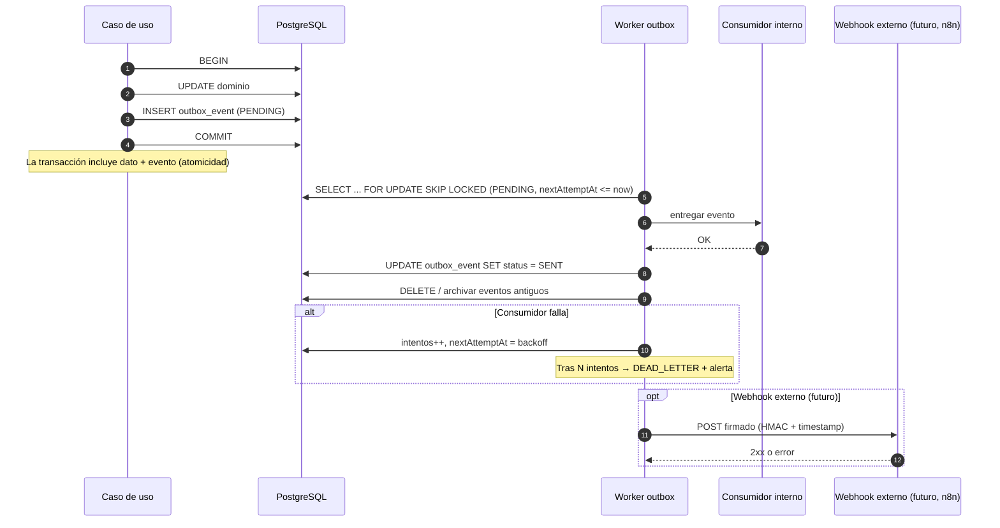

# 09 — Integraciones, eventos y preparación para n8n

**Estado:** documento para revisión · **Fecha:** 2026-11-12 · **Fase:** planificación (Prompt 01)

> **n8n es una integración futura, opcional y externa.** Nada de este documento se implementa en el MVP más allá del *outbox* y el contrato de eventos. La plataforma debe operar correctamente con n8n desconectado, mal configurado o ausente.

---

## 1. Principios de integración

1. **El dominio no conoce n8n.** No hay nodos, flujos, webhooks ni formatos de n8n dentro de los módulos de negocio.
2. **El hecho primero, la integración después.** Toda acción relevante emite un evento de dominio persistido; los consumidores externos son suscriptores.
3. **Asíncrono por defecto** para efectos externos (correo, webhooks, automatizaciones). La respuesta al usuario no espera al tercero.
4. **Idempotencia obligatoria** en todo consumidor y en todo webhook entrante.
5. **La integración se puede apagar** sin afectar la operación; los eventos quedan registrados y se pueden reprocesar.
6. **Contrato versionado** y estable; los cambios incompatibles crean una versión nueva.

---

## 2. Capacidades de integración por fase

| Capacidad | MVP | Fase 2 (n8n) |
|-----------|-----|--------------|
| Tabla `outbox` transaccional | ✅ | ✅ |
| Publicador de eventos → destino interno | ✅ (log/consumidores internos) | ✅ |
| Webhooks salientes firmados a suscriptores | ❌ (contrato definido) | ✅ |
| Endpoint de recepción de webhooks externos de pago | ✅ | ✅ |
| Reintentos con backoff y dead-letter | ✅ (básico) | ✅ (con panel) |
| Suscripciones gestionadas por el negocio | ❌ | ✅ (admin/soporte) |
| Reproceso manual de eventos | ❌ | ✅ |
| n8n desplegado | ❌ | ✅ (fuera de este repositorio) |

---

## 3. Eventos de dominio

### 3.1 Catálogo inicial

| Evento | Versión | Productor | Datos mínimos (sin PII) |
|--------|---------|-----------|--------------------------|
| `BusinessRegistered` | v1 | Businesses | `businessId`, `occurredAt` |
| `BusinessSuspended` | v1 | Businesses | `businessId`, `reasonCode` |
| `BusinessReactivated` | v1 | Businesses | `businessId` |
| `BusinessVerticalEnabled` | v1 | Businesses | `businessId`, `verticalId` |
| `MemberInvited` | v1 | Businesses | `businessId`, `membershipId`, `role` |
| `MemberJoined` | v1 | Businesses | `businessId`, `membershipId` |
| `ListingCreated` | v1 | Listings | `listingId`, `businessId`, `verticalId` |
| `ListingPublished` | v1 | Listings | `listingId`, `businessId`, `verticalId`, `categoryId` |
| `ListingPaused` | v1 | Listings | `listingId` |
| `ListingResumed` | v1 | Listings | `listingId` |
| `ListingSold` | v1 | Listings | `listingId` |
| `ListingArchived` | v1 | Listings | `listingId`, `archivedReason` (`MANUAL`/`MODERATION`/`EXPIRED`) |
| `LeadSubmitted` | v1 | Leads | `leadId`, `businessId`, `listingId` (sin nombre, email, teléfono ni mensaje) |
| `LeadStatusChanged` | v1 | Leads | `leadId`, `status` |
| `SubscriptionActivated` | v1 | Subscriptions | `subscriptionId`, `businessId`, `planId`, `activatedByAdminId` (si fue manual) |
| `SubscriptionSuspended` | v1 | Subscriptions | `subscriptionId`, `reasonCode` |
| `SubscriptionReactivated` | v1 | Subscriptions | `subscriptionId` |
| `SubscriptionCancelled` | v1 | Subscriptions | `subscriptionId`, `accessUntil` |
| `SubscriptionExpired` | v1 | Subscriptions | `subscriptionId`, `businessId` |
| `ModerationCaseOpened` | v1 | Moderation | `caseId`, `targetType`, `targetId` |
| `ReportSubmitted` | v1 | Moderation | `reportId`, `targetType`, `targetId` |

> **Sin eventos de cobro en el MVP:** no existen `CheckoutStarted`, `SubscriptionStarted`, `SubscriptionRenewed`, `SubscriptionPaymentFailed`, `PaymentSucceeded`, `InvoiceIssued` ni `ProviderEventReceived`. El cobro es manual y la activación se registra en `SubscriptionActivated`. Los eventos de pasarela se reintroducen en fase 2 (Q-06).

**Regla:** los eventos llevan **identificadores**, no contenido personal. Quien necesite el detalle lo consulta con autorización.

### 3.2 Envelope

```json
{
  "eventId": "uuid",
  "eventType": "ListingPublished",
  "eventVersion": 1,
  "occurredAt": "2026-11-12T18:00:00.000Z",
  "producer": "listings",
  "aggregateType": "Listing",
  "aggregateId": "uuid",
  "businessId": "uuid",
  "correlationId": "uuid",
  "causationId": "uuid|null",
  "payload": { "listingId": "uuid", "verticalId": "uuid" }
}
```

- `eventId` es la clave de idempotencia.
- `correlationId` permite reconstruir un flujo completo.
- `eventVersion` se incrementa solo con cambios incompatibles.

---

## 4. Outbox transaccional



**Propiedades**

- La escritura del evento ocurre en **la misma transacción** que el cambio de estado: no existe publicación sin evento ni evento sin publicación.
- El worker usa `FOR UPDATE SKIP LOCKED` para escalar horizontalmente sin duplicados.
- Estados: `PENDING → SENT` o `PENDING → DEAD_LETTER`; reintentos con backoff exponencial (1 min, 5 min, 15 min, 1 h, 6 h — **PROPUESTA**).
- Retención de eventos enviados: 90 días en tabla; luego archivo (**PROPUESTA**).

---

## 5. Webhooks salientes (fase 2)

| Aspecto | Definición |
|---------|------------|
| Destino | URL registrada por el suscriptor (n8n u otro), solo `https` |
| Firma | `X-MC-Signature: t=<timestamp>,v1=<hmac_sha256(t + "." + body, secret)>` |
| Timestamp | Rechazo si > 300 s de diferencia |
| Idempotencia | `X-MC-Event-Id` + header `X-MC-Delivery-Attempt` |
| Respuesta esperada | 2xx en < 5 s; cuerpo ignorado |
| Reintentos | Backoff exponencial hasta 24 h; luego dead-letter visible |
| Orden | **No garantizado** entre eventos distintos; sí por agregado si se usa la misma partición lógica |
| Seguridad | Secreto por suscriptor, rotable; sin datos personales en el payload |
| Versionado | `X-MC-Event-Version`; cambios incompatibles → nueva versión y periodo de convivencia |
| Observabilidad | Registro por entrega: estado, código, latencia, intento |

**Nunca** se envían a webhooks: contraseñas, tokens, contenido de mensajes de leads, datos de pago.

---

## 6. Integración con n8n (fase 2)

### 6.1 Flujos previstos (no implementados)

| Flujo | Disparador | Acción en n8n | Datos |
|-------|-----------|---------------|-------|
| Aviso de lead al negocio | `LeadSubmitted` | Enviar email/WhatsApp con enlace al panel | `leadId` + consulta autenticada |
| Recordatorio de publicación por vencer | Job del `worker` (no hay evento previo) / `ListingArchived` con `archivedReason='EXPIRED'` | Notificar al negocio | `listingId` |
| Seguimiento de leads sin atender | Programado | Recordatorio a miembros | `leadId` agregados |
| Aviso de suscripción por vencer | job diario sobre `Subscription.periodEnd` | Notificar al owner | `subscriptionId` |
| Onboarding de negocio nuevo | `BusinessRegistered` | Secuencia de bienvenida | `businessId` |
| Confirmación de plan activado | `SubscriptionActivated` | Agradecimiento + instrucciones | `subscriptionId` |

### 6.2 Reglas de acoplamiento

- n8n **consume** webhooks y **llama** a la API pública/privada con credenciales de servicio; no accede a la base de datos.
- Las credenciales de n8n son de un usuario de servicio con permisos mínimos y auditados (**PENDIENTE** de diseño).
- Si n8n está caído: los webhooks fallan y se reintentan; la plataforma no se degrada.
- Ningún flujo de negocio (publicar, cobrar, expirar) depende de un workflow de n8n.
- Los workflows se versionan fuera del repositorio de la aplicación y se documentan en un anexo operativo (**PENDIENTE**).

---

## 7. Webhooks entrantes (fase 2: pagos)

> **No aplica al MVP.** No hay pasarela de pago (Q-06, C-10): el cobro es manual y la activación la registra un administrador. Esta sección queda como contrato previsto para cuando se integre Wompi/Mercado Pago en fase 2; no describe una capacidad existente.

| Aspecto | Definición |
|---------|------------|
| Endpoint | `POST /webhooks/payments/:provider` |
| Autenticación | Firma del proveedor (HMAC o esquema propio), verificada sobre el cuerpo crudo |
| Idempotencia | `providerEventId` único en tabla `provider_events` |
| Orden | Se tolera desorden; el estado se calcula por tipo + fechas |
| Respuesta | 2xx rápido; procesamiento asíncrono |
| Replay | Ventana de timestamp + registro de eventos procesados |
| Errores | 4xx para firma inválida; 5xx solo si se quiere reintento del proveedor |
| Observabilidad | Cada evento registrado con estado (`RECEIVED`, `PROCESSED`, `IGNORED`, `FAILED`) |

**Proveedor concreto de cobro: PENDIENTE para fase 2** (Q-06). El contrato se define de forma agnóstica al proveedor; el proveedor de base de datos ya está decidido ([ADR-006](decisions/ADR-006-production-database-provider.md)).

---

## 8. Idempotencia y consistencia

| Escenario | Mecanismo |
|-----------|-----------|
| Reintento de webhook de pago (fase 2) | `provider_events.providerEventId` único |
| Reintento de webhook saliente | `eventId` + `deliveryAttempt` en destino |
| Activación manual repetida | Estado + `subscriptionId`: la segunda llamada responde 200 sin extender periodo ni duplicar evento |
| Doble clic en "publicar" | Transición idempotente: si ya está `PUBLISHED`, responde 200 sin evento |
| Envío duplicado de lead | `Idempotency-Key` del cliente, retenida 24 h |
| Job de expiración ejecutado dos veces | Condición por fecha + estado; segunda ejecución no cambia nada |
| Reproceso manual de outbox | `eventId` ya `SENT` no se reenvía salvo marcado explícito |

---

## 9. Seguridad de integraciones

- Secretos por integración, por entorno; rotación documentada.
- Lista blanca de destinos de webhook (sin IPs privadas, sin `localhost`, sin esquemas distintos de `https`).
- Timeouts de salida (5 s conexión, 10 s total) y límite de tamaño de respuesta.
- Sin reenvío de cabeceras del cliente a terceros.
- Registro de llamadas salientes sin secretos.
- Protección SSRF en cualquier funcionalidad que permita configurar URLs (**PENDIENTE** si se habilita autoservicio).

---

## 10. Observabilidad de eventos

| Métrica | Uso |
|---------|-----|
| `outbox_pending_count` | Detectar worker caído o backlog |
| `outbox_oldest_pending_age` | Alerta si > 5 min |
| `outbox_dead_letter_count` | Alerta si > 0 |
| `webhook_delivery_success_rate` | Salud de suscriptores |
| `webhook_delivery_p95_ms` | Latencia de destinos |
| `provider_event_failures` | Problemas con el proveedor de pagos |

Cada evento tiene traza: `eventId` → `correlationId` → petición original.

---

## 11. Qué NO se hace en el MVP

- No se despliega n8n ni se crean workflows.
- No se implementan webhooks salientes (solo se deja el contrato y la tabla).
- No se implementa un panel de suscripciones a webhooks.
- No se integra ningún proveedor de pagos real (solo el puerto y los adaptadores de prueba).
- No se integran proveedores de mensajería adicionales (WhatsApp Business API, SMS).
- No se expone la base de datos a herramientas de automatización.

---

## 12. Criterios para aprobar la fase 2 de integraciones

1. MVP en producción con al menos 20 negocios y 500 publicaciones activas.
2. Tasa de dead-letter < 0,1 % durante 30 días.
3. Contrato de eventos congelado en v1 y documentado.
4. Credenciales de servicio y auditoría de accesos resueltas.
5. Validación legal del envío de datos a terceros (n8n self-hosted o cloud).
6. Aprobación explícita de costo y operación de n8n.
