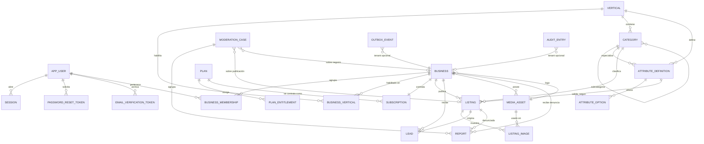
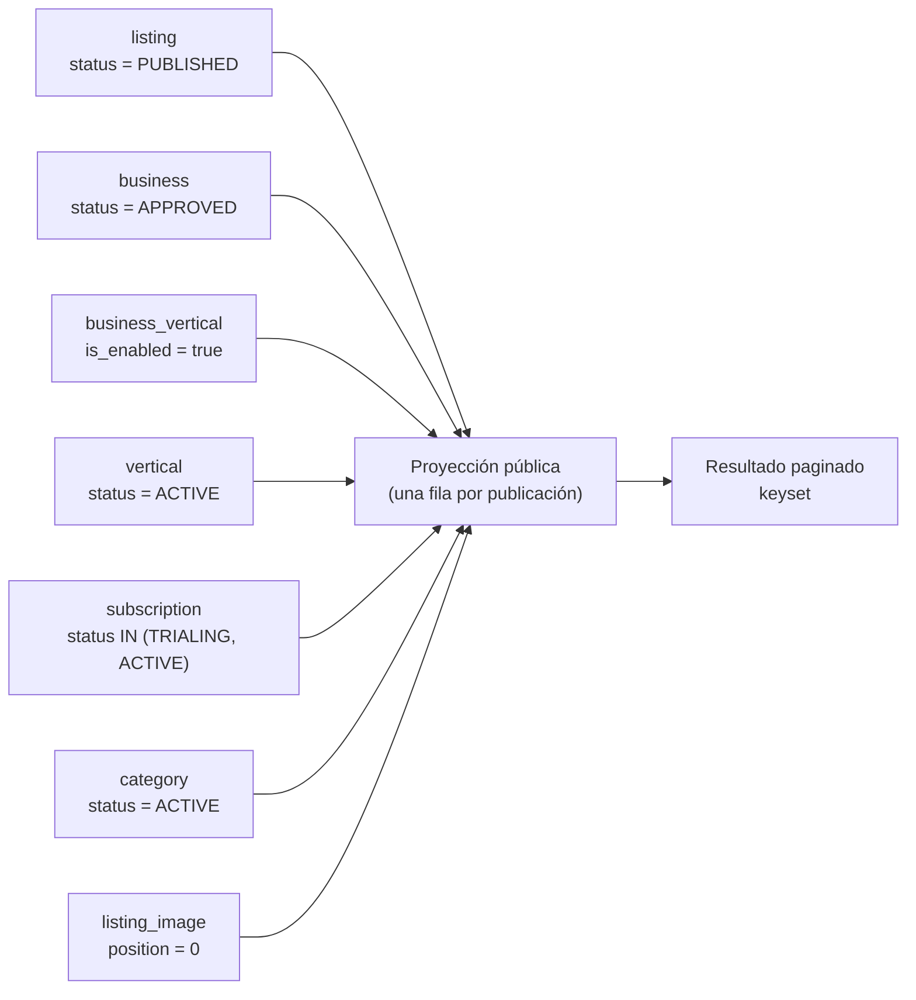

# 15. Modelo entidad-relación del MVP

**Fecha:** 2026-11-12 · **Estado:** PROPUESTA (diseño sujeto a revisión) · **Alcance:** modelo lógico del MVP, sin `schema.prisma` ni migraciones.

Este documento define **qué entidades existen, cómo se relacionan y dónde están los límites transaccionales**. El diccionario de campos está en [16](16-data-dictionary.md); el aislamiento en [17](17-tenant-isolation-matrix.md); estados en [18](18-state-transition-matrix.md); índices y restricciones en [19](19-indexing-and-integrity.md); retención y privacidad en [20](20-data-retention-and-privacy.md).

Contexto fijado por C-10 ([12 §8.1](12-risks-and-open-decisions.md)): cobro manual sin pasarela, sin moderación previa, planes Free/Base/Pro, COP fijo, `city` obligatorio, un miembro por negocio, idempotencia en la activación manual. **Ninguna entidad de pasarela de pago se incluye.**

---

## 1. Principios del modelo

| # | Principio | Consecuencia concreta |
|---|-----------|------------------------|
| P1 | **El tenant es `Business`.** Toda tabla operativa lleva `business_id` y se consulta con él. | `listing`, `lead`, `media_asset`, `subscription`, `business_membership`, `business_vertical`, `report`, `moderation_case` |
| P2 | **La taxonomía es global y configurable.** Verticales, categorías y atributos no pertenecen a un negocio. | `vertical`, `category`, `attribute_definition`, `attribute_option` sin `business_id` |
| P3 | **Una publicación tiene un negocio, una vertical y una categoría de esa vertical.** | FK compuestas, no chequeos en aplicación (§3) |
| P4 | **Los límites del plan se leen, no se duplican.** | `plan_entitlement` (clave/valor) y `subscription.plan_id`; no hay columnas `max_active_listings` en `business` |
| P5 | **Nada se borra si tiene historial.** | `deleted_at` en `business`, `listing`, `media_asset`, `lead`; borrado físico solo en sesiones y tokens |
| P6 | **Los estados son enums de PostgreSQL**, cerrados y estables. | `business_status`, `listing_status`, `subscription_status`, `lead_status`, `report_status`, `moderation_decision` |
| P7 | **Los hechos inmutables no se actualizan.** | `audit_entry` y `outbox_event` son append-only |
| P8 | **Sin polimorfismo cuando una FK real es viable.** | `listing_image` como tabla de unión en lugar de `media_asset.owner_type/owner_id` |
| P9 | **El catálogo no tiene tabla propia.** | Ninguna tabla `catalog_item`; el catálogo es una consulta sobre `listing` (§7) |
| P10 | **Dinero en enteros.** | `price_amount integer` en pesos COP; `price_currency char(3) DEFAULT 'COP'` con `CHECK` |

---

## 2. Convenciones

- Tablas y columnas en `snake_case`; modelos Prisma en `PascalCase` con `@@map`/`@map` ([10 §3](10-data-and-persistence-strategy.md)).
- PK `id uuid` (UUID v7). **Decisión C-11.1 (APROBADA, D-01):** default de columna `uuidv7()`, función nativa del core de PostgreSQL 18 — sin extensión. Alternativa secundaria si el tooling de Prisma lo exige: `@default(uuid(7))` en el cliente. La base genera el identificador; la aplicación nunca lo inventa.
- `created_at`/`updated_at` en toda tabla mutable; `timestamptz` en UTC.
- Fechas de negocio con nombre explícito (`published_at`, `sold_at`, `activated_at`).
- Los enums se documentan en [18](18-state-transition-matrix.md); aquí solo se referencian.
- Los nombres de tabla en singular (`listing`, no `listings`) para que las FK compuestas se lean sin ambigüedad.

---

## 3. Diagrama entidad-relación

Solo se dibujan entidades del MVP. Las relaciones punteadas son **lógicas** (se validan en el caso de uso, no con FK) y están marcadas como tales.



**Lectura del diagrama**

| Relación | Cardinalidad | Por qué |
|----------|--------------|---------|
| `business ||--|| subscription` | 1:1 en la práctica | El MVP exige una suscripción por negocio; la unicidad se garantiza con índice parcial ([19 §4](19-indexing-and-integrity.md)), no con una FK 1:1, porque el historial de suscripciones vencidas se conserva |
| `business ||--o{ business_vertical` | N:M con atributos | Un negocio opera en varias verticales si el admin lo habilita |
| `vertical ||--o{ category` + `category ||--o{ category` | Árbol | Subcategorías con profundidad acotada (máx. 3) |
| `attribute_definition` → `vertical`/`category` | N:1 con `category_id` opcional | Definición a nivel de vertical y especialización por categoría |
| `listing` → `attribute_definition` | Punteada | El enlace no es por FK: los valores viven en `listing.attributes` JSONB y se validan contra las definiciones vigentes del par (vertical, categoría) |
| `listing_image` → `media_asset` | N:1 | El mismo objeto puede reutilizarse (p. ej. imagen de catálogo del negocio) sin duplicar el archivo |
| `moderation_case` → `listing`/`business` | 0..1 a cada lado | Un caso apunta a **un** objeto; se modela con dos FK anulables y un `CHECK` de exclusividad (§5) |
| `lead` → `listing` | N:1 anulable | El formulario puede enviarse desde el perfil del negocio, sin publicación |

---

## 4. Entidades por agregado

### 4.1 Identidad y acceso (global)

| Entidad | Rol | Notas |
|---------|-----|-------|
| `app_user` | Aggregate root | Email único normalizado (minúsculas), `password_hash` (Argon2id), `email_verified_at`, `status`. Solo se guarda lo necesario para autenticar y contactar |
| `session` | Entity de `app_user` | `token_hash` único (SHA-256 del token opaco), `expires_at`, `revoked_at`, `ip_hash`, `user_agent`. Nunca se guarda el token en claro |
| `password_reset_token` | Entity de `app_user` | `token_hash` único, `expires_at` (30 min), `used_at`. Se invalida al usar |
| `email_verification_token` | Entity de `app_user` | `token_hash` único, `expires_at` (24 h), `used_at` |

**Decisión:** el nombre `app_user` evita la colisión con la palabra reservada `user` en PostgreSQL y con `USER` en SQL estándar. En Prisma el modelo es `User` con `@@map("app_user")`.

### 4.2 Negocio y membresías (tenant)

| Entidad | Rol | Notas |
|---------|-----|-------|
| `business` | Aggregate root | `slug` único, `name`, `status` (`APPROVED`/`SUSPENDED`/`CLOSED`), `city` (enum de 10 municipios), `address_line`, `whatsapp_e164`, `logo_asset_id`, `accepted_terms_at`, `privacy_policy_version`, `deleted_at` |
| `business_membership` | Entity de `business` | `(user_id, business_id)` único; `role` (`OWNER`/`ADMIN`/`EDITOR`/`VIEWER`); `status` (`ACTIVE`/`REVOKED`). En el MVP solo existe una membresía `OWNER` activa por negocio |
| `business_vertical` | Entity de `business` | `(business_id, vertical_id)` único; `is_enabled`; `enabled_at`. La habilitación la hace un admin (`PLATFORM_ADMIN`) |

**Invariante:** un negocio no puede publicar en una vertical no habilitada. La FK compuesta de `listing` (§5) apunta a `business_vertical`, así que la fila **debe existir**; `is_enabled = true` se valida en el caso de uso (un `CHECK` no puede mirar otra tabla).

### 4.3 Taxonomía (global, administrada por `Admin`)

| Entidad | Rol | Notas |
|---------|-----|-------|
| `vertical` | Aggregate root | `slug` único, `name`, `status` (`ACTIVE`/`INACTIVE`), `sort_order` |
| `category` | Entity de `vertical` | `(vertical_id, parent_id, slug)` único; `parent_id` puede ser `NULL`; `depth` (0–2); `status` |
| `attribute_definition` | Configuración | `vertical_id` obligatorio, `category_id` opcional; `key`, `data_type` (`TEXT`/`NUMBER`/`BOOLEAN`/`DATE`/`ENUM`), `required`, `filterable`, `searchable`, `validation` (JSONB acotado), `sort_order` |
| `attribute_option` | Configuración | Para `ENUM`: `attribute_definition_id`, `key`, `label`, `sort_order`, `is_active` |

**Herencia de atributos:** una definición con `category_id = NULL` aplica a toda la vertical; una con `category_id` aplica solo a esa categoría. La resolución efectiva (vertical ∪ categoría) se calcula en el caso de uso y se documenta en [16 §5](16-data-dictionary.md).

### 4.4 Publicaciones e imágenes (tenant)

| Entidad | Rol | Notas |
|---------|-----|-------|
| `listing` | Aggregate root | `business_id`, `vertical_id`, `category_id`, `title`, `description`, `price_amount`, `price_currency`, `condition_code`, `status`, `attributes` JSONB, `published_at`, `sold_at`, `archived_reason`, `deleted_at`, `version` (control optimista) |
| `media_asset` | Entity de `business` | `business_id`, `storage_key` único, `mime`, `size_bytes`, `width`, `height`, `checksum`, `status` (`PENDING`/`READY`/`FAILED`), `deleted_at` |
| `listing_image` | Entity de `listing` | `listing_id`, `media_asset_id`, `position` (0–4), `alt_text`; único `(listing_id, position)` y `(listing_id, media_asset_id)` |

**Por qué `listing_image` y no un `owner_type` en `media_asset`:** un `owner_type/owner_id` no se puede referenciar con FK y permite asociar una imagen a un negocio por error. La tabla de unión conserva la integridad y permite el mismo activo en dos publicaciones sin duplicar el objeto en el almacenamiento.

### 4.5 Contacto (tenant)

| Entidad | Rol | Notas |
|---------|-----|-------|
| `lead` | Aggregate root | `business_id`, `listing_id` opcional, `name`, `email`, `phone_e164`, `message`, `source` (`WEB_FORM`), `status`, `consent_given`, `consent_text`, `consent_at`, `ip_hash`, `user_agent_summary`, `contacted_at`, `closed_at`, `deleted_at` |

**Sin `lead_status_history`:** el cambio de estado se registra en `audit_entry` (`entity_type = 'lead'`) y en las columnas `contacted_at`/`closed_at`. Se justifica porque el historial de leads no se consulta en el MVP y duplicar la auditoría crea dos fuentes de verdad ([20 §6](20-data-retention-and-privacy.md)).

**WhatsApp no tiene entidad.** Es un enlace generado en el servidor a partir de `business.whatsapp_e164`; no crea fila. Si en el futuro se mide el clic, se hace con analítica (Q-11), no con una tabla de contactos.

### 4.6 Suscripciones (tenant + configuración global)

| Entidad | Rol | Notas |
|---------|-----|-------|
| `plan` | Aggregate root (global) | `code` único (`FREE`, `BASE`, `PRO`), `name`, `price_amount`, `price_currency`, `interval_months`, `trial_days`, `is_active`, `version` |
| `plan_entitlement` | Entity de `plan` | `(plan_id, key)` único: `max_active_listings`, `max_images_per_listing`, `max_members`, `leads_panel`; `value` JSONB con tipo declarado (`{"type":"integer","value":10}`) |
| `subscription` | Aggregate root | `business_id`, `plan_id`, `status`, `current_period_start`, `current_period_end`, `trial_end`, `cancelled_at`, `activated_at`, `activated_by_admin_id`, `activation_note`, `suspension_reason` |

### 4.7 Moderación reactiva (tenant)

| Entidad | Rol | Notas |
|---------|-----|-------|
| `report` | Entity | `business_id`, `listing_id` opcional, `reporter_user_id` opcional (puede ser anónimo), `reason` (`PROHIBITED_ITEM`/`FRAUD`/`COUNTERFEIT`/`OFFENSIVE`/`OTHER`), `details`, `status`, `moderation_case_id` |
| `moderation_case` | Aggregate root | `business_id`, `target_type` (`BUSINESS`/`LISTING`), `target_business_id`, `target_listing_id`, `status` (`OPEN`/`RESOLVED`/`DISMISSED`), `decision` (`NONE`/`SUSPEND_BUSINESS`/`ARCHIVE_LISTING`/`NO_ACTION`), `decided_by`, `decided_at`, `decision_note` |

### 4.8 Transversal

| Entidad | Rol | Notas |
|---------|-----|-------|
| `audit_entry` | Append-only | `actor_type` (`USER`/`ADMIN`/`SYSTEM`), `actor_id`, `action`, `entity_type`, `entity_id`, `business_id` opcional, `before`/`after` (solo campos relevantes), `request_id`, `ip_hash`, `occurred_at` |
| `outbox_event` | Outbox transaccional | `event_id` único, `event_type`, `event_version`, `aggregate_type`, `aggregate_id`, `business_id` opcional, `payload`, `status` (`PENDING`/`PUBLISHED`/`FAILED`), `attempts`, `available_at`, `published_at`, `last_error` |

---

## 5. Integridad estructural: FK compuestas

El objetivo es que **la base de datos**, no solo el caso de uso, impida cruzar negocios o verticales. Estas restricciones requieren claves únicas auxiliares que se detallan en [19](19-indexing-and-integrity.md).

| Regla | Mecanismo | Efecto |
|-------|-----------|--------|
| Una categoría pertenece a una vertical y un padre de la misma vertical | `UNIQUE (id, vertical_id)` en `category`; FK `(parent_id, vertical_id) → category(id, vertical_id)` | No se puede colgar una subcategoría de otra vertical |
| Una publicación usa una categoría de **su** vertical | `UNIQUE (id, vertical_id)` en `category`; FK `(category_id, vertical_id) → category(id, vertical_id)` | `CATEGORY_NOT_IN_VERTICAL` pasa a ser un error de integridad, no solo de aplicación |
| Una publicación pertenece a una vertical **habilitada** para su negocio | `UNIQUE (business_id, vertical_id)` en `business_vertical`; FK `(business_id, vertical_id) → business_vertical(business_id, vertical_id)` | No se publica en una vertical no habilitada; `is_enabled` se valida en el caso de uso |
| Un lead pertenece al mismo negocio que la publicación | `UNIQUE (id, business_id)` en `listing`; FK `(listing_id, business_id) → listing(id, business_id)` | `LEAD_BUSINESS_MISMATCH` es imposible por construcción |
| Una imagen no sale de su publicación | FK `(listing_id) → listing(id)` + `UNIQUE (listing_id, position)` | Máximo 5 posiciones (0–4) por `CHECK` |
| Un caso de moderación apunta a un solo objeto | `CHECK (num_nonnulls(target_business_id, target_listing_id) = 1)` | Sin casos ambiguos |

> **Nota sobre `is_enabled`:** una FK no puede exigir `is_enabled = true`. Se aceptan dos defensas: el caso de uso comprueba la habilitación dentro de la misma transacción, y un trigger `BEFORE INSERT/UPDATE` en `listing` puede reforzarlo (**PROPUESTA**, ver [19 §6](19-indexing-and-integrity.md)). Sin el trigger, la integridad de la habilitación depende de la aplicación.

---

## 6. Agregados y límites transaccionales

| Agregado | Raíz | Incluye | Frontera transaccional |
|----------|------|---------|------------------------|
| `Business` | `business` | `business_membership`, `business_vertical` | Crear negocio + membresía `OWNER` + aceptación de T&C en **una** transacción |
| `Listing` | `listing` | `listing_image` | Crear/editar publicación + imágenes + `outbox_event` en **una** transacción. `media_asset` se sube antes (no es parte del agregado) |
| `Subscription` | `subscription` | — | Activar/renovar/cancelar + `audit_entry` + `outbox_event` en **una** transacción (R-32) |
| `Lead` | `lead` | — | Crear lead + `outbox_event`; el lead es inmutable en su contenido |
| `ModerationCase` | `moderation_case` | `report` | Abrir caso desde una denuncia + decisión + `audit_entry` + `outbox_event` |
| `Plan` | `plan` | `plan_entitlement` | Crear versión de plan con sus límites en **una** transacción; nunca se edita un plan con suscripciones |
| `User` | `app_user` | `session`, tokens | Registro + sesión; el resto de operaciones son independientes |

**Regla de consistencia entre agregados:** `listing.business_id` no cambia nunca después de crear la publicación. Mover una publicación de negocio exigiría borrarla y recrearla, lo que preserva la trazabilidad de los leads.

---

## 7. Cómo el catálogo público consulta sin duplicar

No existe tabla de catálogo. La consulta del catálogo es una **proyección**:



Cada fila del resultado es **la misma fila de `listing`**, enriquecida con datos del negocio y de la taxonomía. No hay copia, ni cola de sincronización, ni riesgo de inventario desincronizado. La regla de visibilidad completa está en [11 §5.2](11-public-marketplace-experience.md) y se materializa en el `WHERE` de la consulta ([15 §8](#8-consultas-conceptuales)).

---

## 8. Consultas conceptuales

Se describen en lenguaje natural + pseudoconsulta, **sin código de aplicación**.

### 8.1 Catálogo por vertical y ciudad (público)

> "Dame las publicaciones `PUBLISHED` de la vertical `prenderias`, en Medellín, categoría *Ropa*, con precio entre 20.000 y 80.000 COP, ordenadas por más recientes, página de 24."

```
listing l
  JOIN business b            ON b.id = l.business_id AND b.status='APPROVED' AND b.deleted_at IS NULL
  JOIN business_vertical bv  ON bv.business_id = l.business_id AND bv.vertical_id = l.vertical_id AND bv.is_enabled
  JOIN vertical v            ON v.id = l.vertical_id AND v.status='ACTIVE'
  JOIN category c            ON c.id = l.category_id AND c.status='ACTIVE'
  JOIN subscription s        ON s.business_id = b.id AND s.status IN ('TRIALING','ACTIVE')
 WHERE l.status='PUBLISHED' AND l.deleted_at IS NULL
   AND v.slug='prenderias' AND b.city='MEDELLIN'
   AND c.slug='ropa' AND l.price_amount BETWEEN 20000 AND 80000
 ORDER BY l.published_at DESC, l.id DESC
 LIMIT 24
```

Índices previstos: `(vertical_id, status, published_at DESC, id DESC)`, `(business_id)`, `(city)` parcial, GIN sobre `attributes` para los filtros marcados `filterable`.

### 8.2 Filtro por atributo configurable

> "Además, que sea talla M y marca *Nike*."

```
AND l.attributes @> '{"talla":"M","marca":"nike"}'
```

La normalización de claves y valores (`nike`, no `Nike`) ocurre al validar contra `attribute_definition`; el GIN `jsonb_path_ops` resuelve la contención. Un atributo `filterable` puede además tener índice de expresión si el uso lo demuestra ([19 §5](19-indexing-and-integrity.md)).

### 8.3 Panel privado: publicaciones del negocio

> "Publicaciones del negocio del usuario autenticado, todos los estados, ordenadas por actualización."

```
business_id := resolver desde sesión + membresía (nunca del body/query)
listing WHERE business_id = :business_id AND deleted_at IS NULL
ORDER BY updated_at DESC
```

### 8.4 Panel privado: leads del negocio

> "Leads nuevos del negocio, con la publicación de origen si existe."

```
lead l LEFT JOIN listing li ON li.id = l.listing_id AND li.business_id = l.business_id
WHERE l.business_id = :business_id AND l.deleted_at IS NULL
```

La FK compuesta `(listing_id, business_id)` garantiza que el `LEFT JOIN` no pueda traer una publicación de otro negocio.

### 8.5 Límite del plan antes de publicar

> "¿Cuántas publicaciones activas tiene el negocio y cuál es su límite?"

```
SELECT count(*) FROM listing
 WHERE business_id = :business_id
   AND status IN ('PUBLISHED','PAUSED')
   AND deleted_at IS NULL;

-- límite
SELECT value FROM plan_entitlement
 WHERE plan_id = (suscripción vigente del negocio) AND key='max_active_listings';
```

El conteo y la escritura ocurren en la misma transacción con bloqueo del negocio para evitar que dos publicaciones simultáneas superen el límite ([19 §7](19-indexing-and-integrity.md)).

---

## 9. Ejemplos concretos (ilustrativos, no datos reales)

### 9.1 Publicación de celular en una prendería

| Campo | Valor de ejemplo |
|-------|------------------|
| `title` | "iPhone 12 128 GB — como nuevo" |
| `vertical` | `prenderias` |
| `category` | `tecnologia > celulares` |
| `condition_code` | `LIKE_NEW` |
| `price_amount` | `1150000` (COP, entero) |
| `attributes` | `{"marca":"apple","modelo":"iphone 12","almacenamiento_gb":128,"bateria_pct":89,"incluye_cargador":true,"garantia_meses":3}` |

Definiciones usadas: `marca` (ENUM, filterable), `modelo` (TEXT, searchable), `almacenamiento_gb` (NUMBER, filterable), `bateria_pct` (NUMBER, no filterable), `incluye_cargador` (BOOLEAN), `garantia_meses` (NUMBER).

### 9.2 Publicación de joya

| Campo | Valor de ejemplo |
|-------|------------------|
| `title` | "Anillo oro 18k con zafiro" |
| `vertical` | `joyerias` |
| `category` | `anillos > compromiso` |
| `condition_code` | `GOOD` |
| `price_amount` | `2400000` |
| `attributes` | `{"material":"oro 18k","quilates":18,"peso_g":4.2,"piedra":"zafiro","talla_anillo":7,"certificado":false}` |

**Lo que estos ejemplos demuestran:** el mismo `listing` sirve para ambos sin columnas específicas; los atributos son datos, no esquema; la vertical y la categoría determinan qué es obligatorio. La joya podría no tener `marca`, y el celular no tener `quilates`: ninguno de los dos rompe el modelo.

---

## 10. Contradicciones detectadas y resolución

| # | Contradicción | Documentos | Resolución | Estado |
|---|---------------|------------|------------|--------|
| C-01 | Estados de `Subscription`: los docs tenían `PENDING_ACTIVATION`/`ACTIVE`/`CANCELLED`/`EXPIRED`; el encargo pedía `TRIALING`/`ACTIVE`/`SUSPENDED`/`EXPIRED`/`CANCELLED` | [06 §11](06-core-flows-and-state-machines.md), [12 §8.1](12-risks-and-open-decisions.md) vs. encargo Prompt 02 | **Cinco estados:** `TRIALING`, `ACTIVE`, `SUSPENDED`, `EXPIRED`, `CANCELLED`. Sin `PAST_DUE` (no hay cobro automático que falle) y sin `PENDING_ACTIVATION` (la activación manual resuelve el pago en una sola transacción). Grafía `CANCELLED` | **APROBADA (C-11.2)** |
| C-02 | `listing.status` incluía `EXPIRED` en [03 §4.2](03-system-architecture.md) y [06 §12](06-core-flows-and-state-machines.md); el encargo fija cinco estados sin `EXPIRED` | 03, 06 vs. Prompt 02 / C-10 | Enum de cinco estados (`DRAFT`, `PUBLISHED`, `PAUSED`, `SOLD`, `ARCHIVED`). El vencimiento pasa a `ARCHIVED` con `archived_reason = 'EXPIRED'` | **APROBADA (C-11)** |
| C-03 | Dinero "en unidades menores" ([10 §3](10-data-and-persistence-strategy.md)) vs. `priceAmount` entero en COP (encargo) | 10 vs. Prompt 02 | El peso colombiano no se usa con centavos en este negocio: `price_amount` = **pesos enteros** (`30000` = $30.000) | **APROBADA (C-11)** |
| C-04 | `Plan` con `version` en [04 §3](04-domain-overview.md) pero el encargo no la lista | 04 vs. Prompt 02 | Se mantiene `plan.code` + `plan.version` y `is_active`; una versión nueva no reescribe la anterior | **APROBADA (C-11)** |
| C-05 | `condition` como enum fijo ([13 glossary](13-glossary.md)) vs. atributo configurable por vertical | 13 vs. C-10 §6 / encargo | **Enum fijo** `condition_code`: `NEW`, `LIKE_NEW`, `GOOD`, `FAIR`, `POOR`. Si una vertical necesita más granularidad se modela como atributo adicional `condition_detail`; el campo principal no es configurable | **APROBADA (C-11.3 / D-13)** |

---

## 11. Lo que este modelo deliberadamente no incluye

| Ausente | Motivo |
|---------|--------|
| `payment_provider_account`, `payment_webhook_event`, `subscription_payment`, `billing_attempt`, `invoice` | Cobro manual (C-10, Q-06). Wompi/Mercado Pago son fase 2 |
| `catalog_item` / tabla espejo del catálogo | El catálogo es consulta (§7) |
| `lead_status_history` | Se cubre con `audit_entry` + columnas de fecha (§4.5) |
| `moderation_policy` / cola de revisión previa | Sin moderación previa (Q-07) |
| `order`, `cart`, `checkout`, `escrow`, `payout` | El pago de artículos ocurre fuera de la plataforma |
| `review` / `rating` | No hay compra verificable |
| `conversation` / `message` | WhatsApp externo o Lead |
| `inventory_movement` (kardex) | El MVP gestiona publicaciones, no contabilidad de inventario |
| Coordenadas / PostGIS | `city` + `address_line` bastan para el piloto (Q-16) |
| Tabla de miembros histórica separada | `business_membership.status` conserva el rastro; el MVP tiene un solo miembro |

---

## 12. Riesgos del modelo

| # | Riesgo | Impacto | Mitigación |
|---|--------|---------|------------|
| M-01 | Validación de `attributes` solo en aplicación | Medio | Una única ruta de escritura (`ListingRepository`), pruebas de validación por tipo y *contract tests* contra las definiciones |
| M-02 | FK compuesta a `business_vertical` no exige `is_enabled` | Medio | Validación transaccional + trigger opcional ([19 §6](19-indexing-and-integrity.md)) |
| M-03 | Crecimiento de `audit_entry` y `outbox_event` | Bajo | Particionado por mes cuando supere 5 M de filas; retención definida en [20](20-data-retention-and-privacy.md) |
| M-04 | `plan_entitlement.value` JSONB sin tipo fuerte | Bajo | `{"type","value"}` validado en el caso de uso; `EntitlementReader` es el único lector |
| M-05 | Cambiar `category_id` de una publicación con leads | Bajo | Se permite; los leads conservan `listing_id` y la categoría del lead no se copia |
| M-06 | Índice parcial de suscripción única y activaciones concurrentes | Medio | `UNIQUE (business_id) WHERE status IN (...)` + transacción con `SELECT ... FOR UPDATE` ([19 §7](19-indexing-and-integrity.md)) |

---

## 13. Decisiones del modelo

### 13.1 Cerradas (C-11)

| ID | Pregunta | Resolución | Estado |
|----|----------|------------|--------|
| D-01 | ¿UUID v7 en aplicación o en base? | `DEFAULT uuidv7()` de PostgreSQL 18; alternativa secundaria `@default(uuid(7))` de Prisma si el tooling lo exige | **APROBADA (C-11.1)** |
| C-01 | ¿Cuántos estados tiene `Subscription`? | **Cinco**: `TRIALING`, `ACTIVE`, `SUSPENDED`, `EXPIRED`, `CANCELLED`; sin `PENDING_ACTIVATION` ni `PAST_DUE`; único parcial `('TRIALING','ACTIVE')` | **APROBADA (C-11.2)** |
| D-13 | ¿`condition` configurable por vertical? | Enum fijo `NEW`, `LIKE_NEW`, `GOOD`, `FAIR`, `POOR`; granularidad extra con `condition_detail` | **APROBADA (C-11.3)** |
| D-14 | ¿Archivar publicaciones en cascada al cerrar o suspender un negocio? | **No**: conservan su estado y se invisibilizan por `VisibilityPolicy`. El archivado masivo solo existe como acción administrativa explícita al cerrar el negocio | **APROBADA (C-11.4)** |
| D-15 | ¿Más de un `OWNER` por negocio? | Un solo `OWNER` en el MVP; se valida en el caso de uso de creación de membresía, **sin trigger** de base de datos | **APROBADA (C-11.6)** |
| D-16 | ¿`moderation_case` guarda el resultado? | `decision` (`PENDING`, `RESOLVED_UPHELD`, `RESOLVED_DISMISSED`), `decided_by`, `decided_at`, `resolution_note` | **APROBADA (C-11.5)** |
| D-17 | ¿Historial de suscripciones? | Una fila por ciclo; solo una viva (`TRIALING`/`ACTIVE`), el resto `EXPIRED`/`CANCELLED` como historial | **APROBADA (C-11)** |

### 13.2 Abiertas (no bloquean el Prompt 03)

| ID | Pregunta | Supuesto actual | Impacta |
|----|----------|-----------------|---------|
| D-18 | ¿Se particiona `audit_entry` desde el inicio? | No; cuando supere 5 M de filas | Operación y respaldo |

---

## 14. Documentos relacionados

- [16 — Diccionario de datos](16-data-dictionary.md)
- [17 — Matriz de aislamiento por tenant](17-tenant-isolation-matrix.md)
- [18 — Matriz de transiciones de estado](18-state-transition-matrix.md)
- [19 — Índices e integridad](19-indexing-and-integrity.md)
- [20 — Retención y privacidad](20-data-retention-and-privacy.md)
- [ADR-008 — Modelo de datos del dominio](decisions/ADR-008-domain-data-model.md)
- [ADR-009 — Atributos dinámicos](decisions/ADR-009-dynamic-listing-attributes.md)
- [ADR-010 — Suscripciones y entitlements](decisions/ADR-010-subscriptions-and-entitlements.md)
