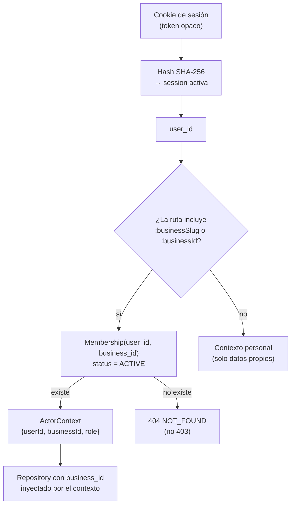

# 17. Matriz de aislamiento por tenant

**Fecha:** 2026-11-12 · **Estado:** PROPUESTA · **Decisión de referencia:** [ADR-003](decisions/ADR-003-multitenancy-strategy.md) — aislamiento en la capa de aplicación; RLS **evaluado y diferido**, no se reevalúa aquí.

Este documento responde a una pregunta concreta: **para cada tabla, ¿es global, de configuración o de un negocio, y qué impide que un usuario lea o escriba datos de otro negocio?**

El modelo de campos está en [16](16-data-dictionary.md); las restricciones ejecutables, en [19](19-indexing-and-integrity.md).

---

## 1. Definiciones

| Término | Significado en MarketCentral |
|---------|------------------------------|
| **Tenant** | `Business`. La unidad de aislamiento de datos operativos |
| **Tabla global** | No pertenece a ningún negocio; la administra la plataforma |
| **Tabla de configuración** | Global, pero define el comportamiento de todos los negocios (taxonomía, planes) |
| **Tabla de tenant** | Tiene `business_id` propio y toda lectura/escritura debe filtrarse por el negocio resuelto de la sesión |
| **Tabla derivada** | No tiene `business_id`, pero cuelga de una tabla de tenant por FK; su aislamiento se hereda |
| **Alcance de lectura** | Quién puede leer la fila: público, miembro del negocio, staff de plataforma |

---

## 2. Resumen por tabla

| # | Tabla | Ámbito | `business_id` | Lectura pública | Lectura del negocio | Escritura |
|---|-------|--------|:-------------:|:---------------:|---------------------|-----------|
| 1 | `app_user` | Global | ✗ | ✗ | Solo su propia fila | El propio usuario |
| 2 | `session` | Global (por usuario) | ✗ | ✗ | Solo sus sesiones activas | El propio usuario / sistema |
| 3 | `password_reset_token` | Global | ✗ | ✗ | No se lee (solo se consume) | Sistema |
| 4 | `email_verification_token` | Global | ✗ | ✗ | No se lee | Sistema |
| 5 | `business` | **Tenant** | PK del tenant | Sí (perfil público, campos públicos) | Sí (todos los campos) | `OWNER` (MVP); staff para suspender |
| 6 | `business_membership` | **Tenant** | ✓ | ✗ | Sí (solo miembros) | `OWNER` (MVP); staff en soporte |
| 7 | `business_vertical` | **Tenant** | ✓ | ✗ (se refleja en el catálogo) | Sí | Staff (`PLATFORM_ADMIN`) |
| 8 | `vertical` | Configuración | ✗ | Sí (`ACTIVE`) | Sí | Staff |
| 9 | `category` | Configuración | ✗ | Sí (`ACTIVE`) | Sí | Staff |
| 10 | `attribute_definition` | Configuración | ✗ | Sí (`ACTIVE`, solo metadatos) | Sí | Staff |
| 11 | `attribute_option` | Configuración | ✗ | Sí (`is_active`) | Sí | Staff |
| 12 | `listing` | **Tenant** | ✓ | Sí, solo si cumple `VisibilityPolicy` | Sí, todos sus estados | Miembros con rol de publicación |
| 13 | `media_asset` | **Tenant** | ✓ | Solo vía URL firmada/objeto público del catálogo | Sí | Miembros; el servicio de media |
| 14 | `listing_image` | Derivada | ✗ (FK a `listing`) | Sí, junto con la publicación visible | Sí | Miembros con permiso sobre la publicación |
| 15 | `lead` | **Tenant** | ✓ | ✗ | Sí, solo `OWNER` en MVP | El comprador **crea** (sin sesión); el negocio cambia estado |
| 16 | `plan` | Configuración | ✗ | Sí (precios y límites son públicos) | Sí | Staff |
| 17 | `plan_entitlement` | Derivada | ✗ (FK a `plan`) | Sí | Sí | Staff |
| 18 | `subscription` | **Tenant** | ✓ | ✗ (solo su efecto en la visibilidad) | Sí (`OWNER` lectura; activación solo staff) | Staff (`FINANCE`/`PLATFORM_ADMIN`) |
| 19 | `report` | **Tenant** | ✓ | ✗ | El denunciante ve su denuncia; el negocio **no** ve el detalle | Cualquiera (crea); staff (gestiona) |
| 20 | `moderation_case` | **Tenant** | ✓ | ✗ | ✗ (el negocio solo ve el efecto: suspensión/archivado) | Staff (`MODERATOR`) |
| 21 | `audit_entry` | Global con `business_id` opcional | ✓ opcional | ✗ | ✗ | Sistema (append-only) |
| 22 | `outbox_event` | Global con `business_id` opcional | ✓ opcional | ✗ | ✗ | Sistema (append-only) |

---

## 3. Regla de resolución del tenant

Ninguna consulta privada acepta `business_id` del cliente como autorización. El identificador se resuelve así:

| Paso | Regla |
|------|-------|
| 1 | El token de sesión se hashea y se busca en `session` con `revoked_at IS NULL AND expires_at > now()` |
| 2 | El `business_id` sale de la **ruta** (`/b/:businessSlug/...`) o del recurso solicitado, nunca de un campo del cuerpo |
| 3 | Se verifica `business_membership(user_id, business_id, status='ACTIVE')` |
| 4 | Si no hay membresía → **404** (no revelar que el negocio existe) |
| 5 | Si hay membresía pero el rol no permite la acción → **403** |
| 6 | El rol efectivo viaja en `ActorContext` y lo consume el caso de uso, no el controlador |
| 7 | El repositorio recibe el `businessId` ya resuelto; no lo toma de un DTO |

**Corolario:** un `business_id` enviado en el `body` o en un query param se **ignora**; a lo sumo se compara con el resuelto y, si difiere, se responde `404`.

---

## 4. Aislamiento por tabla: reglas concretas

### 4.1 `business`

| Operación | Regla |
|-----------|-------|
| Lectura pública | Solo `status='APPROVED'`, `deleted_at IS NULL`; se exponen `slug`, `name`, `description`, `city`, `whatsapp_e164` (transformado en enlace), `logo_asset_id`, categorías/verticales habilitadas y publicaciones visibles |
| Lectura del dueño | Todos los campos excepto `suspended_reason` si el staff lo marcó como interno |
| Edición | `OWNER`; `slug` cambia solo con validación de unicidad |
| Suspensión | Solo `MODERATOR`/`PLATFORM_ADMIN` vía `ModerationCase`; escribe `status`, `suspended_reason`, `AuditEntry`, `OutboxEvent` |

### 4.2 `business_membership`

| Operación | Regla |
|-----------|-------|
| Listar | Solo miembros del negocio; en el MVP el resultado es el propio `OWNER` |
| Crear / revocar | `OWNER`; fase 2 |
| Protección | `UNIQUE (business_id, user_id)`; índice parcial de `OWNER` activo; el último `OWNER` no puede revocarse (`LAST_OWNER`) |

### 4.3 `listing`

| Operación | Regla |
|-----------|-------|
| Lectura pública | `status='PUBLISHED'` **y** `deleted_at IS NULL` **y** `VisibilityPolicy` sobre negocio, vertical, suscripción y categoría |
| Lectura del negocio | Cualquier estado del propio negocio |
| Crear | `business_id` del `ActorContext`; `vertical_id` debe estar habilitada; `category_id` de esa vertical (FK compuesta) |
| Editar | Solo publicaciones del negocio; campos de estado con transición válida |
| Cambiar de negocio | **Prohibido** (invariante de agregado) |
| Borrado | Lógico (`deleted_at`); nunca físico si tiene leads o imágenes asociadas |

### 4.4 `lead`

| Operación | Regla |
|-----------|-------|
| Crear | **Sin sesión** (comprador anónimo). El `business_id` se deriva del `slug` de la ruta o de la publicación, nunca del cuerpo. Validación de existencia + visibilidad de la publicación |
| Leer | Solo `OWNER` del negocio (en MVP); `SUPPORT` solo con motivo registrado |
| Cambiar estado | Solo `OWNER`; `NEW → CONTACTED → CLOSED_*` |
| Datos | El contenido original es inmutable; solo se anonimiza a solicitud del titular |

### 4.5 `subscription`

| Operación | Regla |
|-----------|-------|
| Leer | `OWNER` del negocio; staff |
| Crear | Al registrar el negocio, automáticamente con el plan Free en `TRIALING` |
| Activar / renovar | Solo `FINANCE`/`PLATFORM_ADMIN` con `activation_note` (**R-32**) |
| Cancelar | `OWNER` (cancela al final del periodo) o staff |
| Modificar límites | Nunca directo: se cambia `plan_id` a otra versión de plan |

### 4.6 `media_asset`

| Operación | Regla |
|-----------|-------|
| Subir | Miembro con permiso de publicación; el objeto se registra con el `business_id` del contexto |
| Leer | El objeto del catálogo es público si la publicación es visible; el resto, solo el negocio |
| Asignar a publicación | Solo si `media_asset.business_id = listing.business_id` (validado en el caso de uso; no hay FK compuesta porque `listing_image` no lleva `business_id`) |
| Borrar | Lógico primero; purga del objeto tras 30 días sin referencias |

> **Alternativa considerada y descartada:** añadir `business_id` a `listing_image` para una FK compuesta. Se descartó porque duplicaría el tenant y podría desincronizarse; la validación se hace en el caso de uso con una consulta que une `listing_image → listing → business`.

### 4.7 `report` y `moderation_case`

| Operación | Regla |
|-----------|-------|
| Crear denuncia | Cualquier visitante (con rate limit y captcha si se aprueba); el `business_id` se deriva del objeto denunciado |
| Leer denuncia | El denunciante (si tiene cuenta) ve la suya; el negocio denunciado **no** ve el detalle, solo el efecto |
| Resolver | Solo `MODERATOR`; decisión + nota + `AuditEntry` + `OutboxEvent` |

### 4.8 `audit_entry` y `outbox_event`

| Operación | Regla |
|-----------|-------|
| Escritura | Solo dentro de la transacción del caso de uso; jamás desde un endpoint genérico |
| Lectura | `PLATFORM_ADMIN`/`SUPPORT` con registro de la propia consulta; el negocio no accede |
| `business_id` | Se copia del contexto para permitir filtrado por tenant en soporte; si el negocio se borra, `SET NULL` conserva el hecho |

---

## 5. Aislamiento reforzado por la base de datos

Aunque la autorización viva en la aplicación, el esquema impide cruces por construcción:

| Riesgo | Defensa en base de datos | Defensa en aplicación |
|--------|--------------------------|------------------------|
| Publicación en vertical no habilitada | FK `(business_id, vertical_id) → business_vertical(business_id, vertical_id)` | Verificación de `is_enabled` en la misma transacción |
| Categoría de otra vertical | FK `(category_id, vertical_id) → category(id, vertical_id)` | `CATEGORY_NOT_IN_VERTICAL` como validación previa (mejor mensaje) |
| Lead de otro negocio | FK `(listing_id, business_id) → listing(id, business_id)` | El `business_id` del lead se deriva del objeto, no del cuerpo |
| Dos suscripciones vivas | Índice único parcial `(business_id) WHERE status IN ('TRIALING','ACTIVE')` | Transacción con bloqueo del negocio |
| Dos `OWNER` en MVP | Índice único parcial `(business_id) WHERE role='OWNER' AND status='ACTIVE'` | `LAST_OWNER` y regla de un solo miembro |
| Lead sin consentimiento | `CHECK (consent_given = true)` + `consent_text`/`consent_at` NOT NULL | Formulario exige la casilla |
| Activación manual sin nota | `CHECK` que exige `activated_by_admin_id` y `activation_note` cuando el estado pasa a `ACTIVE` | `ActivateManually` exige la nota |

**Sin RLS:** el aislamiento depende de que **toda** consulta privada pase por un repositorio que recibe el `businessId` del `ActorContext`. Esa es la decisión de ADR-003 y su riesgo principal: una consulta nueva que olvide el filtro no la detiene la base de datos. Mitigaciones: revisión de código con checklist, pruebas negativas N-01…N-15 ([07 §9](07-security-and-multitenancy.md)) y un test de arquitectura que prohíbe `prisma.*.findMany` fuera de los repositorios de tenant (**PROPUESTA**).

---

## 6. Pruebas de aislamiento obligatorias

| ID | Escenario | Resultado esperado |
|----|-----------|--------------------|
| T-01 | `OWNER` A pide `GET /b/{slugB}/listings` | 404 |
| T-02 | `OWNER` A envía `PATCH /listings/{listingB}` con su sesión | 404 |
| T-03 | `OWNER` A crea publicación con `businessId` de B en el cuerpo | Se ignora el campo; la publicación se crea en A o se rechaza por validación |
| T-04 | `OWNER` A publica en una vertical no habilitada para A | 403 `VERTICAL_NOT_ENABLED` |
| T-05 | `OWNER` A publica con categoría de otra vertical | 422 `CATEGORY_NOT_IN_VERTICAL` |
| T-06 | Lead enviado a publicación de B con `businessId` de A en el cuerpo | Lead se crea en B (derivado del objeto) |
| T-07 | `OWNER` A intenta leer leads de B | 404 |
| T-08 | Staff sin rol `FINANCE` intenta activar suscripción | 403 |
| T-09 | Activación concurrente de la misma suscripción | Una sola transición; la segunda responde idempotente |
| T-10 | Consulta pública incluye negocio `SUSPENDED` | No aparece |
| T-11 | Consulta pública incluye suscripción `EXPIRED` | No aparece |
| T-12 | Denunciante consulta denuncia de otro | 404 |

---

## 7. Riesgos residuales

| # | Riesgo | Mitigación |
|---|--------|------------|
| I-01 | Consulta nueva sin filtro de `business_id` | Repositorios por tenant, revisión obligatoria y test de arquitectura |
| I-02 | Endpoint público que use `business_id` del cliente | Derivar siempre del `slug`/publicación y validar visibilidad |
| I-03 | Fuga por `include` de Prisma que traiga relaciones de otro tenant | Prohibido `include` de relaciones de tenant sin filtro; se usan selects explícitos |
| I-04 | Exportaciones o reportes que unan tablas sin `business_id` | Reportes solo para staff, con `business_id` visible y auditados |
| I-05 | Logs con datos personales | `lead.message` y credenciales excluidos del logger ([07 §8](07-security-and-multitenancy.md)) |
