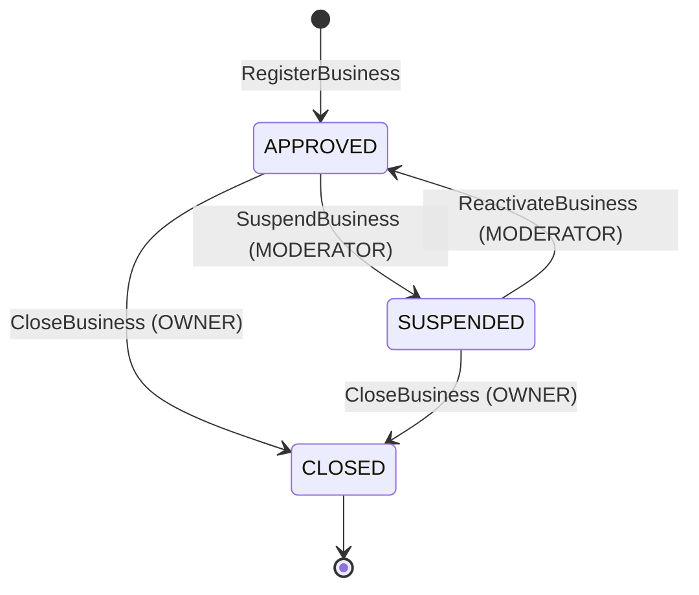
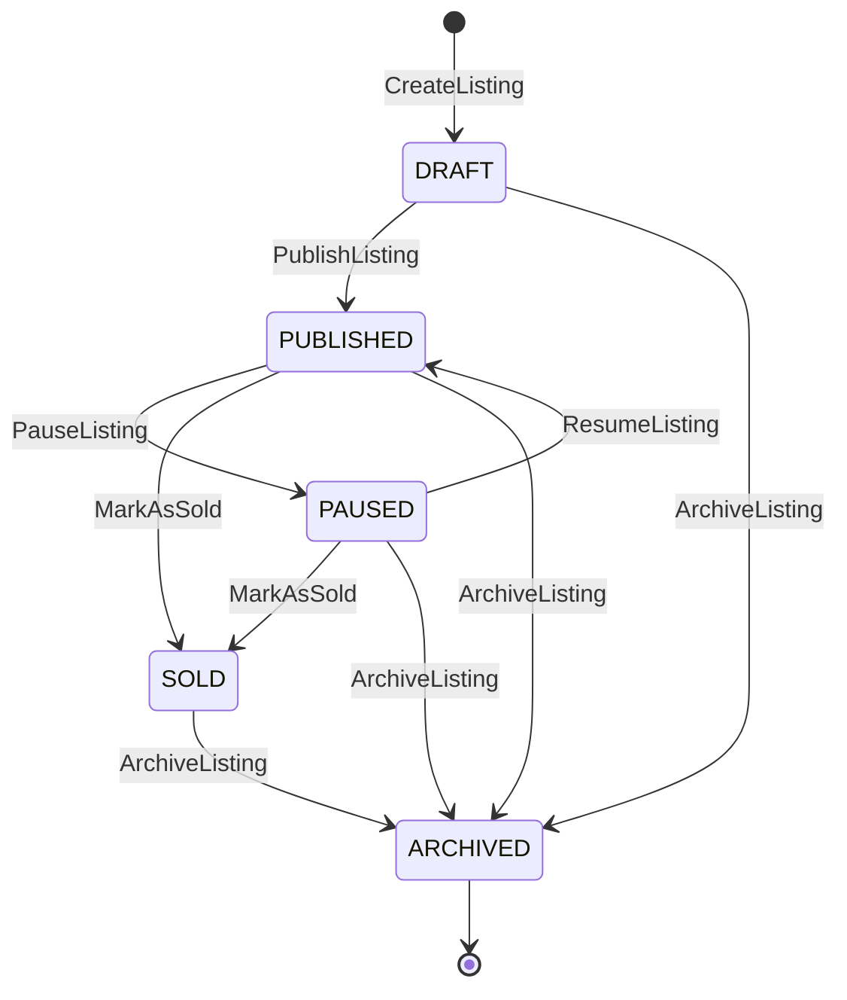
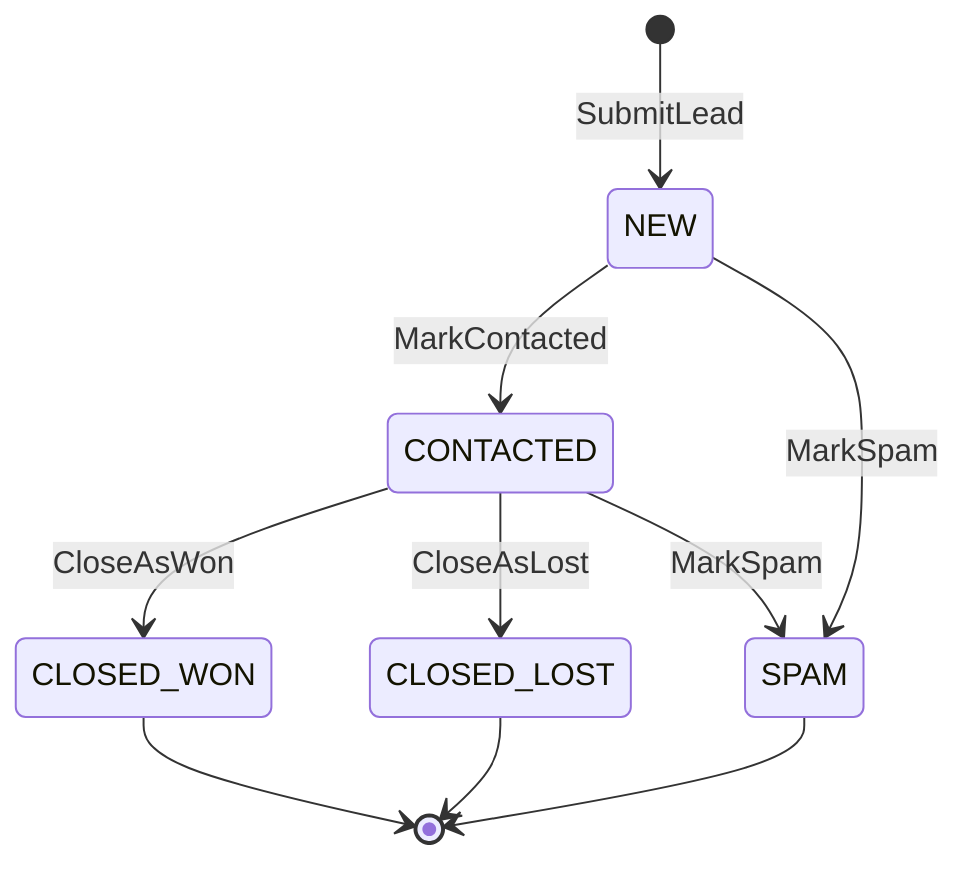
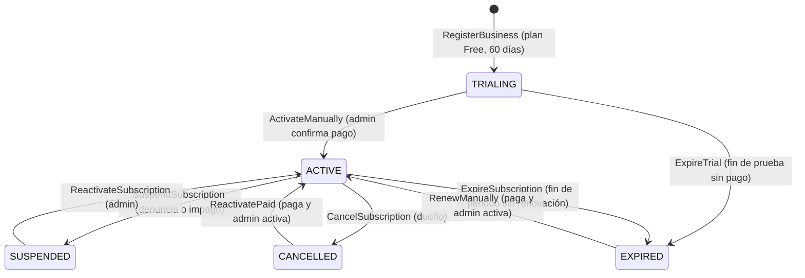

# 18. Matriz de transiciones de estado

**Fecha:** 2026-11-12 · **Estado:** PROPUESTA · **Relacionado:** [06](06-core-flows-and-state-machines.md) (flujos), [04](04-domain-overview.md) (invariantes), [16 §9](16-data-dictionary.md) (enums).

Toda transición descrita aquí es **ejecutada por un caso de uso** del backend, dentro de una transacción, y produce tres efectos consistentes: el cambio de estado, una entrada en `audit_entry` y —cuando corresponde— un `outbox_event`. Lo que no esté en esta matriz **no es una transición válida** y devuelve `INVALID_TRANSITION`.

**Actores:** `OWNER` (dueño del negocio, único miembro en el MVP), `MODERATOR`, `PLATFORM_ADMIN`, `FINANCE`, `SYSTEM` (job o worker del outbox), `ANONYMOUS` (comprador sin cuenta).

---

## 1. `Business`



| Desde | Evento | Actor | Precondición | Efecto | Evento emitido | Si falla |
|-------|--------|-------|--------------|--------|----------------|----------|
| — | `RegisterBusiness` | ANONYMOUS (futuro `OWNER`) | Email verificado; T&C aceptados (`accepted_terms_at`, `privacy_policy_version`); `city` válido; `slug` libre | Crea `business` en `APPROVED`, `business_membership` `OWNER`, `business_vertical` inicial, `subscription` Free en `TRIALING` | `business.registered` | `TERMS_NOT_ACCEPTED`, `SLUG_TAKEN`, `EMAIL_NOT_VERIFIED`; rollback completo |
| `APPROVED` | `SuspendBusiness` | `MODERATOR` | Existe `ModerationCase` resuelto con decisión `SUSPEND_BUSINESS`; `suspension_reason` no vacío | `status=SUSPENDED`; publicaciones dejan de ser visibles por `VisibilityPolicy`; **no** se tocan sus estados ni sus datos | `business.suspended` | `INVALID_TRANSITION` si ya `SUSPENDED`; `REASON_REQUIRED` |
| `SUSPENDED` | `ReactivateBusiness` | `MODERATOR` | El motivo quedó resuelto; nota de decisión | `status=APPROVED`; `suspended_reason` se conserva en el histórico de auditoría y se limpia en la fila | `business.reactivated` | `INVALID_TRANSITION` |
| `APPROVED` | `CloseBusiness` | `OWNER` | Sin obligaciones pendientes; confirmación explícita | `status=CLOSED`; publicaciones pasan a `ARCHIVED` con `archived_reason='BUSINESS_CLOSED'`; sesiones se mantienen para consulta | `business.closed` | `INVALID_TRANSITION` |
| `SUSPENDED` | `CloseBusiness` | `OWNER` | — | Igual que el anterior | `business.closed` | `INVALID_TRANSITION` |

**No existe** `PENDING_REVIEW`, `PENDING_VERIFICATION` ni `REJECTED` (Q-07). El alta nace `APPROVED`; el control es reactivo y se apoya en los T&C aceptados.

**Al cerrar:** los datos no se borran. `CLOSED` es terminal para la operación; el borrado lógico (`deleted_at`) y la retención se rigen por [20](20-data-retention-and-privacy.md).

---

## 2. `Listing`



| Desde | Evento | Actor | Precondición | Efecto | Evento emitido | Si falla |
|-------|--------|-------|--------------|--------|----------------|----------|
| — | `CreateListing` | `OWNER` | Vertical habilitada y activa; categoría de esa vertical; `price_amount > 0`; `condition_code` válido | Crea en `DRAFT`; `published_at` nulo | `listing.created` | `VERTICAL_NOT_ENABLED`, `CATEGORY_NOT_IN_VERTICAL`, `INVALID_PRICE` |
| `DRAFT` | `PublishListing` | `OWNER` | ≥ 1 imagen `READY` (máx. 5); atributos obligatorios completos y válidos; negocio `APPROVED`; suscripción `TRIALING`/`ACTIVE`; límite `max_active_listings` no alcanzado | `status=PUBLISHED`; `published_at=now()`; cuenta para el límite | `listing.published` | `MISSING_REQUIRED_ATTRIBUTES`, `NO_READY_MEDIA`, `PLAN_LIMIT_REACHED`, `BUSINESS_NOT_ACTIVE`, `SUBSCRIPTION_INACTIVE` |
| `PUBLISHED` | `PauseListing` | `OWNER` | — | `status=PAUSED`; sale del catálogo; **sigue contando** para el límite | `listing.paused` | `INVALID_TRANSITION` |
| `PAUSED` | `ResumeListing` | `OWNER` | Límite del plan disponible; suscripción vigente; imágenes y atributos siguen válidos | `status=PUBLISHED`; `published_at` se conserva (no se reescribe) | `listing.published` | `PLAN_LIMIT_REACHED`, `SUBSCRIPTION_INACTIVE` |
| `PUBLISHED` / `PAUSED` | `MarkAsSold` | `OWNER` | — | `status=SOLD`; `sold_at=now()`; sale del catálogo; deja de contar para el límite | `listing.sold` | `INVALID_TRANSITION` |
| `DRAFT` / `PUBLISHED` / `PAUSED` / `SOLD` | `ArchiveListing` | `OWNER` o `MODERATOR` | `OWNER`: sin restricción. `MODERATOR`: caso resuelto con `ARCHIVE_LISTING` | `status=ARCHIVED`; `archived_reason` = `MANUAL`, `MODERATION` o `EXPIRED` | `listing.archived` | `INVALID_TRANSITION`; `REASON_REQUIRED` para moderación |
| `PUBLISHED` | `ExpireListings` (job) | `SYSTEM` | `published_at < now() - 60 días` (valor **PROPUESTO**) | `status=ARCHIVED`; `archived_reason='EXPIRED'` | `listing.archived` | Reintento idempotente por lote; un fallo no bloquea el resto |

**Estados terminales:** `ARCHIVED` y `SOLD` (desde `SOLD` solo se puede archivar). No se permite volver a `DRAFT`: recrear exige una publicación nueva, lo que preserva la trazabilidad de leads y del historial.

**`ARCHIVED` y el límite:** una publicación archivada **no** cuenta para `max_active_listings`; `PUBLISHED` y `PAUSED` sí. Es la razón por la que pausar no libera cupo: el negocio podría tener 10 publicaciones pausadas ocupando los 10 cupos del plan Free y ninguna visible, lo que sería peor para él y para el catálogo. Se documenta como regla de producto y se refleja en la consulta de [15 §8.5](15-entity-relationship-model.md).

---

## 3. `Lead`



| Desde | Evento | Actor | Precondición | Efecto | Evento emitido | Si falla |
|-------|--------|-------|--------------|--------|----------------|----------|
| — | `SubmitLead` | ANONYMOUS | `consent_given=true`; email o teléfono válido; mensaje 10–2.000; publicación visible o negocio `APPROVED`; rate limit por IP y por negocio | Crea en `NEW`; `consent_at=now()`; `source=WEB_FORM` | `lead.submitted` | `CONSENT_REQUIRED`, `INVALID_CONTACT`, `RATE_LIMITED`, `LISTING_NOT_CONTACTABLE` |
| `NEW` | `MarkContacted` | `OWNER` | — | `status=CONTACTED`; `contacted_at=now()` (solo la primera vez) | `lead.contacted` | `INVALID_TRANSITION` |
| `NEW` / `CONTACTED` | `MarkSpam` | `OWNER` | — | `status=SPAM`; no cuenta en métricas de contacto | `lead.marked_spam` | `INVALID_TRANSITION` |
| `CONTACTED` | `CloseAsWon` | `OWNER` | — | `status=CLOSED_WON`; `closed_at=now()` | `lead.closed` | `INVALID_TRANSITION` |
| `CONTACTED` | `CloseAsLost` | `OWNER` | — | `status=CLOSED_LOST`; `closed_at=now()` | `lead.closed` | `INVALID_TRANSITION` |

**Inmutabilidad:** el contenido del lead (`name`, `email`, `phone_e164`, `message`, `consent_*`) no se actualiza nunca. `NEW → CLOSED_WON` directo **no** se permite: obliga a registrar el contacto, que es la métrica que justifica la suscripción.

---

## 4. `Subscription`

> **Decisión C-11.2 (APROBADA):** el MVP usa **cinco** estados — `TRIALING`, `ACTIVE`, `SUSPENDED`, `EXPIRED`, `CANCELLED`. No existe `PAST_DUE` (no hay cobro automático que pueda fallar) ni `PENDING_ACTIVATION` (la activación manual ocurre en **una sola transacción** cuando el admin confirma el pago, sin necesidad de una fila intermedia).



| Estado | Qué significa | Quién lo produce |
|--------|---------------|------------------|
| `TRIALING` | Periodo gratuito vigente (plan Free, 60 días) | `RegisterBusiness` (SYSTEM) |
| `ACTIVE` | Periodo pagado vigente; el negocio opera con los límites del plan. **Único estado que da visibilidad de pago** | `ActivateManually` (FINANCE/PLATFORM_ADMIN) |
| `SUSPENDED` | Suscripción bloqueada por decisión administrativa (denuncia o impago) | `SuspendSubscription` (staff) |
| `EXPIRED` | Terminó el periodo o la prueba sin renovación; conserva datos, pierde visibilidad | Job `ExpireSubscriptions` o acción de staff |
| `CANCELLED` | El dueño canceló; no se renueva | `CancelSubscription` (OWNER) |

| Desde | Evento | Actor | Precondición | Efecto | Evento emitido | Si falla |
|-------|--------|-------|--------------|--------|----------------|----------|
| — | `RegisterBusiness` | SYSTEM | Alta de negocio | Crea `subscription` Free, `TRIALING`, `trial_end = now() + 60 días`, `current_period_end = trial_end` | `subscription.trial_started` | Rollback del alta |
| `TRIALING` | `ActivateManually` | `FINANCE` / `PLATFORM_ADMIN` | Pago confirmado fuera del sistema; `activation_note` (5–500) | **Misma transacción:** `status=ACTIVE`, `activated_at`, `activated_by_admin_id`, `activation_note`, `current_period_start=now()`, `current_period_end = now() + interval_months`, `plan_id` = plan pagado; `trial_end` se conserva como historial | `subscription.activated` | `NOTE_REQUIRED`, `INVALID_TRANSITION` |
| `TRIALING` | `ExpireTrial` | SYSTEM (job) | `trial_end < now()` | `status=EXPIRED`; el negocio sigue existiendo; sus publicaciones se invisibilizan | `subscription.expired` | Reintento diario; idempotente por `status` |
| `ACTIVE` | `SuspendSubscription` | `FINANCE` / `PLATFORM_ADMIN` | `suspension_reason` no vacío | `status=SUSPENDED`; publicaciones intactas e invisibles | `subscription.suspended` | `REASON_REQUIRED` |
| `ACTIVE` | `ExpireSubscription` | SYSTEM (job) | `current_period_end < now() - gracia` (gracia **PROPUESTA**: 5 días) | `status=EXPIRED`; publicaciones invisibles por `VisibilityPolicy`; **no** se borra inventario | `subscription.expired` | Idempotente por `status` |
| `ACTIVE` | `CancelSubscription` | `OWNER` | — | `status=CANCELLED`; `cancelled_at`; acceso hasta `current_period_end` | `subscription.cancelled` | `INVALID_TRANSITION` |
| `SUSPENDED` | `ReactivateSubscription` | `FINANCE` / `PLATFORM_ADMIN` | Nota de reactivación | `status=ACTIVE`; conserva `current_period_end` | `subscription.reactivated` | `INVALID_TRANSITION` |
| `EXPIRED` | `RenewManually` | `FINANCE` / `PLATFORM_ADMIN` | Nota; pago confirmado | `status=ACTIVE`; `current_period_start=now()`, `current_period_end = now() + interval_months` | `subscription.renewed` | `NOTE_REQUIRED` |
| `CANCELLED` | `ReactivatePaid` | `FINANCE` / `PLATFORM_ADMIN` | Nota; pago confirmado | `status=ACTIVE`; nuevo periodo desde `now()` | `subscription.reactivated` | `NOTE_REQUIRED` |

### 4.1 Idempotencia de la activación manual (R-32)

Tres capas, en este orden:

1. **Constraint:** índice único parcial `(business_id) WHERE status IN ('TRIALING','ACTIVE')` impide dos suscripciones vivas.
2. **Transacción con bloqueo:** la transición de `TRIALING`/`EXPIRED`/`CANCELLED` a `ACTIVE` abre transacción, bloquea la fila del negocio y la de `subscription` (`SELECT ... FOR UPDATE`) y verifica el estado antes de escribir.
3. **Auditoría idempotente:** la clave de auditoría es `(action='subscription.activate', entity_id, period_start)`. Un doble clic no crea dos entradas ni dos periodos.

**Respuesta ante repetición:** si la suscripción ya está `ACTIVE` con el mismo `current_period_start`, se devuelve el estado actual con `200` y `alreadyApplied: true`. Si está `ACTIVE` con otro periodo, es una renovación y se trata como transición nueva (no como duplicado).

### 4.2 Qué pasa cuando vence, falla o se cancela

| Situación | Efecto sobre el negocio | Efecto sobre las publicaciones |
|-----------|-------------------------|-------------------------------|
| `EXPIRED` | Sigue pudiendo entrar al panel; no puede publicar nuevas hasta renovar | **No se borran ni se cambian de estado**; `VisibilityPolicy` las excluye del catálogo porque la suscripción no está vigente |
| `SUSPENDED` | Panel en modo lectura; sin publicación | Igual: invisibles, intactas |
| `CANCELLED` | Sale del catálogo al terminar el periodo pagado | Igual |
| Reactivación | Vuelve la visibilidad de las publicaciones que seguían `PUBLISHED` | Sin cambios de estado: la visibilidad es derivada |

**Decisión C-11.4 (APROBADA):** la visibilidad **nunca** se materializa en el estado de la publicación ni en el del negocio. El predicado del catálogo es:

```
business.status = 'APPROVED'
AND listing.status = 'PUBLISHED'
AND subscription.status IN ('TRIALING','ACTIVE')
```

Suspender o cerrar un negocio **no archiva en cascada** sus publicaciones: conservan su estado (`PUBLISHED`, `DRAFT`, `PAUSED`…) y solo se invisibilizan. El archivado en cascada existe únicamente como acción administrativa explícita al cerrar un negocio de forma definitiva (`CloseBusiness`, con confirmación y auditoría).

---

## 5. `ModerationCase` y `Report`

| Entidad | Desde | Evento | Actor | Precondición | Efecto | Evento |
|---------|-------|-------|-------|--------------|--------|--------|
| `Report` | — | `SubmitReport` | ANONYMOUS / `USER` | Objeto denunciado visible o existente; motivo válido; rate limit | `status=OPEN`; se asocia a un `ModerationCase` (se crea si no hay uno abierto para el objeto) | `report.submitted` |
| `Report` | `OPEN` | `TriageReport` | `MODERATOR` | — | `status=TRIAGED` | `report.triaged` |
| `Report` | `OPEN` / `TRIAGED` | `DismissReport` | `MODERATOR` | Nota | `status=DISMISSED` | `report.dismissed` |
| `Report` | `OPEN` / `TRIAGED` | `ActionReport` | `MODERATOR` | Decisión aplicada | `status=ACTIONED` | `report.actioned` |
| `ModerationCase` | — | `OpenCase` | SYSTEM (al recibir denuncia) | No hay caso abierto para el objeto | `status=OPEN`, `decision=NONE` | `moderation_case.opened` |
| `ModerationCase` | `OPEN` | `DecideCase` | `MODERATOR` | `decision ≠ NONE`; nota 5–500 | `status=RESOLVED`; `decided_by`, `decided_at`; aplica el efecto (`SUSPEND_BUSINESS` → `business.suspended`; `ARCHIVE_LISTING` → `listing.archived`) | `moderation_case.resolved` |
| `ModerationCase` | `OPEN` | `DismissCase` | `MODERATOR` | Nota | `status=DISMISSED`, `decision=NO_ACTION` | `moderation_case.dismissed` |

**Sin cola previa:** no existen transiciones de `PENDING_REVIEW → PUBLISHED` porque la publicación nunca pasa por revisión. La moderación solo actúa sobre objetos ya públicos.

---

## 6. Invariantes transversales

| # | Invariante | Dónde se garantiza |
|---|-----------|--------------------|
| INV-01 | Una publicación no cambia de negocio | Regla de agregado + ausencia de caso de uso |
| INV-02 | `PUBLISHED` exige `published_at` y al menos una imagen `READY` | `CHECK` de estado + validación transaccional |
| INV-03 | Un lead pertenece al negocio de su publicación | FK compuesta `(listing_id, business_id)` |
| INV-04 | Una sola suscripción vigente por negocio | Índice único parcial + transacción |
| INV-05 | `ACTIVE` por activación manual exige admin y nota | `CHECK` + caso de uso |
| INV-06 | Una publicación archivada no vuelve a `DRAFT` | Máquina de estados |
| INV-07 | Los eventos se escriben en la misma transacción del cambio | Outbox transaccional |
| INV-08 | Ningún estado cambia sin `audit_entry` | Caso de uso único; prueba por transición |

---

## 7. Errores de transición

| Código | HTTP | Cuándo |
|--------|:----:|--------|
| `INVALID_TRANSITION` | 409 | La transición no existe en esta matriz |
| `PLAN_LIMIT_REACHED` | 409 | Publicar o reanudar excede `max_active_listings` |
| `SUBSCRIPTION_INACTIVE` | 403 | El negocio no tiene suscripción vigente para publicar |
| `BUSINESS_NOT_ACTIVE` | 403 | Negocio `SUSPENDED`/`CLOSED` |
| `VERTICAL_NOT_ENABLED` | 403 | Vertical no habilitada para el negocio |
| `CATEGORY_NOT_IN_VERTICAL` | 422 | Categoría ajena a la vertical |
| `MISSING_REQUIRED_ATTRIBUTES` | 422 | Falta un atributo obligatorio |
| `NO_READY_MEDIA` | 422 | Publicar sin imagen procesada |
| `LISTING_NOT_CONTACTABLE` | 404 | Lead sobre publicación no visible o de otro negocio |
| `CONSENT_REQUIRED` | 422 | Lead sin consentimiento |
| `NOTE_REQUIRED` | 422 | Activación/renovación sin `activation_note` |
| `REASON_REQUIRED` | 422 | Suspensión/archivado por moderación sin motivo |
| `LAST_OWNER` | 409 | Se intenta dejar un negocio sin `OWNER` |
| `RATE_LIMITED` | 429 | Abuso del formulario |

---

## 8. Cierres de C-11 aplicados a esta matriz

| Decisión | Efecto |
|----------|--------|
| C-11.2 / C-01 | `Subscription` con **cinco** estados; `PENDING_ACTIVATION` y `PAST_DUE` eliminados; `TRIALING → ACTIVE` en una transacción (§4). |
| C-11.4 / D-14 | Sin cascada: `Business` `SUSPENDED`/`CLOSED` no cambia `listing.status`; la invisibilidad es un predicado (§5.2). |
| C-11.3 / D-13 | `condition_code` es un enum fijo, no una transición ni un atributo configurable de estado. |
| C-11.5 / D-16 | `moderation_case.decision` (`PENDING`/`RESOLVED_UPHELD`/`RESOLVED_DISMISSED`) sustituye a `status`; `REPORT` ya no se cierra en un estado intermedio. |
| C-02 (C-11) | `Listing` sin `EXPIRED`: el vencimiento es `ARCHIVED` con `archived_reason='EXPIRED'` (§3). |
