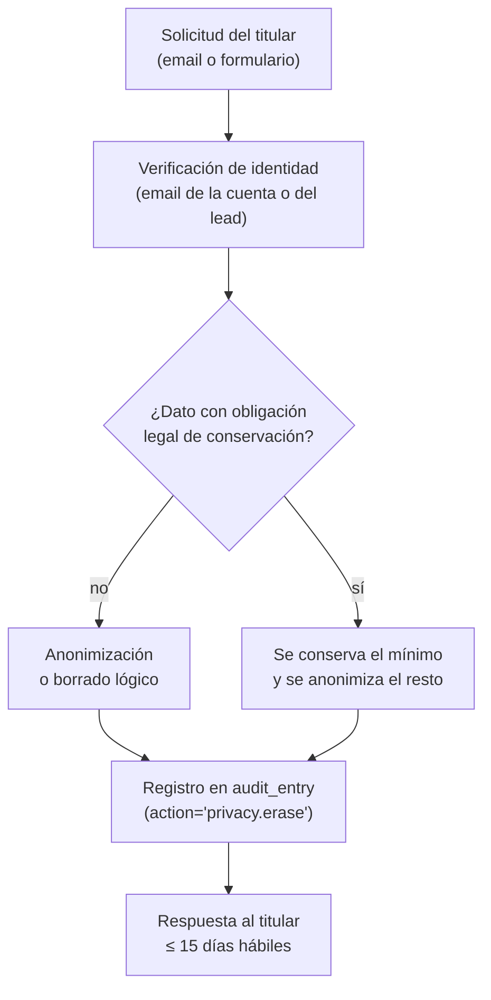

# 20. Retención, minimización y privacidad de datos

**Fecha:** 2026-11-12 · **Estado:** PROPUESTA · **Marco:** Ley 1581 de 2012 y decretos reglamentarios (Colombia), con las salvedades de [12 §8.1](12-risks-and-open-decisions.md) (L-01/L-02, C-10).

> **Aviso:** este documento describe **decisiones de diseño de datos**, no asesoría jurídica. Las plantillas de T&C y Política de Privacidad del MVP son estándar (C-10); una revisión legal formal es **PENDIENTE** antes de escalar el volumen o cambiar el modelo de cobro. Ver [12 §9](12-risks-and-open-decisions.md).

---

## 1. Principios

| # | Principio | Consecuencia en el modelo |
|---|-----------|---------------------------|
| P1 | **Minimización** | Solo se recolecta lo necesario para contactar y operar: nombre, email o teléfono, mensaje. Sin cédula, sin dirección del comprador, sin fecha de nacimiento |
| P2 | **Finalidad declarada** | Los datos de un lead existen para que **ese negocio** responda a **ese** contacto; no se usan para marketing de la plataforma |
| P3 | **Consentimiento informado y probado** | `lead.consent_given` obligatorio, `consent_text` con la versión exacta mostrada y `consent_at` |
| P4 | **Trazabilidad sin secretos** | `audit_entry` no guarda contraseñas, tokens, cuerpos completos de lead ni datos financieros |
| P5 | **Borrado con historia** | Los registros con historial se anonimizan o marcan con `deleted_at`; no se borran en cascada si eso destruye evidencia |
| P6 | **Retención declarada** | Cada tabla tiene un plazo (§4) y un mecanismo de purga o anonimización |
| P7 | **Transferencia internacional controlada** | Proveedores externos (Neon en São Paulo, Cloudflare R2, correo) se evalúan por ubicación y contrato; ver §8 |

---

## 2. Qué datos existen y por qué

| Categoría | Tablas | Necesidad | Sensibilidad |
|-----------|--------|-----------|--------------|
| Cuenta de usuario | `app_user`, `session`, tokens | Autenticar y proteger la cuenta | Alta (credenciales) |
| Identidad del negocio | `business`, `business_membership` | Perfil público, contacto comercial, responsables | Media |
| Inventario | `listing`, `listing_image`, `media_asset` | Publicar y mostrar artículos | Baja (contenido público) |
| Contacto de compradores | `lead` | Responder a una consulta concreta | **Alta** (dato personal de tercero) |
| Cobro | `subscription`, `plan` | Controlar vigencia y límites; sin datos de tarjeta | Media |
| Operación y seguridad | `audit_entry`, `outbox_event`, `report`, `moderation_case` | Trazabilidad, denuncias, antiabuso | Media-alta |

**No se recolecta ni almacena:** número de tarjeta, datos bancarios del comprador, cédula, geolocalización precisa, contactos del teléfono, identificadores publicitarios.

---

## 3. Consentimiento

### 3.1 En el alta del negocio

| Campo | Contenido |
|-------|-----------|
| `business.accepted_terms_at` | Fecha de aceptación de los T&C |
| `business.privacy_policy_version` | Versión del documento aceptado (`2026-11-12`) |

Se muestran dos casillas separadas (T&C y tratamiento de datos); no se permite el alta sin ambas. La versión se versiona en el repositorio (`legal/`), no en la base de datos.

### 3.2 En el formulario de contacto

| Campo | Contenido |
|-------|-----------|
| `lead.consent_given` | `true` obligatorio (`CHECK`) |
| `lead.consent_text` | Texto exacto mostrado, p. ej. "Autorizo a {negocio} a contactarme por este medio para responder a mi consulta. Entiendo que MarketCentral no participa en la compraventa." |
| `lead.consent_at` | Timestamp del envío |

**Finalidad limitada:** el consentimiento se otorga **al negocio**, no a la plataforma. El aviso lo dice explícitamente (L-01/L-02: el negocio es responsable del tratamiento de los datos de sus compradores).

**Sin consentimiento no hay lead.** No existe un modo "solo curiosear" que cree fila.

---

## 4. Retención por tabla

| Tabla | Retención | Al vencer | Justificación |
|-------|-----------|-----------|---------------|
| `app_user` | Mientras la cuenta exista + 30 días | Borrado lógico y anonimización del email | Permite reclamar la cuenta y evita suplantación |
| `session` | Hasta `expires_at` (30 días) | Borrado físico | Efímero |
| `password_reset_token` | 30 min o hasta uso | Borrado físico | Seguridad |
| `email_verification_token` | 24 h o hasta uso | Borrado físico | Seguridad |
| `business` | Mientras exista + 90 días tras `CLOSED` | `deleted_at` + anonimización de contacto | Historia comercial y auditoría |
| `business_membership` | Mientras exista el negocio | `REVOKED` (no se borra) | Trazabilidad de quién operó |
| `business_vertical` | Mientras exista el negocio | Borrado con el negocio | — |
| `listing` | Mientras exista el negocio; archivadas 24 meses | `deleted_at`; purga de imágenes a los 30 días | Historial de catálogo y reclamos |
| `media_asset` | Mientras esté referenciado + 30 días | Borrado del objeto en R2 y de la fila | Evita huérfanos y costo de storage |
| `listing_image` | Con la publicación | Borrado con la publicación | — |
| `lead` | **12 meses** desde `created_at` | Anonimización (`name`, `email`, `phone`, `message`) conservando estado y fechas | Ciclo comercial de una prendería; el negocio ya lo atendió o no |
| `subscription` | 5 años | Se conserva (historial contable manual) | Prueba de activaciones y notas |
| `plan` / `plan_entitlement` | Indefinido (versiones) | — | Referencia histórica |
| `report` | 24 meses | Anonimización de `details` y del denunciante | Antiabuso y evidencia |
| `moderation_case` | 5 años | Se conserva sin datos del denunciante | Decisiones administrativas |
| `audit_entry` | 24 meses | Purga por lotes | Trazabilidad operativa; ver §5 |
| `outbox_event` | 90 días tras `PUBLISHED` | Purga | Reintentos e idempotencia |
| Logs de aplicación | 30 días | Rotación | Diagnóstico |
| Respaldos lógicos | 12 semanas | Rotación | Recuperación (ADR-006 §2.5) |

**Regla de coherencia:** ningún plazo de retención puede ser menor que el necesario para atender una reclamación abierta; si existe una denuncia o disputa en curso, los registros implicados se congelan hasta su cierre.

---

## 5. Auditoría sin datos personales innecesarios

| Regla | Detalle |
|-------|---------|
| Campos permitidos en `before`/`after` | Identificadores, estados, fechas, montos, notas de decisión |
| Campos prohibidos | `password_hash`, tokens, `token_hash`, `consent_text` completo, `message` del lead, `whatsapp_e164` completo, IP en claro |
| IP | Solo `ip_hash` con HMAC y pepper del servidor |
| Actor | `actor_id` (UUID) sin email ni nombre |
| Consulta de auditoría | Solo `PLATFORM_ADMIN` y `SUPPORT` con motivo; la consulta misma deja rastro |
| Retención | 24 meses; luego se conservan solo agregados (conteo por acción y mes) |

---

## 6. Eventos y outbox

`outbox_event.payload` se diseña con **referencias, no contenido**:

| Evento | Incluye | No incluye |
|--------|---------|------------|
| `listing.published` | `listingId`, `businessId`, `verticalId`, `categoryId`, `priceAmount`, `publishedAt` | `description`, `attributes` completos, imágenes |
| `lead.submitted` | `leadId`, `businessId`, `listingId?`, `source`, `createdAt` | `name`, `email`, `phone`, `message` |
| `subscription.activated` | `subscriptionId`, `businessId`, `planId`, `periodStart`, `periodEnd`, `activatedByAdminId` | Nota completa (solo su longitud o un hash si se requiere) |
| `business.registered` | `businessId`, `city`, `createdAt` | Datos de contacto |

**Motivo:** un evento puede viajar a un sistema externo (n8n en fase 2) y quedar retenido allí; si lleva datos personales, se duplica la superficie de tratamiento y de borrado. El consumidor que necesite el detalle lo consulta por API con autorización, no lo recibe en el evento.

---

## 7. Borrado, anonimización y derechos del titular

### 7.1 Procedimiento

| Derecho | Cómo se atiende en el modelo |
|---------|------------------------------|
| Acceso | Exportación de los datos del usuario y de sus leads (solo el negocio ve los suyos) |
| Rectificación | Edición de `app_user` y `business`; el lead **no** se rectifica (contenido original inmutable): se anota la corrección en `audit_entry` |
| Supresión | Anonimización de `lead` y `app_user`; el negocio no puede borrar leads que ya generaron historial, pero puede anonimizarlos a solicitud del titular |
| Oposición | El comprador puede pedir que no se le contacte más: se marca `lead.status='SPAM'` o se anonimiza |
| Portabilidad | Exportación JSON de los datos propios (fase 2 si el volumen lo exige) |

### 7.2 Anonimización del lead

Se reemplazan `name`, `email`, `phone_e164` y `message` por valores no identificables, conservando `business_id`, `listing_id`, `status`, `created_at`, `contacted_at`, `closed_at` y `consent_at`. Así se mantienen las métricas del negocio sin conservar dato personal.

**Irreversibilidad:** la anonimización es definitiva; no hay copia de respaldo recuperable a nivel de fila (los respaldos rotan en 12 semanas).

---

## 8. Proveedores y transferencia internacional

| Proveedor | Función | Ubicación | Dato expuesto | Estado |
|-----------|---------|-----------|---------------|--------|
| Neon | PostgreSQL | `aws-sa-east-1` (São Paulo, Brasil) | Todos los datos de negocio | **APROBADA** ([ADR-006](decisions/ADR-006-production-database-provider.md)) |
| Cloudflare R2 | Objetos (imágenes) | Región configurable del bucket | Imágenes de publicaciones (públicas por diseño) | **PROPUESTA** |
| Proveedor de correo | Transaccional | Por definir | Email del usuario, enlaces de verificación | **PENDIENTE** (Q-20) |
| Hosting de `web`/`api` | Cómputo | Por definir | Tráfico y datos en memoria | **PENDIENTE** (Q-21) |

**Transferencia internacional:** Brasil es el destino de la base de datos. La Ley 1581 exige declarar y, en su caso, informar la transferencia; el nivel de protección se sustenta en el contrato con el proveedor. **Validación legal PENDIENTE** (L-01). Mitigación de diseño: los datos personales son mínimos (nombre, contacto, mensaje) y las imágenes no contienen datos personales por diseño del producto (se prohíbe subir documentos de identidad; se avisa en T&C).

**Encargados:** el negocio es responsable de los datos de sus compradores; la plataforma actúa como encargado. Esa relación debe quedar escrita en los T&C y en la Política de Privacidad (L-02).

---

## 9. Seguridad de los datos en reposo y en tránsito

| Control | Detalle |
|---------|---------|
| Tránsito | TLS obligatorio en `web`, `api`, base de datos y R2; HSTS en producción |
| Reposo (BD) | Cifrado del proveedor (Neon cifra el volumen) + respaldos cifrados con clave propia antes de subir a R2 |
| Reposo (objetos) | SSE de R2; URLs firmadas de corta duración para contenido no público |
| Secretos | Variables de entorno por entorno; nunca en el repositorio; rotación documentada en [07 §7](07-security-and-multitenancy.md) |
| Acceso a producción | Cuentas nominales, MFA, principio de menor privilegio; sin acceso directo a la BD desde `web` |
| Registros | Sin PII; `requestId` para correlación |

---

## 10. Respaldos y su relación con la privacidad

| Aspecto | Decisión |
|---------|----------|
| Contenido | Respaldo lógico semanal (`pg_dump`) cifrado antes de salir del entorno |
| Retención | 12 semanas ([ADR-006 §2.5](decisions/ADR-006-production-database-provider.md)) |
| Restauración | Trimestral, verificada y registrada |
| Borrado en respaldos | Un dato anonimizado puede seguir en un respaldo hasta que rote; se documenta en la Política de Privacidad y se acepta como riesgo residual |
| Objetos | R2 no está incluido en el respaldo de la BD; la pérdida del bucket exige re-subida (las imágenes no son recuperables desde la BD) |

---

## 11. Riesgos de privacidad

| # | Riesgo | Impacto | Mitigación |
|---|--------|---------|------------|
| PR-01 | El negocio usa los datos del lead para fines distintos | Alto | T&C que lo prohíben; consentimiento dirigido al negocio; retención de 12 meses |
| PR-02 | Lead con datos sensibles escritos en el mensaje libre | Medio | Aviso en el formulario; no se indexa ni se envía en eventos; anonimización |
| PR-03 | Transferencia internacional no declarada | Alto | Revisión legal antes del lanzamiento; cláusulas con el proveedor |
| PR-04 | Datos en respaldos tras una solicitud de supresión | Medio | Ventana de 12 semanas declarada; cifrado y acceso restringido |
| PR-05 | Acceso indebido de soporte a leads | Alto | 404/403 por defecto; acceso solo con motivo y auditoría de la consulta |
| PR-06 | Imágenes con documentos de identidad | Medio | Prohibición en T&C + moderación reactiva + rechazo en revisión manual si se detecta |
| PR-07 | Enumeración de negocios o leads por IDs | Bajo | UUID v7; 404 en lugar de 403; rate limit |

---

## 12. Checklist antes de producción

- [ ] T&C y Política de Privacidad publicadas con versión `2026-11-12` y enlazadas desde el alta y el formulario.
- [ ] Doble casilla de consentimiento en el alta del negocio; una casilla en el lead.
- [ ] `consent_text` guardado exactamente como se mostró.
- [ ] Anonimización de lead implementada y probada (job manual en el MVP).
- [ ] Job de purga de sesiones, tokens y media huérfana.
- [ ] Respaldo semanal cifrado + restauración probada una vez.
- [ ] Registro de la transferencia internacional a Brasil en la documentación de privacidad.
- [ ] Revisión legal formal (PENDIENTE) antes de superar 50 negocios o introducir cobros automáticos.
