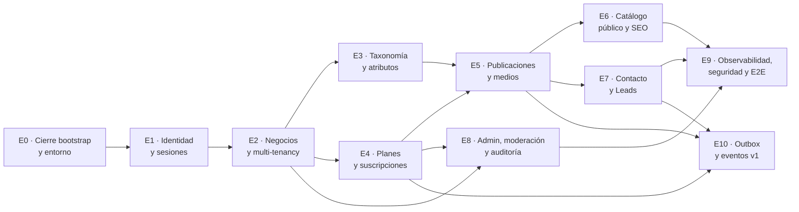

# 22 — Roadmap de implementación del MVP

- **Estado:** APROBADO (C-13, 2026-11-12: plan, orden E4→E5 y 60 historias)
- **Fecha:** 2026-11-12
- **Rol:** Engineering Manager + Arquitecto de Software
- **Alcance:** planificación. Este documento no crea código, `schema.prisma` ni migraciones.
- **Documentos de referencia:** `docs/01`–`21` y `docs/decisions/ADR-001`–`ADR-011`.

---

## 0. Cómo leer este documento

Cada historia es una unidad de trabajo de **1–2 días** para un desarrollador (o un agente de código),
con contrato de API, reglas citadas, pruebas y criterios de aceptación verificables. Las historias no
describen implementación: describen **qué** debe existir y **cómo se comprueba**.

Convenciones:

- `E<n>-H<m>` identifica historia; `E<n>` identifica épica.
- **Clasificación:** `MVP-CORE` (sin esto no hay MVP), `MVP-OPCIONAL` (mejora dentro del MVP, se puede
  posponer sin romper el flujo), `POST-MVP` (no se implementa en esta etapa; aparece solo para dejar
  trazabilidad y evitar que se cuele por la puerta de atrás).
- **Reglas** citan documentos (`docs/04 §7 R-16`) o ADR (`ADR-010`). Una historia sin respaldo
  documental se marca **PENDIENTE** y queda en §11, no en el plan aprobado.
- Los días son estimaciones de esfuerzo de un desarrollador con el stack ya aprendido; no incluyen
  revisión, despliegue ni reuniones.

---

## 1. Estado de partida (verificado el 2026-11-12)

| Área | Estado real |
| ---- | ----------- |
| Documentación | `docs/01`–`21` + `docs/decisions/ADR-001`–`011` + `README` de docs. 23 archivos antes de este. |
| Monorepo | pnpm 12 + Turborepo 2.11.11; `apps/web` (Next 16.4.6), `apps/api` (NestJS 12.5.0 ESM), 4 paquetes. |
| Calidad | `pnpm build` 5/5, `pnpm check` limpio, `pnpm test` 3/3 (1 API + 2 web). |
| Base de datos | PostgreSQL 18.6 (`postgres:18.6-bookworm`) en Docker Compose, volumen persistente, healthcheck. |
| Prisma | CLI y client fijados en 7.10.1. **No existe `schema.prisma`** ni migraciones. |
| Restricciones activas | Sin `apps/worker` (ADR-001 Opción B); sin pasarela de pago (C-10, Q-06); sin moderación previa (Q-07); sin RLS (ADR-003); n8n fuera del MVP operativo (ADR-007). |
| Workarounds | `apps/web/next.config.ts` ya no contiene `ignoreBuildErrors`, `resolveAlias` ni `experimental.cpus/workerThreads`; solo queda un comentario de cabecera. **No se pueden reintroducir** (regla 8 y DoD 5). |

### 1.1 Inconsistencias de estado detectadas (cerradas en C-13)

Al crear el roadmap, el encargo fijaba ADR-008 y ADR-010 como APROBADOS y el encabezado de los archivos decía otra cosa:

| Documento | Estado en el archivo (al crear el roadmap) | Estado que asumía el encargo | Cierre |
| --------- | ----------------------------------------- | ---------------------------- | ------ |
| `ADR-008-domain-data-model.md` | `PROPUESTA` | APROBADO | **APROBADA** (C-13) |
| `ADR-009-dynamic-listing-attributes.md` | `PROPUESTA` | «APROBADO o PROPUESTA — verificar» | **APROBADA** (C-13) |
| `ADR-010-subscriptions-and-entitlements.md` | APROBADA en estados/constraint/idempotencia; resto PROPUESTA | APROBADO | **APROBADA** en su totalidad (C-14) |
| `ADR-011-bootstrap-versions.md` | «APROBADA con verificación pendiente en entorno real» | C-12 completado en entorno real | **APROBADA** (C-13) |

El 2026-11-12 (C-13) el humano aprobó el roadmap y cerró D-19 y D-20: los tres ADR quedaron en
APROBADA y este documento ya no asume ninguna etiqueta provisional.

---

## 2. Principios del plan

1. **Una épica = varios PR pequeños.** Ninguna épica se entrega como un PR único; el mínimo son las
   historias listadas (regla 9).
2. **Vertical slices.** Cada historia deja un camino ejecutable de punta a punta (esquema → caso de
   uso → endpoint → prueba), no una capa horizontal sin uso.
3. **La base de datos no se adelanta al dominio.** La migración de una entidad entra con la historia
   que la usa, no antes. `schema.prisma` completo no se escribe de golpe (ADR-008 §6).
4. **Aislamiento por defecto.** Todo endpoint privado pasa por el guard multi-tenant y por un
   repositorio con `business_id` inyectado (docs/17, ADR-003). Una historia que no pueda cumplirlo es
   PENDIENTE.
5. **Sin deuda de calidad.** Una historia con `ignoreBuildErrors`, `any` sin justificar, TODO sin
   ticket o test desactivado no está Done (DoD global).
6. **Lo que no está aprobado, no se construye.** Si aparece un vacío, se documenta en §11 y se sigue
   con el supuesto más conservador.

---

## 3. Orden de épicas y justificación

El orden propuesto por el encargo era: 0 bootstrap, 1 identidad, 2 negocios, 3 taxonomía, 4
publicaciones, 5 catálogo, 6 leads, 7 suscripciones, 8 admin, 9 observabilidad, 10 n8n.

**Cambio aplicado: Suscripciones pasa a E4 y Publicaciones a E5.** Motivos:

1. **Los límites por plan son una precondición de publicación**, no un añadido. `PublishListing`
   necesita `PlanEntitlement` (publicaciones activas, imágenes) y `VisibilityPolicy` necesita el
   estado de la suscripción. Construir Listings primero obligaría a inventar un puerto temporal y a
   reescribir la regla en E7 (retrabajo en la historia más sensible del producto).
2. **El plan Free se asigna al crear el negocio** (`TRIALING`, 60 días). Si E2 crea negocios sin
   suscripción, quedarían negocios invisibles por falta de una fila que aún no existe. Con
   Subscriptions antes, `CreateBusiness` puede crear la suscripción Free en la misma transacción.
3. **El catálogo público (E6) depende de ambos**, así que el orden relativo entre E4 y E5 solo afecta
   al retrabajo, no a la posibilidad de paralelizar: E4 puede ejecutarse en paralelo con E3.

Orden final y dependencias:

---

## 4. Resumen de épicas

| Épica | Nombre | Clasificación | Historias | Días est. |
| ----- | ------ | ------------- | --------- | --------- |
| E0 | Cierre del bootstrap y entorno de producción | MVP-CORE | 5 | 5 |
| E1 | Identidad, autenticación y sesiones | MVP-CORE | 6 | 9 |
| E2 | Negocios, membresías y multi-tenancy | MVP-CORE | 5 | 7 |
| E3 | Taxonomía y atributos configurables | MVP-CORE | 5 | 7 |
| E4 | Planes, suscripciones y cobro manual | MVP-CORE | 6 | 9 |
| E5 | Publicaciones, medios y estados | MVP-CORE | 7 | 11 |
| E6 | Marketplace público, SEO y responsive | MVP-CORE | 6 | 9 |
| E7 | Contacto y Leads | MVP-CORE | 5 | 7 |
| E8 | Administración, moderación reactiva y auditoría | MVP-CORE | 5 | 7 |
| E9 | Observabilidad, seguridad reforzada y E2E | MVP-CORE | 6 | 8 |
| E10 | Outbox, eventos v1 y preparación de n8n | MVP-OPCIONAL | 4 | 6 |
| **Total** | | | **60** | **85** |

Lectura: 85 días de desarrollo efectivo ≈ **17 semanas** con un desarrollador; con dos perfiles
paralelizables (backend y frontend) el camino crítico baja a ~11–12 semanas (§5 de `docs/23`).

---

## 5. Definición global de Done

Aplicable a **toda** historia, además de sus criterios propios:

1. `pnpm build` compila (5/5 tareas).
2. `pnpm check` pasa (lint + typecheck + `format:check`).
3. `pnpm test` pasa (unitarias + integración del módulo tocado).
4. Tiene prueba E2E si toca flujo público o de negocio (catálogo, publicación, lead, suscripción).
5. No introduce workarounds en `next.config.ts` ni `ignoreBuildErrors`.
6. No modifica `docs/01`–`21` ni `ADR-001`–`011` sin justificación explícita en el PR.
7. La documentación del módulo (docstring y `README` si aplica) refleja el comportamiento.
8. El endpoint nuevo aparece en `/api/docs` (Swagger) con sus códigos de respuesta.
9. No se loguean PII, tokens ni contraseñas (docs/07 §10, docs/20 §5).
10. No hay TODO sin ticket asociado en el código nuevo.

**Puerta de épica.** Al cerrar cada épica se entrega: historias y estado (Done / En curso / Bloqueada),
cobertura de pruebas de la épica, decisiones pendientes surgidas, actualización del diagrama de
dependencias si cambió, y confirmación de que la siguiente épica puede arrancar sin deuda bloqueante.

---

## 6. Épicas e historias

### E0 — Cierre del bootstrap y entorno de producción

Objetivo: dejar el repositorio listo para trabajo incremental y el entorno de producción decidido y
documentado, sin tocar código de producto. El bootstrap técnico ya está verificado; esta épica cierra
lo que quedó fuera por restricciones del entorno de sesión.

| ID | Historia | Clasif. | Días |
| -- | -------- | ------- | ---- |
| E0-H1 | Registro de la verificación en entorno real | MVP-CORE | 1 |
| E0-H2 | Repositorio Git e higiene de ramas | MVP-CORE | 1 |
| E0-H3 | Proyecto Neon Free `aws-sa-east-1` y cadenas de conexión | MVP-CORE | 1 |
| E0-H4 | Variables de entorno por ambiente y gestión de secretos | MVP-CORE | 1 |
| E0-H5 | PostgreSQL local reproducible y `pnpm db:*` | MVP-CORE | 1 |

#### E0-H1 — Registro de la verificación en entorno real

> **Estado (2026-11-12): parcialmente adelantada por C-13.** La verificación se ejecutó, los tres
> workarounds se eliminaron y `ADR-011` ya está en **APROBADA**. Lo que queda de esta historia es
> solo (i) `pnpm install --frozen-lockfile` con pnpm 12 y (ii) regenerar el lockfile con pnpm 12; el
> resto de la aceptación está cumplido.

- **Objetivo:** dejar constancia de que `next.config.ts` funciona sin los tres workarounds y cerrar
  el estado documental del bootstrap.
- **Alcance:** incluye ejecutar y registrar build/check/test sin workarounds, y actualizar la fila de
  estado de `docs/21` §6.4 y `ADR-011` de «verificación pendiente» a APROBADA. **No incluye** cambios
  de código.
- **Módulos y archivos:** `docs/21-bootstrap-versions.md`, `docs/decisions/ADR-011-bootstrap-versions.md`.
- **Reglas:** ADR-011 §6; `docs/21` §6.4.
- **Permisos:** no aplica (documental).
- **API:** no aplica.
- **Datos/migraciones:** no.
- **Pruebas:** ejecución real de `pnpm build`, `pnpm check`, `pnpm test` en un entorno con
  `%LOCALAPPDATA%` escribible y pnpm 12.
- **Aceptación:** (a) `pnpm install --frozen-lockfile` con pnpm 12 termina sin error; (b) build 5/5 sin
  los tres bloques; (c) el lockfile queda regenerado con pnpm 12; (d) `docs/21` §6.4 y ADR-011
  registran la fecha, el SO y el resultado.
- **Riesgos/reversión:** si el build falla, se documenta el workaround necesario **con TODO** y no se
  declara cerrado. Reversión: `git revert` del commit documental.
- **Depende de:** —

#### E0-H2 — Repositorio Git e higiene de ramas

- **Objetivo:** inicializar Git con una política de ramas y commits que soporte el trabajo por historia.
- **Alcance:** incluye `git init`, rama `main`, `.gitignore` revisado, `.gitattributes` para LF,
  convención `feat/E<epica>-H<historia>-slug`, plantilla de PR con la checklist de DoD. **No incluye**
  CI todavía.
- **Módulos y archivos:** `.gitignore`, `.gitattributes`, `.github/pull_request_template.md`.
- **Reglas:** `docs/03` §6.4 (pipeline Turborepo); DoD global.
- **Permisos:** no aplica.
- **API:** no aplica.
- **Datos/migraciones:** no.
- **Pruebas:** `git status` limpio tras commit inicial; una rama de prueba creada y borrada.
- **Aceptación:** (a) `main` contiene el bootstrap y `docs/`; (b) `.tools/`, `.cache/`, `.env` no están
  versionados; (c) la plantilla de PR incluye los 10 puntos del DoD; (d) `git config core.autocrlf`
  documentado.
- **Riesgos/reversión:** commits con archivos grandes o secretos; se revisa `.gitignore` **antes** del
  primer commit. Reversión: borrar `.git` mientras el repo sea local.
- **Depende de:** —

#### E0-H3 — Proyecto Neon Free `aws-sa-east-1` y cadenas de conexión

- **Objetivo:** provisionar el PostgreSQL administrado del MVP y documentar las dos cadenas de conexión.
- **Alcance:** incluye crear el proyecto en la región São Paulo, la base `marketcentral`, el rol de
  aplicación, `DATABASE_URL` (pooled) y `DATABASE_URL_UNPOOLED` (directa), y verificar `psql` contra
  ambas. **No incluye** migraciones ni datos.
- **Módulos y archivos:** `.env.example`, `docs/21` (anexo de entornos), `README.md`.
- **Reglas:** ADR-006 §2.1–§2.3; `docs/10` §7.
- **Permisos:** cuenta de Neon del propietario del proyecto (humano).
- **API:** no aplica.
- **Datos/migraciones:** no.
- **Pruebas:** `SELECT version(), current_database()` por las dos cadenas; `uuidv7()` y `pg_trgm`
  disponibles (`CREATE EXTENSION IF NOT EXISTS pg_trgm`).
- **Aceptación:** (a) región = `aws-sa-east-1`; (b) pooled llega con `-pooler`; (c) `uuidv7()` devuelve
  un UUID v7; (d) las cadenas están en el gestor de secretos, no en el repo; (e) versión exacta de
  PostgreSQL anotada en `docs/21` (la define Neon).
- **Riesgos/reversión:** elegir mal la región obliga a recrear el proyecto (no se puede cambiar);
  se verifica antes de crear datos. Reversión: borrar el proyecto y repetir.
- **Depende de:** —

#### E0-H4 — Variables de entorno por ambiente y gestión de secretos

- **Objetivo:** un único contrato de variables, validado al arrancar, con separación local/producción.
- **Alcance:** incluye `.env.example` completo y comentado, validación estricta ya existente en API y
  web ampliada con las variables nuevas (`DATABASE_URL`, `DATABASE_URL_UNPOOLED`, `R2_*`, `MAIL_*`),
  y la regla de que producción no arranca con valores por defecto. **No incluye** proveedor de secretos
  gestionado (PENDIENTE, §11 D-21).
- **Módulos y archivos:** `apps/api/src/config/env.validation.ts`, `apps/web/src/lib/env.ts`,
  `.env.example`, `README.md`.
- **Reglas:** `docs/07` §9 (secretos y separación de entornos); `docs/03` §10.
- **Permisos:** no aplica.
- **API:** no aplica.
- **Datos/migraciones:** no.
- **Pruebas:** unitarias de `validateEnv` para cada variable obligatoria y para el rechazo de `*` en
  CORS en producción; arranque con `.env.example` incompleto debe fallar con mensaje explícito.
- **Aceptación:** (a) falta una variable obligatoria → proceso no arranca y dice cuál; (b) ninguna
  variable sensible tiene valor por defecto en producción; (c) `.env.example` lista las 12 variables
  con su propósito y un valor ficticio; (d) `NODE_ENV=production` con `http://` en una URL pública
  falla.
- **Riesgos/reversión:** bloquear el arranque por una variable opcional; se distingue obligatoria de
  opcional en el esquema. Reversión: `git revert`.
- **Depende de:** E0-H3.

#### E0-H5 — PostgreSQL local reproducible y `pnpm db:*`

- **Objetivo:** que cualquier persona levante la base local con un comando y sepa cuándo está sana.
- **Alcance:** incluye `docker compose up -d` verificado, healthcheck comprobado, scripts `db:up`,
  `db:down`, `db:reset` (borra volumen, solo local) y `db:logs`, y documentación del puerto 5432.
  **No incluye** migraciones ni seeds.
- **Módulos y archivos:** `infrastructure/docker/docker-compose.yml`, `package.json`, `README.md`.
- **Reglas:** ADR-005; `docs/10` §6.3.
- **Permisos:** Docker local del desarrollador.
- **API:** no aplica.
- **Datos/migraciones:** no (el volumen existe, el esquema todavía no).
- **Pruebas:** `pnpm db:up` → `pg_isready` responde `accepting connections`; `pnpm db:down` deja de
  responder; `db:reset` recrea el volumen vacío.
- **Aceptación:** (a) healthcheck en estado `healthy`; (b) volumen `marketcentral_pgdata` persiste tras
  `down/up`; (c) `db:reset` advierte que borra datos; (d) el `README` explica el puerto y el nombre de
  la base.
- **Riesgos/reversión:** `db:reset` ejecutado contra una base remota; el script valida que
  `DATABASE_URL` apunte a `localhost` antes de borrar.
- **Depende de:** E0-H2.

---

### E1 — Identidad, autenticación y sesiones

Objetivo: usuarios reales con sesión server-side, contraseñas Argon2id y recuperación de cuenta, con
las pruebas negativas que exige `docs/07`.

| ID | Historia | Clasif. | Días |
| -- | -------- | ------- | ---- |
| E1-H1 | Esquema `app_user` y política de contraseñas | MVP-CORE | 1,5 |
| E1-H2 | Registro y verificación de correo | MVP-CORE | 2 |
| E1-H3 | Inicio y cierre de sesión con cookie opaca | MVP-CORE | 1,5 |
| E1-H4 | Recuperación de contraseña | MVP-CORE | 1,5 |
| E1-H5 | Rate limiting y bloqueo de credenciales | MVP-CORE | 1 |
| E1-H6 | Puerto de correo y adaptador de desarrollo | MVP-CORE | 1,5 |

#### E1-H1 — Esquema `app_user` y política de contraseñas

- **Objetivo:** persistir identidades con email único normalizado y hash Argon2id.
- **Alcance:** incluye `app_user` (`id uuidv7`, `email citext unique`, `password_hash`, `name`,
  `phone`, `email_verified_at`, `status`, timestamps, `deleted_at`), el `PasswordHasher` de dominio y su
  adaptador Argon2id con parámetros OWASP. **No incluye** registro HTTP (E1-H2) ni roles de plataforma
  (E8-H3).
- **Módulos y archivos:** `apps/api/prisma/schema.prisma` (solo `app_user`),
  `apps/api/src/modules/identity/**`, migración `init_app_user`.
- **Reglas:** `docs/16` §`app_user`; `docs/07` §3 (Argon2id m=19456 KiB, t=2, p=1); `docs/19` §1 (PK
  `uuidv7()`); ADR-008.
- **Permisos:** no aplica (interno).
- **API:** no expone endpoints todavía.
- **Datos/migraciones:** **sí** — tabla `app_user`, extensión `citext`, índice único de email.
- **Pruebas:** unitarias del puerto (hash distinto por salt, verificación correcta/incorrecta);
  integración (email duplicado → violación de único; `deleted_at` no rompe el único).
- **Aceptación:** (a) dos hashes del mismo password difieren; (b) `password_hash` nunca aparece en
  logs; (c) la migración corre con `prisma migrate dev` y se revierte en local; (d) `id` se genera en
  base con `uuidv7()`.
- **Riesgos/reversión:** parámetros de Argon2 demasiado altos en CI lento; se mide el tiempo de hash
  (< 1 s, docs/07) y se ajusta memoria antes de merges. Reversión: migración `down` + eliminar tabla.
- **Depende de:** E0-H4, E0-H5.

#### E1-H2 — Registro y verificación de correo

- **Objetivo:** alta de usuario con correo verificado por token de un solo uso.
- **Alcance:** incluye `POST /auth/register`, `EmailVerificationToken` (hash del token, `expires_at`,
  `used_at`), `POST /auth/verify-email`, reenvío con límite, y el guard que impide publicar sin correo
  verificado (se aplica en E2). **No incluye** login (E1-H3) ni captcha (E1-H5).
- **Módulos y archivos:** `apps/api/src/modules/identity/application/register-user.use-case.ts`,
  `.../verify-email.use-case.ts`, `.../infrastructure/**`, `apps/api/prisma/schema.prisma`
  (`email_verification_token`), migración.
- **Reglas:** `docs/06` §3; `docs/07` §4 (token opaco hasheado, ventana de 24 h); `docs/16`.
- **Permisos:** público; el token identifica al usuario.
- **API:** `POST /auth/register` → `201` \| `400` (validación) \| `409` (email existente) \| `429`;
  `POST /auth/verify-email` → `204` \| `400` (token inválido/expirado/usado) \| `410`; `POST
  /auth/verify-email/resend` → `202` \| `429`. Auth: no.
- **Datos/migraciones:** **sí** — `email_verification_token`.
- **Pruebas:** unitarias (normalización de email, token expirado, reutilización); integración (registro
  → token en outbox de correo → verificación → `email_verified_at`); E2E (registro y verificación con
  correo simulado).
- **Aceptación:** (a) el token en claro nunca se persiste; (b) reutilizar el token devuelve `410`;
  (c) el registro con email existente no revela si la cuenta está verificada; (d) la respuesta no
  incluye el hash ni el token.
- **Riesgos/reversión:** enumeración de cuentas por temporización; respuesta constante y test de
  tiempos. Reversión: migración `down`.
- **Depende de:** E1-H1, E1-H6.

#### E1-H3 — Inicio y cierre de sesión con cookie opaca

- **Objetivo:** sesión server-side con token opaco, cookie `HttpOnly` y revocación inmediata.
- **Alcance:** incluye `session` (`token_hash`, `user_id`, `expires_at`, `revoked_at`, `ip_hash`,
  `user_agent`), `POST /auth/login`, `POST /auth/logout`, `GET /auth/me`, refresco deslizante con tope
  absoluto, y el guard de sesión. **No incluye** MFA (POST-MVP) ni «recordarme» configurable.
- **Módulos y archivos:** `apps/api/src/modules/identity/**`, `apps/api/src/common/guards/session.guard.ts`,
  esquema `session`, migración.
- **Reglas:** `docs/07` §4 (cookie `HttpOnly; Secure; SameSite=Lax`, token opaco hasheado); «regla 404
  vs 403» §6.
- **Permisos:** usuario autenticado.
- **API:** `POST /auth/login` → `200` + `Set-Cookie` \| `401` (credenciales) \| `429`;
  `POST /auth/logout` → `204` \| `401`; `GET /auth/me` → `200` \| `401`.
- **Datos/migraciones:** **sí** — `session`.
- **Pruebas:** unitarias (expiración, revocación); integración (cookie no accesible por JS, sesión
  revocada deja de autenticar); E2E (login, recarga mantiene sesión, logout la elimina).
- **Aceptación:** (a) la cookie no contiene el token en claro; (b) cerrar sesión invalida el token en
  base; (c) sesión expirada → `401` sin filtrar motivo; (d) `ip_hash` es HMAC, nunca IP cruda.
- **Riesgos/reversión:** fijación de sesión; se rota el token al autenticar. Reversión: migración
  `down` + borrar cookie emitida por el cliente.
- **Depende de:** E1-H1.

#### E1-H4 — Recuperación de contraseña

- **Objetivo:** restablecer contraseña con token de un uso y cierre de sesiones activas.
- **Alcance:** incluye `password_reset_token`, `POST /auth/password/forgot` (siempre `202`),
  `POST /auth/password/reset`, invalidación de todas las sesiones del usuario y evento de auditoría.
  **No incluye** cambio de contraseña autenticado (E1-H3 + E2-H2).
- **Módulos y archivos:** `apps/api/src/modules/identity/**`, `apps/api/prisma/schema.prisma`
  (`password_reset_token`), migración.
- **Reglas:** `docs/07` §4; `docs/20` §5 (auditoría sin PII).
- **Permisos:** público con token.
- **API:** `POST /auth/password/forgot` → `202` siempre; `POST /auth/password/reset` → `204` \| `400`
  \| `410`.
- **Datos/migraciones:** **sí** — `password_reset_token`.
- **Pruebas:** unitarias (expiración 1 h, un solo uso); integración (reset invalida sesiones previas);
  E2E (flujo completo con correo simulado).
- **Aceptación:** (a) `forgot` no revela si el email existe; (b) el token usado dos veces → `410`;
  (c) tras el reset, ninguna sesión anterior autentica; (d) queda `audit_entry` sin email en claro.
- **Riesgos/reversión:** abuso de `forgot` como spam; límite por IP y por email (E1-H5).
- **Depende de:** E1-H1, E1-H6.

#### E1-H5 — Rate limiting y bloqueo de credenciales

- **Objetivo:** frenar fuerza bruta y abuso de los endpoints de identidad.
- **Alcance:** incluye contadores por IP y por identificador (email) en los endpoints de auth,
  respuesta `429` con `Retry-After`, y la tabla de límites de `docs/07`. **No incluye** captcha ni
  proveedor externo de fraude (POST-MVP).
- **Módulos y archivos:** `apps/api/src/common/throttler/**`, `apps/api/src/config/*.ts`.
- **Reglas:** `docs/07` §5 (límites propuestos); `docs/08` NFR-S-*.
- **Permisos:** no aplica.
- **API:** afecta a `/auth/*`; `429` documentado en Swagger.
- **Datos/migraciones:** no (contadores en memoria del proceso; se documenta que no sobreviven
  reinicios).
- **Pruebas:** integración (6 intentos fallidos → `429`; ventana expira y vuelve a permitir);
  unitarias del cálculo de ventana.
- **Aceptación:** (a) `Retry-After` presente y correcto; (b) el límite por email no bloquea a otros
  usuarios de la misma IP; (c) queda registrado el evento de bloqueo sin PII.
- **Riesgos/reversión:** bloquear a un usuario legítimo; umbral conservador y ventana corta.
  Reversión: desactivar el guard por configuración, no borrando código.
- **Depende de:** E1-H3.

#### E1-H6 — Puerto de correo y adaptador de desarrollo

- **Objetivo:** enviar correos transaccionales detrás de un puerto, con adaptador de desarrollo que no
  requiere proveedor.
- **Alcance:** incluye `MailSender` (puerto), adaptador `console`/archivo para desarrollo y tests,
  plantillas mínimas (verificación, reset) y registro del intento de envío. **No incluye** proveedor
  real de correo (PENDIENTE, §11 D-21) ni plantillas HTML definitivas.
- **Módulos y archivos:** `apps/api/src/modules/notifications/**`.
- **Reglas:** `docs/05` §13 (Notifications); `docs/08` NFR (tolerancia a fallos de servicios externos).
- **Permisos:** no aplica.
- **API:** no expone endpoints.
- **Datos/migraciones:** no.
- **Pruebas:** unitarias (render de plantilla, escapes de HTML); integración (registro genera un envío
  con destinatario correcto y ningún token en logs).
- **Aceptación:** (a) cambiar de adaptador no toca casos de uso; (b) el adaptador de test captura los
  envíos para aserciones; (c) un fallo del proveedor no revierte la transacción de negocio.
- **Riesgos/reversión:** acoplar plantillas al proveedor; plantillas en el módulo, no en el adaptador.
- **Depende de:** E0-H4.

---

### E2 — Negocios, membresías y multi-tenancy

Objetivo: el negocio como tenant, con `city` obligatoria, un solo `OWNER` en el MVP y un aislamiento
que no dependa de un `business_id` enviado por el cliente.

| ID | Historia | Clasif. | Días |
| -- | -------- | ------- | ---- |
| E2-H1 | Esquema `business`, `business_membership` y `city` | MVP-CORE | 1,5 |
| E2-H2 | Alta de negocio (`APPROVED`) con `OWNER` | MVP-CORE | 2 |
| E2-H3 | `ActorContext`, guard multi-tenant y repositorio con tenant | MVP-CORE | 2 |
| E2-H4 | Perfil del negocio y datos públicos | MVP-CORE | 1 |
| E2-H5 | Membresías con un solo `OWNER` e invariante `LAST_OWNER` | MVP-CORE | 1 |

#### E2-H1 — Esquema `business`, `business_membership` y `city`

- **Objetivo:** persistir el negocio y la relación usuario–negocio según el diccionario aprobado.
- **Alcance:** incluye `business` (`name`, `slug`, `description`, `city` del enum AMVA, `address_line`,
  `phone`, `logo_media_id`, `status`, `terms_accepted_at`, `privacy_policy_version`, timestamps,
  `deleted_at`), `business_membership` (`business_id`, `user_id`, `role`, `status`) con único
  `(business_id, user_id)` y el enum `amva_city` de 10 municipios. **No incluye** verticales (E2-H4,
  E3) ni suscripción (E4-H3).
- **Módulos y archivos:** `apps/api/prisma/schema.prisma`, migración `init_business`.
- **Reglas:** `docs/16` §`business`; `docs/19` §1–§4; `docs/04` R-16; ADR-008.
- **Permisos:** no aplica (esquema).
- **API:** no expone.
- **Datos/migraciones:** **sí** — `business`, `business_membership`, enums `amva_city`, `membership_role`.
- **Pruebas:** integración de constraints (ciudad fuera del enum → error; `(business_id,user_id)`
  duplicado → error).
- **Aceptación:** (a) `city` es `NOT NULL`; (b) `slug` único entre no borrados; (c) `terms_accepted_at`
  obligatorio para crear; (d) el esquema corre y revierte en local.
- **Riesgos/reversión:** enum de municipios incompleto; se centraliza en el catálogo y se amplía por
  migración, no por `CHECK` disperso.
- **Depende de:** E1-H1.

#### E2-H2 — Alta de negocio (`APPROVED`) con `OWNER`

- **Objetivo:** que un usuario verificado cree su negocio y quede operativo sin aprobación previa.
- **Alcance:** incluye `POST /businesses` (nombre, ciudad, `addressLine`, teléfono, aceptación de T&C),
  creación transaccional de `business` + `business_membership(OWNER)`, generación de `slug` único y
  evento `BusinessRegistered`. **No incluye** suscripción Free (E4-H3) ni selección de verticales
  (E2-H4).
- **Módulos y archivos:** `apps/api/src/modules/businesses/**`, migración si el `slug` requiere columna
  adicional.
- **Reglas:** `docs/04` R-16 («nace `APPROVED`»), §7; `docs/06` §2; `docs/16` §`business`.
- **Permisos:** usuario autenticado con correo verificado, sin negocio previo.
- **API:** `POST /businesses` → `201` \| `400` \| `401` \| `409` (ya tiene negocio) \| `422`
  (T&C no aceptados); `GET /businesses/:id` (propio) → `200` \| `404`; auth: sí.
- **Datos/migraciones:** **sí** solo si falta el índice de `slug`.
- **Pruebas:** unitarias (slug a partir del nombre, colisiones); integración (transacción crea negocio y
  membresía; fallo a mitad no deja huérfanos); E2E (registro → alta de negocio → panel).
- **Aceptación:** (a) el negocio queda `APPROVED`; (b) el creador es `OWNER` único; (c) no se acepta
  `business_id` del cliente en ningún punto; (d) evento `BusinessRegistered` en la misma transacción.
- **Riesgos/reversión:** doble alta por doble clic; índice único de `OWNER` activo y `409` idempotente.
  Reversión: borrar negocio en local (nunca en producción).
- **Depende de:** E2-H1, E1-H2.

#### E2-H3 — `ActorContext`, guard multi-tenant y repositorio con tenant

- **Objetivo:** resolver el tenant desde la sesión y hacer imposible una consulta sin `business_id`.
- **Alcance:** incluye `ActorContext` (usuario, rol de plataforma, `business_id`, rol de membresía),
  `TenantGuard` que resuelve la membresía desde el recurso y responde `404` si no existe, y
  `TenantScopedRepository` que inyecta `business_id` en cada consulta. **No incluye** RLS (ADR-003) ni
  permisos por rol fino (E2-H5).
- **Módulos y archivos:** `apps/api/src/common/context/**`, `apps/api/src/common/guards/**`,
  `apps/api/src/common/persistence/**`.
- **Reglas:** `docs/17` §3–§5 (resolución en 7 pasos, 404 vs 403); ADR-003; `docs/07` §5.
- **Permisos:** cualquier rol de membresía para lectura; escritura según matriz `docs/07` §5.
- **API:** no expone endpoints; se aplica a `/businesses/*`.
- **Datos/migraciones:** no.
- **Pruebas:** **las 12 pruebas negativas T-01…T-12** de `docs/17` §6 (usuario de otro negocio intenta
  leer, editar y borrar) + unitarias del `404` frente a `403`.
- **Aceptación:** (a) enviar `business_id` ajeno en body/query no cambia el tenant; (b) recurso de otro
  negocio → `404`; (c) el repositorio lanza si se usa sin `ActorContext`; (d) ninguna consulta privada
  compila sin `business_id`.
- **Riesgos/reversión:** fuga por una consulta «de sistema» que evita el repositorio; se marca con un
  método explícito y revisión obligatoria. Reversión: `git revert` de la historia (no toca datos).
- **Depende de:** E2-H1, E1-H3.

#### E2-H4 — Perfil del negocio y datos públicos

- **Objetivo:** editar el perfil y exponer los campos que el comprador puede ver.
- **Alcance:** incluye `PATCH /businesses/current`, selección de verticales habilitadas
  (`business_vertical`), y la proyección pública (`nombre`, `descripción`, `city`, `addressLine`,
  `teléfono comercial`, `logo`). **No incluye** categorías ni publicaciones (E3, E5).
- **Módulos y archivos:** `apps/api/src/modules/businesses/**`, `apps/api/prisma/schema.prisma`
  (`business_vertical`), migración.
- **Reglas:** `docs/04` R-16…R-19; `docs/11` §6 (perfil público); `docs/16`.
- **Permisos:** `OWNER` (único rol habilitado en MVP) puede editar; lectura pública del perfil.
- **API:** `PATCH /businesses/current` → `200` \| `400` \| `403`; `PUT /businesses/current/verticals` →
  `200` \| `422` (vertical inactiva); `GET /n/:slug` (público) → `200` \| `404`.
- **Datos/migraciones:** **sí** — `business_vertical`.
- **Pruebas:** unitarias (campos editables vs inmutables); integración (vertical inactiva rechazada);
  E2E (editar perfil y verlo en la página pública).
- **Aceptación:** (a) el teléfono público es el comercial, no el del usuario; (b) un negocio suspendido
  no aparece en público; (c) la respuesta pública no incluye `terms_accepted_at` ni datos internos.
- **Riesgos/reversión:** filtrar campos internos; DTO de salida explícito y prueba de contrato.
- **Depende de:** E2-H2, E2-H3.

#### E2-H5 — Membresías con un solo `OWNER` e invariante `LAST_OWNER`

- **Objetivo:** modelar los cuatro roles sin habilitar invitaciones, y garantizar que el negocio nunca
  queda sin dueño.
- **Alcance:** incluye la matriz de permisos de `docs/07` §5 aplicada por `PolicyGuard`, el rechazo de
  invitaciones (`501`/fuera de MVP documentado) y el error `LAST_OWNER` al intentar degradar o borrar
  al único dueño. **No incluye** invitaciones, aceptación ni cambio de rol (POST-MVP, F-08).
- **Módulos y archivos:** `apps/api/src/modules/businesses/domain/policies/**`,
  `apps/api/src/common/guards/policy.guard.ts`.
- **Reglas:** `docs/05` §3 (UC-B05…B09 fuera del MVP); `docs/07` §5; `docs/18` (Business).
- **Permisos:** `OWNER`; roles `ADMIN`/`EDITOR`/`VIEWER` modelados y no asignables en MVP.
- **API:** `GET /businesses/current/members` → `200` \| `403`; `PATCH /businesses/current/members/:id`
  → `409 LAST_OWNER` \| `501` (fuera de MVP).
- **Datos/migraciones:** no (el esquema ya tiene `role`).
- **Pruebas:** unitarias de la matriz (cada rol × cada acción); integración del `LAST_OWNER`;
  negativa (usuario sin membresía → `404`).
- **Aceptación:** (a) nunca queda un negocio sin `OWNER`; (b) `VIEWER` no puede escribir; (c) la
  invitación responde con un mensaje de «no disponible en MVP», no con un error genérico.
- **Riesgos/reversión:** habilitar roles por accidente; los roles extra no se pueden asignar por
  endpoint en MVP.
- **Depende de:** E2-H2, E2-H3.

---

### E3 — Taxonomía y atributos configurables

Objetivo: verticales, categorías y atributos administrables, con validación tipada del JSONB que
consumirá Listings (ADR-009).

| ID | Historia | Clasif. | Días |
| -- | -------- | ------- | ---- |
| E3-H1 | Esquema `vertical`, `category` y CRUD administrativo | MVP-CORE | 1,5 |
| E3-H2 | `AttributeDefinition` y `AttributeOption` | MVP-CORE | 1,5 |
| E3-H3 | Validador de atributos por tipo y versión de esquema | MVP-CORE | 2 |
| E3-H4 | Seed de la vertical Prenderías | MVP-CORE | 1 |
| E3-H5 | Lectura pública de taxonomía y filtros disponibles | MVP-CORE | 1 |

#### E3-H1 — Esquema `vertical`, `category` y CRUD administrativo

- **Objetivo:** definir los sectores y su árbol de categorías sin tocar código.
- **Alcance:** incluye `vertical` (`key`, `name`, `status`), `category` (`vertical_id`, `parent_id`,
  `slug`, `name`, `sort_order`, `status`) con `UNIQUE (id, vertical_id)` y `UNIQUE (vertical_id, slug)`,
  y los endpoints `POST/PATCH /admin/verticals`, `POST/PATCH /admin/categories`. **No incluye** la UI
  de administración (E8-H4) ni atributos (E3-H2).
- **Módulos y archivos:** `apps/api/src/modules/taxonomy/**`, `apps/api/prisma/schema.prisma`
  (`vertical`, `category`), migración.
- **Reglas:** `docs/05` §4 (UC-T01…T04); `docs/15` §5 (FK compuestas); `docs/19` §3–§4.
- **Permisos:** `PLATFORM_ADMIN` (escritura); lectura pública de verticales/categorías activas.
- **API:** `POST /admin/verticals` → `201` \| `409` (`key` duplicada); `PATCH /admin/verticals/:id` →
  `200` \| `404`; `POST /admin/categories` → `201` \| `422` (`parent` de otra vertical); auth: sí.
- **Datos/migraciones:** **sí** — `vertical`, `category`.
- **Pruebas:** unitarias (árbol, slug por vertical); integración (padre de otra vertical rechazado;
  borrado con hijas → `409`); E2E administrativo mínimo.
- **Aceptación:** (a) una categoría no puede apuntar a un padre de otra vertical; (b) desactivar una
  vertical no borra sus categorías; (c) el árbol público solo muestra activas.
- **Riesgos/reversión:** borrar categorías en uso; `ON DELETE RESTRICT` y soft delete.
- **Depende de:** E2-H3 (guard de plataforma), E1-H3.

#### E3-H2 — `AttributeDefinition` y `AttributeOption`

- **Objetivo:** declarar atributos por vertical y categoría, con tipo y obligatoriedad.
- **Alcance:** incluye `attribute_definition` (`vertical_id`, `category_id` nullable, `key`, `label`,
  `data_type` TEXT/NUMBER/BOOLEAN/SELECT/MULTISELECT/DATE, `required`, `filterable`, `options_source`,
  `validation`, `sort_order`) y `attribute_option` (`definition_id`, `value`, `label`, `sort_order`),
  con `UNIQUE (vertical_id, key)`. **No incluye** el validador de valores (E3-H3) ni `condition`
  (E3-H4).
- **Módulos y archivos:** `apps/api/src/modules/taxonomy/**`, migración.
- **Reglas:** ADR-009 §3; `docs/10` §5 (recomendación C); `docs/16` §`attribute_definition`.
- **Permisos:** `PLATFORM_ADMIN`.
- **API:** `POST /admin/attribute-definitions` → `201` \| `409` \| `422`; `PATCH .../:id` → `200`;
  `POST .../:id/options` → `201`; auth: sí.
- **Datos/migraciones:** **sí** — `attribute_definition`, `attribute_option`.
- **Pruebas:** unitarias (tipo desconocido rechazado; `SELECT` exige opciones); integración (`key`
  duplicada por vertical).
- **Aceptación:** (a) una definición `SELECT` sin opciones no se guarda; (b) `filterable` es explícito
  por definición; (c) desactivar una definición no altera publicaciones existentes.
- **Riesgos/reversión:** cambiar el tipo de una definición con valores ya guardados; se prohíbe el
  cambio de `data_type` si existen valores (validación en el caso de uso).
- **Depende de:** E3-H1.

#### E3-H3 — Validador de atributos por tipo y versión de esquema

- **Objetivo:** una única función que valide el objeto `attributes` de una publicación contra las
  definiciones vigentes.
- **Alcance:** incluye `AttributeValidator` (obligatorios presentes, tipo correcto, opciones válidas,
  rangos de `NUMBER`, formato de `DATE`), `attributes_schema_version` en la publicación y errores
  `MISSING_REQUIRED_ATTRIBUTES` / `INVALID_ATTRIBUTE_TYPE`. **No incluye** migración de valores entre
  versiones de definición (POST-MVP, §11 D-22).
- **Módulos y archivos:** `apps/api/src/modules/taxonomy/domain/attribute-validator.ts` y pruebas.
- **Reglas:** ADR-009 §4 (contrato por tipo); `docs/16` §10; `docs/06` (errores).
- **Permisos:** no aplica (dominio).
- **API:** no expone; lo consumen E5-H2 y E5-H3.
- **Datos/migraciones:** no (columna `attributes_schema_version` entra en E5-H1).
- **Pruebas:** unitarias exhaustivas por tipo (tabla de casos válidos/inválidos), incluyendo
  `MULTISELECT` vacío, número como string y fecha inválida.
- **Aceptación:** (a) 100 % de los tipos cubiertos por pruebas; (b) el error indica la `key` exacta;
  (c) el validador no consulta la base: recibe las definiciones ya cargadas.
- **Riesgos/reversión:** divergencia entre la validación de escritura y los filtros de lectura; se
  reutiliza el mismo catálogo de tipos en E6-H2.
- **Depende de:** E3-H2.

#### E3-H4 — Seed de la vertical Prenderías

- **Objetivo:** que el MVP arranque con una taxonomía real y no vacía.
- **Alcance:** incluye script de seed idempotente con la vertical `prendas`, categorías base
  (celulares, computadores, electrodomésticos, muebles, bicicletas, herramientas, otros), atributos
  (`marca`, `modelo`, `estado_detalle`, `almacenamiento`, `talla`) y el enum fijo `condition_code`.
  **No incluye** joyería ni zapatería (verticales futuras).
- **Módulos y archivos:** `apps/api/prisma/seed.ts` (script, no migración), notas en `docs/13`.
- **Reglas:** `docs/02` F-14; `docs/13` (glosario y naming); ADR-009.
- **Permisos:** no aplica.
- **API:** no expone.
- **Datos/migraciones:** no (datos, no esquema). Se ejecuta con `prisma db seed` en local.
- **Pruebas:** integración (dos ejecuciones no duplican); verificación de que `condition` es enum fijo y
  `condition_detail` es atributo.
- **Aceptación:** (a) seed idempotente por `key`/`slug`; (b) los atributos obligatorios de la vertical
  están definidos; (c) un negocio puede publicar sin crear taxonomía a mano.
- **Riesgos/reversión:** seed ejecutado en producción con datos distintos; el script nunca borra, solo
  crea o actualiza por clave.
- **Depende de:** E3-H2.

#### E3-H5 — Lectura pública de taxonomía y filtros disponibles

- **Objetivo:** que el catálogo sepa qué verticales, categorías y filtros mostrar.
- **Alcance:** incluye `GET /catalog/taxonomy` (verticales activas con su árbol) y
  `GET /catalog/taxonomy/:verticalKey/filters` (atributos `filterable` con opciones y rangos).
  **No incluye** el catálogo de publicaciones (E6).
- **Módulos y archivos:** `apps/api/src/modules/public-catalog/controllers/taxonomy.controller.ts`.
- **Reglas:** `docs/11` §3–§4; `docs/05` §4 y §7.
- **Permisos:** público.
- **API:** `GET /catalog/taxonomy` → `200`; `GET /catalog/taxonomy/:verticalKey/filters` → `200` \|
  `404`; auth: no; caché `max-age=300`.
- **Datos/migraciones:** no.
- **Pruebas:** integración (solo activas; filtros solo `filterable`); contrato del JSON.
- **Aceptación:** (a) el árbol respeta `sort_order`; (b) los filtros incluyen tipo y opciones; (c) la
  respuesta se cachea 5 min sin exponer datos de negocios.
- **Riesgos/reversión:** caché que oculta una categoría recién desactivada; TTL corto y purga al
  escribir taxonomía.
- **Depende de:** E3-H1, E3-H2, E3-H4.

---

### E4 — Planes, suscripciones y cobro manual

Objetivo: planes con límites aplicados en backend, suscripción con cinco estados y activación manual
auditada e idempotente (ADR-010, R-32).

| ID | Historia | Clasif. | Días |
| -- | -------- | ------- | ---- |
| E4-H1 | `Plan` + `PlanEntitlement` con seed de tres planes | MVP-CORE | 1,5 |
| E4-H2 | Esquema `subscription` con cinco estados | MVP-CORE | 1,5 |
| E4-H3 | Plan Free al crear negocio (`TRIALING`, 60 días) | MVP-CORE | 1,5 |
| E4-H4 | Activación manual idempotente desde Admin | MVP-CORE | 2 |
| E4-H5 | Vencimiento automático con `@nestjs/schedule` | MVP-CORE | 1,5 |
| E4-H6 | `VisibilityPolicy` y consulta de estado/límites | MVP-CORE | 1 |

#### E4-H1 — `Plan` + `PlanEntitlement` con seed de tres planes

- **Objetivo:** límites configurables por plan, sin columnas fijas ni valores en código.
- **Alcance:** incluye `plan` (`key`, `name`, `price_amount`, `currency`, `period_months`, `version`,
  `status`) y `plan_entitlement` (`plan_id`, `key`, `value jsonb`) con `UNIQUE (plan_id, key)`, y seed
  Free/Base/Pro con `max_active_listings` 10/30/50 y `max_images_per_listing` 5.
- **Módulos y archivos:** `apps/api/prisma/schema.prisma`, `apps/api/prisma/seed.ts`,
  `apps/api/src/modules/subscriptions/**`, migración.
- **Reglas:** ADR-010 §3–§4; `docs/02` F-27; C-10 (precios y límites).
- **Permisos:** `PLATFORM_ADMIN` (escritura); lectura del catálogo de planes.
- **API:** `GET /plans` → `200` (público); `PATCH /admin/plans/:id/entitlements` → `200` \| `403`.
- **Datos/migraciones:** **sí** — `plan`, `plan_entitlement`.
- **Pruebas:** unitarias de lectura de entitlement con valor por defecto; integración del único
  `(plan_id, key)`; seed idempotente.
- **Aceptación:** (a) los tres planes existen con sus precios; (b) cambiar un límite no requiere
  desplegar; (c) `GET /plans` no expone campos internos.
- **Riesgos/reversión:** cambiar límites de un plan vigente afecta negocios activos; se versiona el
  plan (`version`) y se documenta el efecto.
- **Depende de:** E0-H5, E2-H1.

#### E4-H2 — Esquema `subscription` con cinco estados

- **Objetivo:** persistir el ciclo de vida con un único índice parcial de suscripción viva.
- **Alcance:** incluye `subscription` (`business_id`, `plan_id`, `status`, `period_start`,
  `period_end`, `trial_ends_at`, `activated_by_admin_id`, `activation_note`, `suspension_reason`,
  `cancelled_at`, timestamps) y el enum `subscription_status` = `TRIALING`, `ACTIVE`, `SUSPENDED`,
  `EXPIRED`, `CANCELLED`, con índice único parcial `(business_id) WHERE status IN ('TRIALING','ACTIVE')`.
- **Módulos y archivos:** migración `init_subscription`; `apps/api/prisma/schema.prisma`.
- **Reglas:** ADR-010 §4; `docs/18` §4; `docs/19` §2.
- **Permisos:** no aplica.
- **API:** no expone.
- **Datos/migraciones:** **sí** — `subscription`, enum `subscription_status`.
- **Pruebas:** integración (dos suscripciones vivas → violación de único; dos históricas → permitido).
- **Aceptación:** (a) el índice parcial impide duplicados vivos; (b) `cancelled_at` obligatorio si
  `CANCELLED`; (c) `activated_by_admin_id`/`activation_note` obligatorios al activar manualmente.
- **Riesgos/reversión:** estados históricos inconsistentes; migración solo crea, no reescribe.
- **Depende de:** E4-H1, E2-H1.

#### E4-H3 — Plan Free al crear negocio (`TRIALING`, 60 días)

- **Objetivo:** que todo negocio nazca visible, con plan Free y vencimiento a 60 días.
- **Alcance:** incluye extender `CreateBusiness` para crear la suscripción Free en la misma
  transacción, `RequestPlan` (Free → `TRIALING`, pago → `TRIALING` con aviso de activación pendiente) y
  el cálculo de `trial_ends_at`. **No incluye** activación de pago (E4-H4).
- **Módulos y archivos:** `apps/api/src/modules/businesses/application/create-business.use-case.ts`,
  `apps/api/src/modules/subscriptions/**`, pruebas.
- **Reglas:** `docs/02` F-28; ADR-010 §4–§5; C-10 (2 meses).
- **Permisos:** `OWNER` del negocio.
- **API:** `POST /businesses/current/subscription` → `201` \| `409` (ya tiene viva) \| `422`;
  auth: sí.
- **Datos/migraciones:** no (esquema en E4-H2).
- **Pruebas:** unitarias del cálculo de fechas; integración (alta de negocio deja suscripción
  `TRIALING`); E2E (nuevo negocio aparece en el catálogo con plan Free).
- **Aceptación:** (a) negocio nuevo = una sola suscripción `TRIALING`; (b) `trial_ends_at` = +60 días;
  (c) pedir un plan de pago queda `TRIALING` con `activation_note` pendiente y no activa nada.
- **Riesgos/reversión:** negocios existentes sin suscripción; backfill idempotente en la migración de
  datos o en un comando administrativo documentado.
- **Depende de:** E4-H2, E2-H2.

#### E4-H4 — Activación manual idempotente desde Admin

- **Objetivo:** que un administrador registre el pago y active la suscripción sin dobles activaciones.
- **Alcance:** incluye `POST /admin/subscriptions/:id/activate` con `planId`, `periodMonths`, `note`,
  transición `TRIALING|SUSPENDED|EXPIRED|CANCELLED → ACTIVE`, `SELECT … FOR UPDATE` sobre el negocio,
  auditoría obligatoria y respuesta `200 alreadyApplied` si la activación ya ocurrió.
- **Módulos y archivos:** `apps/api/src/modules/subscriptions/application/activate-manually.use-case.ts`,
  `apps/api/src/modules/audit/**`.
- **Reglas:** ADR-010 §4.1 (tres capas de idempotencia); **R-32** (`docs/12`); `docs/18` §4.
- **Permisos:** `PLATFORM_ADMIN` o `FINANCE`.
- **API:** `POST /admin/subscriptions/:id/activate` → `200` \| `403` \| `404` \| `409` (transición
  inválida) \| `422` (nota vacía); auth: sí.
- **Datos/migraciones:** no.
- **Pruebas:** unitarias (transiciones válidas/ inválidas); integración (doble llamada concurrente →
  una sola activación + `alreadyApplied`); auditoría con `action`, `entity_id`, `period_start`.
- **Aceptación:** (a) nota obligatoria; (b) dos activaciones simultáneas no duplican periodo; (c)
  `audit_entry` registra actor, antes/después y nota; (d) sin `FINANCE`/`ADMIN` → `403`.
- **Riesgos/reversión:** activación equivocada de plan; reversión = transición a `CANCELLED` con nota,
  nunca borrado.
- **Depende de:** E4-H2, E8-H3 (roles de plataforma) — si E8 va después, se usa el rol `PLATFORM_ADMIN`
  ya existente del seed de E1.

#### E4-H5 — Vencimiento automático con `@nestjs/schedule`

- **Objetivo:** expirar trials y periodos vencidos sin un worker separado (ADR-001 Opción B).
- **Alcance:** incluye dos jobs idempotentes (`ExpireTrials`, `ExpireSubscriptions`) que procesan lotes
  con `FOR UPDATE SKIP LOCKED`, marcan `EXPIRED`, emiten `SubscriptionExpired` y no tocan publicaciones
  (C-11.4). **No incluye** recordatorios por correo (E7-H4).
- **Módulos y archivos:** `apps/api/src/modules/subscriptions/jobs/*.job.ts`, `apps/api/src/app.module.ts`.
- **Reglas:** ADR-001 Opción B; ADR-010 §6; C-11.4 (sin cascada de archivado).
- **Permisos:** sistema.
- **API:** `POST /admin/jobs/expire-subscriptions` (ejecución manual, protegida) → `202`.
- **Datos/migraciones:** no.
- **Pruebas:** integración con reloj falso (suscripción vence → `EXPIRED`; publicación sigue
  `PUBLISHED` pero invisible); concurrencia de dos ejecuciones simultáneas.
- **Aceptación:** (a) el job es idempotente; (b) no toca `listing.status`; (c) evento emitido una sola
  vez por suscripción; (d) el job corre dentro de `apps/api` y no crea procesos nuevos.
- **Riesgos/reversión:** job bloqueado por una fila; `SKIP LOCKED` y timeout de transacción. Reversión:
  desactivar el cron por configuración.
- **Depende de:** E4-H2.

#### E4-H6 — `VisibilityPolicy` y consulta de estado/límites

- **Objetivo:** una sola regla que decida si una publicación es visible, y endpoints de estado.
- **Alcance:** incluye `VisibilityPolicy` (negocio `APPROVED` + `listing.status='PUBLISHED'` +
  suscripción `TRIALING|ACTIVE`) y `GET /businesses/current/subscription` con estado, fechas, plan y
  límites consumidos/disponibles. **No incluye** el catálogo (E6).
- **Módulos y archivos:** `apps/api/src/modules/subscriptions/domain/visibility-policy.ts`,
  `apps/api/src/modules/public-catalog/**` (solo el predicado compartido).
- **Reglas:** `docs/11` §5.2 (seis condiciones); C-11.4; ADR-010 §6.
- **Permisos:** `OWNER` (lectura del estado); la política es interna.
- **API:** `GET /businesses/current/subscription` → `200` \| `401`; auth: sí.
- **Datos/migraciones:** no.
- **Pruebas:** tabla de verdad de la política (3 × 2 × 5 combinaciones relevantes) y unitarias del
  cálculo de límites restantes.
- **Aceptación:** (a) una publicación `PUBLISHED` de negocio suspendido no es visible; (b) `EXPIRED`
  oculta todo sin archivar; (c) los límites restantes coinciden con las publicaciones activas.
- **Riesgos/reversión:** duplicar la regla en SQL y en TS; el predicado SQL se prueba contra la misma
  tabla de verdad (E6-H1).
- **Depende de:** E4-H2, E2-H2.

---

### E5 — Publicaciones, medios y estados

Objetivo: publicaciones con atributos validados, imágenes y las cinco transiciones de estado, con
límites de plan aplicados en backend.

| ID | Historia | Clasif. | Días |
| -- | -------- | ------- | ---- |
| E5-H1 | Esquema `listing` y `condition_code` | MVP-CORE | 1,5 |
| E5-H2 | Crear publicación (`DRAFT`) | MVP-CORE | 2 |
| E5-H3 | Editar publicación y sus atributos | MVP-CORE | 1,5 |
| E5-H4 | Carga de imágenes con validación real | MVP-CORE | 2 |
| E5-H5 | Orden y límite de imágenes por publicación | MVP-CORE | 1 |
| E5-H6 | `PublishListing` con precondiciones y límite de plan | MVP-CORE | 2 |
| E5-H7 | Pausar, reanudar, vender y archivar + expiración | MVP-CORE | 1,5 |

#### E5-H1 — Esquema `listing` y `condition_code`

- **Objetivo:** persistir la publicación con su vertical, categoría, atributos y estado.
- **Alcance:** incluye `listing` (`business_id`, `vertical_id`, `category_id`, `title`, `slug`,
  `description`, `price_amount`, `price_currency` con `CHECK = 'COP'`, `condition_code`,
  `attributes jsonb`, `attributes_schema_version`, `status`, `published_at`, `archived_reason`,
  `version`, timestamps, `deleted_at`), FK compuestas a `category(id, vertical_id)` y
  `business_vertical(business_id, vertical_id)`. **No incluye** imágenes (E5-H4) ni publicación real
  (E5-H6).
- **Módulos y archivos:** migración `init_listing`; `apps/api/prisma/schema.prisma`.
- **Reglas:** `docs/16` §`listing`; `docs/19` §3–§4; ADR-008; `docs/15` §5.
- **Permisos:** no aplica.
- **API:** no expone.
- **Datos/migraciones:** **sí** — `listing`, enums `listing_status`, `listing_condition`.
- **Pruebas:** integración de FK compuestas (categoría de otra vertical rechazada; vertical no
  habilitada rechazada) y del `CHECK` de moneda.
- **Aceptación:** (a) la base rechaza categoría/vertical incoherentes; (b) `price_currency` solo `COP`;
  (c) `slug` único entre no borrados; (d) `status` inicia en `DRAFT`.
- **Riesgos/reversión:** FK compuestas que complican Prisma; se prueban con migración real antes de
  construir encima (riesgo M-02 de `docs/15`).
- **Depende de:** E3-H1, E2-H4, E4-H2.

#### E5-H2 — Crear publicación (`DRAFT`)

- **Objetivo:** guardar un borrador con atributos validados y sin exponerlo al público.
- **Alcance:** incluye `POST /businesses/current/listings` con título, descripción, precio, condición,
  categoría, atributos y `attributes_schema_version`, validación vía `AttributeValidator`, y límite de
  borradores por negocio (configurable, provisional). **No incluye** imágenes ni publicación.
- **Módulos y archivos:** `apps/api/src/modules/listings/**`, migración si falta algún índice.
- **Reglas:** `docs/02` F-15; `docs/06` §5; ADR-009 §4; `docs/08` NFR (validación de entrada).
- **Permisos:** `OWNER` (MVP).
- **API:** `POST /businesses/current/listings` → `201` \| `403` \| `409`
  (`CATEGORY_NOT_IN_VERTICAL`, `VERTICAL_NOT_ENABLED`) \| `422`
  (`MISSING_REQUIRED_ATTRIBUTES`, `INVALID_ATTRIBUTE_TYPE`).
- **Datos/migraciones:** **sí** solo si falta índice de `slug`.
- **Pruebas:** unitarias de validación; integración (categoría de otra vertical → `409`); contrato de
  errores.
- **Aceptación:** (a) el borrador no es visible en público; (b) los atributos obligatorios se exigen al
  crear; (c) `price_amount` > 0; (d) el `slug` se genera y no colisiona.
- **Riesgos/reversión:** borradores basura; límite y limpieza manual documentada.
- **Depende de:** E5-H1, E3-H3.

#### E5-H3 — Editar publicación y sus atributos

- **Objetivo:** editar contenido sin romper la validación ni la versión de esquema.
- **Alcance:** incluye `PATCH /businesses/current/listings/:id` con control optimista por `version`
  (`409 CONCURRENT_MODIFICATION`), revalidación de atributos y prohibición de cambiar `vertical_id`
  cuando hay publicaciones asociadas a la categoría. **No incluye** edición masiva.
- **Módulos y archivos:** `apps/api/src/modules/listings/**`.
- **Reglas:** `docs/16` (versionado); `docs/06` §5.1; ADR-009.
- **Permisos:** `OWNER` del negocio dueño.
- **API:** `PATCH /businesses/current/listings/:id` → `200` \| `404` \| `409` \| `422`.
- **Datos/migraciones:** no.
- **Pruebas:** integración (dos ediciones con la misma versión → una gana), negativa (publicación de
  otro negocio → `404`).
- **Aceptación:** (a) `version` se incrementa; (b) no se puede cambiar de vertical; (c) atributos
  inválidos no se guardan parcialmente.
- **Riesgos/reversión:** pérdida de edición concurrente; 409 y mensaje claro.
- **Depende de:** E5-H2.

#### E5-H4 — Carga de imágenes con validación real

- **Objetivo:** subir imágenes a almacenamiento de objetos con validación de tipo real y límites.
- **Alcance:** incluye `MediaAsset` (`owner_business_id`, `storage_key`, `mime`, `size_bytes`, `width`,
  `height`, `status`), `MediaStorage` (puerto) + adaptador S3-compatible, URL prefirmada de subida,
  validación de MIME por *magic bytes*, 5 MB por archivo, rechazo de SVG y de archivos con extensión
  engañosa. **No incluye** transformación/redimensionado (POST-MVP) ni el orden de galería (E5-H5).
- **Módulos y archivos:** `apps/api/src/modules/media/**`, migración `init_media_asset`.
- **Reglas:** `docs/07` §11 (seguridad de archivos); `docs/08` NFR; `docs/16` §`media_asset`.
- **Permisos:** `OWNER` del negocio; el archivo queda ligado al tenant.
- **API:** `POST /businesses/current/media/uploads` → `200` (URL prefirmada) \| `413` \| `415`;
  `POST /businesses/current/media/:id/confirm` → `200` \| `409`; auth: sí.
- **Datos/migraciones:** **sí** — `media_asset`.
- **Pruebas:** unitarias de detección MIME (PNG/JPEG reales, `.jpg` con contenido HTML); integración
  (confirmación marca `READY`); negativa (URL prefirmada de otro negocio → `404`).
- **Aceptación:** (a) SVG rechazado; (b) archivo > 5 MB rechazado; (c) el bucket es privado y la subida
  usa URL firmada de corta duración; (d) `storage_key` incluye `business_id`.
- **Riesgos/reversión:** archivos huérfanos en el bucket; job de limpieza documentado y borrado en
  `DELETE`.
- **Depende de:** E2-H3, E0-H4.

#### E5-H5 — Orden y límite de imágenes por publicación

- **Objetivo:** galería ordenada con máximo del plan (5 en MVP).
- **Alcance:** incluye `listing_image` (`listing_id`, `media_asset_id`, `position` 0..4), único por
  posición, límite leído de `PlanEntitlement.max_images_per_listing` y reordenamiento por `PATCH`.
- **Módulos y archivos:** `apps/api/src/modules/listings/**`, migración `init_listing_image`.
- **Reglas:** C-10 (5 imágenes); `docs/16` §`listing_image`; `docs/19` §2.
- **Permisos:** `OWNER`.
- **API:** `POST /businesses/current/listings/:id/images` → `201` \| `409 PLAN_LIMIT_REACHED` \| `422`;
  `PATCH .../images/order` → `200`; `DELETE .../images/:imageId` → `204`.
- **Datos/migraciones:** **sí** — `listing_image`.
- **Pruebas:** integración (sexta imagen → `409`; posición duplicada → error); unitarias del cálculo del
  límite.
- **Aceptación:** (a) el límite sale del plan, no de una constante; (b) borrar una imagen libera el
  cupo; (c) el orden se refleja en el detalle público.
- **Riesgos/reversión:** condición de carrera al añadir simultáneamente; `FOR UPDATE` sobre la
  publicación.
- **Depende de:** E5-H4, E5-H2, E4-H1.

#### E5-H6 — `PublishListing` con precondiciones y límite de plan

- **Objetivo:** publicar solo cuando el contenido y la suscripción lo permiten.
- **Alcance:** incluye `POST /businesses/current/listings/:id/publish` con precondiciones (≥ 1 imagen
  `READY`, atributos válidos, límite de publicaciones activas, negocio `APPROVED`, suscripción
  `TRIALING|ACTIVE`), transición `DRAFT|PAUSED → PUBLISHED` y evento `ListingPublished`. Errores
  `LISTING_NOT_PUBLISHABLE`, `PLAN_LIMIT_REACHED`, `NO_READY_MEDIA`.
- **Módulos y archivos:** `apps/api/src/modules/listings/**`, `apps/api/src/modules/subscriptions/**`
  (lectura de límite).
- **Reglas:** `docs/06` §5.1; `docs/18` §3; `docs/02` F-17/F-21; `docs/11` §5.2.
- **Permisos:** `OWNER`.
- **API:** `POST .../publish` → `200` \| `409` (motivo) \| `422`; auth: sí.
- **Datos/migraciones:** no.
- **Pruebas:** unitarias de las cuatro precondiciones; integración (límite alcanzado → `409`); E2E
  (publicar y ver en catálogo tras E6).
- **Aceptación:** (a) sin imagen READY no publica; (b) el conteo de activas incluye `PAUSED`; (c) el
  estado y `published_at` se actualizan juntos; (d) un negocio suspendido no puede publicar.
- **Riesgos/reversión:** doble clic publica dos veces; transición idempotente y `409` controlado.
- **Depende de:** E5-H5, E4-H6.

#### E5-H7 — Pausar, reanudar, vender y archivar + expiración

- **Objetivo:** completar la máquina de estados con motivos y sin cascadas.
- **Alcance:** incluye `POST .../pause`, `.../resume`, `.../sell`, `.../archive` con
  `archived_reason` (`MANUAL`, `EXPIRED`, `MODERATION`, `BUSINESS_CLOSED`) y el job de expiración que
  pasa `PUBLISHED → ARCHIVED` con `archived_reason='EXPIRED'`. **No incluye** cascada al suspender un
  negocio (C-11.4: solo invisibilidad).
- **Módulos y archivos:** `apps/api/src/modules/listings/**`, job en
  `apps/api/src/modules/listings/jobs/expire-listings.job.ts`.
- **Reglas:** `docs/18` §3 (transiciones y errores); C-02 (sin `EXPIRED` como estado); C-11.4.
- **Permisos:** `OWNER`; el job es sistema.
- **API:** `POST .../pause|resume|sell|archive` → `200` \| `409 INVALID_TRANSITION`; auth: sí.
- **Datos/migraciones:** no.
- **Pruebas:** unitarias de matriz de transiciones; integración (suspendido el negocio, la publicación
  conserva `PUBLISHED`); reloj falso para expiración.
- **Aceptación:** (a) `SOLD` y `ARCHIVED` son terminales; (b) `PAUSED` cuenta para el límite; (c) suspender
  el negocio no cambia `listing.status`; (d) todo cambio deja `audit_entry`.
- **Riesgos/reversión:** reanudar una publicación ya archivada; transición inválida → `409` sin efectos.
- **Depende de:** E5-H6.

---

### E6 — Marketplace público, SEO y responsive

Objetivo: un catálogo que **consulta** publicaciones existentes (sin duplicar inventario), con URLs
legibles, filtros por vertical/ciudad/categoría/precio y buen rendimiento móvil.

| ID | Historia | Clasif. | Días |
| -- | -------- | ------- | ---- |
| E6-H1 | Feed público con `VisibilityPolicy` y keyset pagination | MVP-CORE | 2 |
| E6-H2 | Filtros por categoría, ciudad, precio y atributos | MVP-CORE | 2 |
| E6-H3 | Búsqueda por texto y ordenamiento | MVP-CORE | 1,5 |
| E6-H4 | Detalle de publicación (SSR, JSON-LD, WhatsApp) | MVP-CORE | 1,5 |
| E6-H5 | Perfil público del negocio y sus publicaciones | MVP-CORE | 1 |
| E6-H6 | Portada, navegación por vertical, sitemap y metadatos | MVP-CORE | 1 |

#### E6-H1 — Feed público con `VisibilityPolicy` y keyset pagination

- **Objetivo:** listar publicaciones visibles con paginación estable y sin `OFFSET`.
- **Alcance:** incluye `GET /catalog/listings` con el predicado de visibilidad compartido (negocio
  `APPROVED`, publicación `PUBLISHED`, suscripción `TRIALING|ACTIVE`), cursor keyset
  `(published_at, id)`, tamaño 24/48 y caché de 60 s con purga al publicar/archivar. **No incluye**
  filtros (E6-H2) ni búsqueda (E6-H3).
- **Módulos y archivos:** `apps/api/src/modules/public-catalog/**`,
  `apps/web/src/app/(public)/**`, `packages/api-client`.
- **Reglas:** `docs/11` §3 y §5.2; `docs/08` NFR-P y NFR-DB; `docs/19` §5 (`idx_listing_public_feed`).
- **Permisos:** público.
- **API:** `GET /catalog/listings?cursor=&limit=` → `200` (incluye `nextCursor`), `400` (limit
  inválido); auth: no.
- **Datos/migraciones:** **sí** — índice `idx_listing_public_feed` (de `docs/19`) si no existe aún.
- **Pruebas:** integración (negocio suspendido desaparece; suscripción vencida desaparece; sin
  duplicados entre páginas); E2E (scroll de dos páginas).
- **Aceptación:** (a) el catálogo no copia datos: lee `listing` con `JOIN`; (b) sin `OFFSET`; (c) p95
  < 300 ms con el dataset de prueba; (d) el HTML se renderiza en servidor.
- **Riesgos/reversión:** fuga de publicaciones no visibles; la consulta se prueba contra la tabla de
  verdad de E4-H6 y con un test que cuenta filas esperadas.
- **Depende de:** E5-H6, E4-H6.

#### E6-H2 — Filtros por categoría, ciudad, precio y atributos

- **Objetivo:** filtrar el catálogo por los criterios definidos en `docs/11`.
- **Alcance:** incluye `vertical`, `category` (con descendientes), `city`, rango `price`, `condition` y
  atributos `filterable` (`attributes @> jsonb`), con límites de 8 filtros y 20 valores, y combinación
  con el cursor. **No incluye** facetas con conteos (POST-MVP).
- **Módulos y archivos:** `apps/api/src/modules/public-catalog/**`, `apps/web/src/features/catalog/**`.
- **Reglas:** `docs/11` §4 (límites y orden); `docs/19` §5 (GIN `jsonb_path_ops`); `docs/08` NFR.
- **Permisos:** público.
- **API:** `GET /catalog/listings?vertical=&category=&city=&minPrice=&maxPrice=&condition=&attr.marca=`
  → `200` \| `400` (filtro no permitido o demasiados valores).
- **Datos/migraciones:** **sí** — GIN e índices de precio de `docs/19` si faltan.
- **Pruebas:** integración por cada filtro y combinaciones; negativa (filtro `filterable=false` →
  `400`); E2E (aplicar filtros y conservar el estado en la URL).
- **Aceptación:** (a) los filtros se reflejan en la URL (compartible); (b) un valor fuera del catálogo
  devuelve `400`, no `500`; (c) el filtro de categoría incluye subcategorías.
- **Riesgos/reversión:** explotar índices con muchas combinaciones; se limita el número de filtros y se
  documenta el plan de consulta esperado.
- **Depende de:** E6-H1, E3-H5.

#### E6-H3 — Búsqueda por texto y ordenamiento

- **Objetivo:** buscar por título/descripción y ordenar por relevancia, precio o recencia.
- **Alcance:** incluye `tsvector` con `title` ponderado, `pg_trgm` para tolerancia a errores de
  escritura, la fórmula de `docs/11`
  (`ts_rank(title)*2 + ts_rank(description) + recency_boost`) y `sort=relevance|recent|price_asc|price_desc`.
  **No incluye** motor de búsqueda externo (justificado en `docs/08` §6).
- **Módulos y archivos:** `apps/api/src/modules/public-catalog/**`;
  `apps/web/src/features/catalog/search-bar.tsx`.
- **Reglas:** `docs/11` §4.3; `docs/08` NFR-DB (`pg_trgm` disponible en Neon).
- **Permisos:** público.
- **API:** `GET /catalog/listings?q=&sort=` → `200`; `400` si `q` > 100 caracteres.
- **Datos/migraciones:** **sí** — índice GIN `search_tsv` y `gin_trgm_ops`.
- **Pruebas:** integración (búsqueda con tilde/error tipográfico; orden por precio ascendente y
  descendente); comparación de orden esperado en un dataset fijo.
- **Aceptación:** (a) `q` vacío no altera el orden por defecto; (b) sin resultados → estado vacío con
  sugerencias de categoría; (c) el orden es determinista con desempate por `id`.
- **Riesgos/reversión:** consultas lentas con `%term%`; se exige longitud mínima y se prueba el plan.
- **Depende de:** E6-H1.

#### E6-H4 — Detalle de publicación (SSR, JSON-LD, WhatsApp)

- **Objetivo:** una página de detalle indexable que muestre el aviso de pago externo y el contacto.
- **Alcance:** incluye `/p/[slug]` renderizada en servidor, galería, atributos, precio en COP, aviso
  «el pago se acuerda fuera de la plataforma», enlace de WhatsApp **generado en servidor** con mensaje
  prellenado, formulario de contacto (componente de E7) y JSON-LD `Product`/`Offer`. **No incluye**
  checkout ni carrito.
- **Módulos y archivos:** `apps/web/src/app/(public)/p/[slug]/page.tsx`,
  `apps/web/src/features/listings/**`, `apps/api/src/modules/public-catalog/**`.
- **Reglas:** `docs/11` §5; ADR-004 (WhatsApp externo, sin Lead); `docs/08` NFR-S.
- **Permisos:** público.
- **API:** `GET /catalog/listings/:slug` → `200` \| `404` (incluye no visible); auth: no.
- **Datos/migraciones:** no.
- **Pruebas:** E2E (abrir detalle, comprobar aviso y enlace `wa.me` con el número del negocio); unitaria
  (slug inválido → 404); verificación de JSON-LD válido.
- **Aceptación:** (a) `PUBLISHED` de negocio suspendido → `404`; (b) el número de WhatsApp no está en el
  HTML del listado, solo en el detalle; (c) el JSON-LD no incluye datos del vendedor que no sean
  públicos; (d) LCP ≤ 2,5 s en móvil simulado.
- **Riesgos/reversión:** exponer el teléfono a scraping masivo; el enlace se genera por petición y se
  aplica rate limiting al endpoint.
- **Depende de:** E6-H1.

#### E6-H5 — Perfil público del negocio y sus publicaciones

- **Objetivo:** una página de negocio con sus publicaciones activas.
- **Alcance:** incluye `/n/[slug]` con nombre, descripción, ciudad, dirección, teléfono comercial,
  publicaciones visibles paginadas y enlace a WhatsApp. **No incluye** reseñas ni reputación
  (POST-MVP).
- **Módulos y archivos:** `apps/web/src/app/(public)/n/[slug]/page.tsx`,
  `apps/api/src/modules/public-catalog/**`.
- **Reglas:** `docs/11` §6; ADR-004; `docs/04` R-16…R-19.
- **Permisos:** público.
- **API:** `GET /catalog/businesses/:slug` → `200` \| `404`; incluye `listings` paginadas.
- **Datos/migraciones:** no.
- **Pruebas:** integración (negocio sin publicaciones muestra estado vacío); E2E (navegar del detalle
  al perfil).
- **Aceptación:** (a) solo publicaciones visibles; (b) un negocio suspendido devuelve `404`; (c) el
  perfil enlaza al detalle de cada publicación.
- **Riesgos/reversión:** duplicar la lógica de visibilidad; se reutiliza `VisibilityPolicy`.
- **Depende de:** E6-H1, E2-H4.

#### E6-H6 — Portada, navegación por vertical, sitemap y metadatos

- **Objetivo:** entrada del marketplace con SEO técnico completo.
- **Alcance:** incluye `/` con verticales activas y publicaciones recientes, `/v/[vertical]` como
  landing, `sitemap.xml` dinámico (solo visibles), `robots.txt`, `metadata` por página, `canonical` y
  Open Graph. **No incluye** blog ni páginas de contenido.
- **Módulos y archivos:** `apps/web/src/app/(public)/page.tsx`, `.../v/[vertical]/page.tsx`,
  `apps/web/src/app/sitemap.ts`, `apps/web/src/app/robots.ts`.
- **Reglas:** `docs/11` §2 y §7; `docs/08` NFR-S (URLs legibles, JSON-LD, sitemap).
- **Permisos:** público.
- **API:** consume `GET /catalog/taxonomy` y `GET /catalog/listings`.
- **Datos/migraciones:** no.
- **Pruebas:** E2E (portada → vertical → detalle); validación del sitemap (no incluye `404`);
  comprobación de `canonical` y `hreflang` no aplica (una sola locale).
- **Aceptación:** (a) el sitemap solo lista publicaciones visibles; (b) cada vertical tiene título y
  descripción propios; (c) la navegación funciona con teclado; (d) sin `console.error` en la consola del
  navegador.
- **Riesgos/reversión:** sitemap gigante y lento; se limita a 10.000 URLs y se pagina con índices de
  sitemap.
- **Depende de:** E6-H1, E3-H5.

---

### E7 — Contacto y Leads

Objetivo: dos caminos de contacto bien diferenciados — WhatsApp externo sin Lead y formulario que
persiste un `Lead` con consentimiento — más el panel donde el negocio los gestiona.

| ID | Historia | Clasif. | Días |
| -- | -------- | ------- | ---- |
| E7-H1 | Esquema `lead` con campos de consentimiento | MVP-CORE | 1,5 |
| E7-H2 | Formulario de contacto con `POST /catalog/leads` | MVP-CORE | 2 |
| E7-H3 | Panel de leads del negocio y transiciones | MVP-CORE | 1,5 |
| E7-H4 | Notificación de lead nuevo al negocio | MVP-CORE | 1 |
| E7-H5 | Enlace de WhatsApp sin persistencia ni Lead | MVP-CORE | 1 |

#### E7-H1 — Esquema `lead` con campos de consentimiento

- **Objetivo:** guardar el contacto con prueba de consentimiento y su finalidad.
- **Alcance:** incluye `lead` (`business_id`, `listing_id` nullable, `name`, `email`, `phone`,
  `message`, `status`, `consent_given` con `CHECK = true`, `consent_text`, `consent_at`, `source`,
  `ip_hash`, timestamps) y el enum `lead_status` (`NEW`, `CONTACTED`, `CLOSED_WON`, `CLOSED_LOST`,
  `SPAM`). **No incluye** notas internas (POST-MVP) ni adjuntos.
- **Módulos y archivos:** migración `init_lead`; `apps/api/prisma/schema.prisma`.
- **Reglas:** `docs/16` §`lead`; `docs/20` §4 (12 meses y anonimización); C-10 (L-01/L-02).
- **Permisos:** no aplica (esquema).
- **API:** no expone.
- **Datos/migraciones:** **sí** — `lead`, enum `lead_status`.
- **Pruebas:** integración (`consent_given=false` rechazado por `CHECK`; índice por
  `(business_id, status, created_at)`).
- **Aceptación:** (a) no se guarda un lead sin consentimiento; (b) `consent_text` conserva el texto
  aceptado; (c) el índice del panel existe.
- **Riesgos/reversión:** guardar PII de más; campos mínimos y borrado/anonimización en `docs/20`.
- **Depende de:** E2-H3, E5-H1.

#### E7-H2 — Formulario de contacto con `POST /catalog/leads`

- **Objetivo:** recibir el contacto del comprador y persistirlo como Lead, con antiabuso.
- **Alcance:** incluye endpoint público con validación (nombre, email, teléfono, mensaje ≤ 1.000
  caracteres), consentimiento obligatorio, honeypot, límite por IP, lectura de la publicación para
  fijar `business_id` en servidor y evento `LeadSubmitted`. **No incluye** captcha (POST-MVP).
- **Módulos y archivos:** `apps/api/src/modules/leads/**`, `apps/web/src/features/contact/**`.
- **Reglas:** `docs/06` §7; `docs/11` §5.3; `docs/07` §5 (abuso de formularios); ADR-004.
- **Permisos:** público.
- **API:** `POST /catalog/leads` → `201` \| `400` \| `404` (publicación no visible) \| `429`;
  auth: no.
- **Datos/migraciones:** no.
- **Pruebas:** unitarias (validación, honeypot); integración (`business_id` sale de la publicación, no
  del body); E2E (enviar formulario desde el detalle y ver el lead en el panel).
- **Aceptación:** (a) `business_id` y `listing_id` los determina el servidor; (b) doble envío del mismo
  formulario en 10 s → `429`; (c) la respuesta no devuelve el lead completo; (d) un correo inválido no
  crea el lead.
- **Riesgos/reversión:** spam masivo; rate limit por IP + honeypot + captcha diferido a POST-MVP.
- **Depende de:** E7-H1, E6-H4.

#### E7-H3 — Panel de leads del negocio y transiciones

- **Objetivo:** que el dueño vea y gestione sus leads sin salir del aislamiento.
- **Alcance:** incluye `GET /businesses/current/leads` (paginado, filtro por estado) y
  `PATCH /businesses/current/leads/:id` con transiciones `NEW→CONTACTED`, `CONTACTED→CLOSED_WON|CLOSED_LOST`,
  `NEW→SPAM` y prohibición de `NEW→CLOSED_WON` directo. **No incluye** asignación a usuarios (1
  miembro en MVP).
- **Módulos y archivos:** `apps/api/src/modules/leads/**`, `apps/web/src/app/(app)/panel/leads/**`.
- **Reglas:** `docs/18` §5 (máquina de `Lead`); `docs/04` D-05 (solo el dueño ve leads); `docs/05` §8.
- **Permisos:** `OWNER` del negocio dueño del lead.
- **API:** `GET /businesses/current/leads` → `200`; `PATCH .../leads/:id` → `200` \| `404` \| `409`
  `INVALID_TRANSITION`.
- **Datos/migraciones:** no.
- **Pruebas:** integración (lead de otro negocio → `404`); unitarias de la matriz de transiciones; E2E
  (cambiar estado y verlo persistido).
- **Aceptación:** (a) no hay forma de leer leads ajenos; (b) el contenido del lead es inmutable; (c)
  `SPAM` no se puede deshacer; (d) el panel funciona en móvil.
- **Riesgos/reversión:** fuga por listado sin tenant; prueba negativa obligatoria (T-* de `docs/17`).
- **Depende de:** E7-H2, E2-H3.

#### E7-H4 — Notificación de lead nuevo al negocio

- **Objetivo:** avisar al dueño cuando entra un lead, sin acoplar el dominio al proveedor de correo.
- **Alcance:** incluye envío asíncrono best-effort al correo del `OWNER` con datos mínimos del lead y
  enlace al panel, y el registro del intento. **No incluye** recordatorios de renovación (POST-MVP) ni
  plantillas HTML definitivas.
- **Módulos y archivos:** `apps/api/src/modules/notifications/**`.
- **Reglas:** `docs/05` §13; `docs/08` NFR (tolerancia a fallos); `docs/20` §6 (el evento no lleva el
  contenido del lead).
- **Permisos:** sistema.
- **API:** no expone.
- **Datos/migraciones:** no.
- **Pruebas:** integración (lead crea un envío con destinatario del `OWNER`); unitaria (fallo del
  proveedor no rompe el `201`).
- **Aceptación:** (a) el correo no incluye el mensaje completo del comprador; (b) un fallo de correo no
  revierte el lead; (c) el envío aparece en el registro de intentos.
- **Riesgos/reversión:** correo como dependencia dura; sale por evento/outbox (E10) o best-effort.
- **Depende de:** E7-H2, E1-H6.

#### E7-H5 — Enlace de WhatsApp sin persistencia ni Lead

- **Objetivo:** dejar explícito, en código y en pruebas, que WhatsApp no crea Lead.
- **Alcance:** incluye la generación del enlace `https://wa.me/<numero>?text=...` en servidor con
  mensaje que identifica la publicación, y una prueba que verifica que **no** se crea `lead` ni
  `audit_entry`. **No incluye** medición de clics (PENDIENTE, §11 D-23).
- **Módulos y archivos:** `apps/api/src/modules/public-catalog/**`,
  `apps/web/src/features/contact/whatsapp-link.tsx`.
- **Reglas:** ADR-004 (WhatsApp externo); `docs/11` §5.3; `docs/01` §3 (modelo de contacto).
- **Permisos:** público.
- **API:** `GET /catalog/listings/:slug` incluye `whatsappUrl` ya construida.
- **Datos/migraciones:** no.
- **Pruebas:** unitaria (URL correcta con `encodeURIComponent`); integración (la petición no inserta
  filas en `lead`).
- **Aceptación:** (a) el número se valida en formato internacional; (b) no hay endpoint de «clic»; (c)
  la prueba asegura cero leads tras abrir el enlace.
- **Riesgos/reversión:** que alguien añada analítica silenciosa; la prueba de «cero leads» es obligatoria
  en CI.
- **Depende de:** E6-H4.

---

### E8 — Administración, moderación reactiva y auditoría

Objetivo: capacidades globales auditadas, moderación solo ante denuncia y suspensión con motivo.

| ID | Historia | Clasif. | Días |
| -- | -------- | ------- | ---- |
| E8-H1 | Esquema `report` y `moderation_case` | MVP-CORE | 1,5 |
| E8-H2 | Denuncia pública de publicación o negocio | MVP-CORE | 1,5 |
| E8-H3 | Decisión de caso y efecto sobre negocio/publicación | MVP-CORE | 2 |
| E8-H4 | Panel de administración mínimo (usuarios, roles, planes) | MVP-CORE | 1,5 |
| E8-H5 | Consulta de auditoría y trazabilidad | MVP-CORE | 1 |

#### E8-H1 — Esquema `report` y `moderation_case`

- **Objetivo:** registrar denuncias y casos con decisión explícita.
- **Alcance:** incluye `report` (`reporter_user_id` nullable, `target_type`, `target_id`,
  `reason_code`, `details`, `status`, timestamps) y `moderation_case` (`report_id`,
  `target_type`, `target_id`, `decision` con `PENDING|RESOLVED_UPHELD|RESOLVED_DISMISSED`,
  `decided_by`, `decided_at`, `resolution_note`), con índice único parcial de caso abierto por objeto.
- **Módulos y archivos:** migración `init_moderation`; `apps/api/prisma/schema.prisma`.
- **Reglas:** `docs/16` §`moderation_case` (C-11.5); `docs/18` §5; `docs/19` §2.
- **Permisos:** no aplica (esquema).
- **API:** no expone.
- **Datos/migraciones:** **sí** — `report`, `moderation_case`, enums `report_status`, `moderation_decision`.
- **Pruebas:** integración (dos casos abiertos para el mismo objeto → violación de único).
- **Aceptación:** (a) un caso abierto por objeto; (b) la decisión no borra el `report`; (c)
  `decided_by`/`decided_at` obligatorios al resolver.
- **Riesgos/reversión:** moderación que se convierte en cola previa; el estado `PENDING` es de caso, no
  de publicación.
- **Depende de:** E5-H1, E2-H1.

#### E8-H2 — Denuncia pública de publicación o negocio

- **Objetivo:** permitir que un comprador denuncie sin cuenta, con límites.
- **Alcance:** incluye `POST /catalog/reports` con `target` y motivo del catálogo, deduplicación por IP
  y objetivo en 24 h, y evento `ReportSubmitted`. **No incluye** notificación al denunciante (POST-MVP).
- **Módulos y archivos:** `apps/api/src/modules/moderation/**`,
  `apps/web/src/features/report/report-dialog.tsx`.
- **Reglas:** `docs/05` §11; `docs/18` §5; `docs/07` §5.
- **Permisos:** público.
- **API:** `POST /catalog/reports` → `201` \| `400` \| `404` (objetivo inexistente) \| `429`.
- **Datos/migraciones:** no.
- **Pruebas:** integración (denuncia duplicada en ventana → `429`); E2E (denunciar desde el detalle).
- **Aceptación:** (a) el denunciante anónimo no se identifica por IP cruda; (b) el reporte no cambia
  nada visible hasta que un moderador decide; (c) la respuesta no revela si el objeto existe cuando no
  es visible.
- **Riesgos/reversión:** denuncias coordinadas para tumbar competencia; límites y revisión humana.
- **Depende de:** E8-H1, E6-H4.

#### E8-H3 — Decisión de caso y efecto sobre negocio/publicación

- **Objetivo:** que la moderación resuelva y aplique consecuencias sin cascadas automáticas.
- **Alcance:** incluye `POST /admin/moderation-cases/:id/decide` con
  `UPHELD`/`DISMISSED`, nota obligatoria, suspensión del negocio con `suspension_reason` o archivado de
  la publicación con `archived_reason='MODERATION'`, y `audit_entry` de la decisión. **No incluye**
  reincidencia ni sanciones escalonadas (POST-MVP).
- **Módulos y archivos:** `apps/api/src/modules/moderation/**`, `apps/api/src/modules/businesses/**`,
  `apps/api/src/modules/listings/**`.
- **Reglas:** `docs/18` §5; `docs/04` R-19; C-11.4 (sin cascada); `docs/07` §10 (auditoría).
- **Permisos:** `MODERATOR` o `PLATFORM_ADMIN`.
- **API:** `POST /admin/moderation-cases/:id/decide` → `200` \| `403` \| `409` (ya resuelto) \| `422`.
- **Datos/migraciones:** no.
- **Pruebas:** integración (suspender negocio oculta sus publicaciones sin cambiarles el estado);
  unitarias de transición de caso.
- **Aceptación:** (a) decisión idempotente; (b) el motivo es obligatorio y se guarda; (c) la publicación
  archivada por moderación no puede republicarse sin revisión (fuera de MVP: se marca y se documenta);
  (d) todo queda auditado con actor y antes/después.
- **Riesgos/reversión:** suspensión errónea; reversión por `ReactivateBusiness` auditado.
- **Depende de:** E8-H2, E4-H6.

#### E8-H4 — Panel de administración mínimo (usuarios, roles, planes)

- **Objetivo:** operar la plataforma sin tocar la base.
- **Alcance:** incluye pantallas y endpoints para listar usuarios, asignar roles de plataforma
  (`MODERATOR`, `SUPPORT`, `FINANCE`, `PLATFORM_ADMIN`), listar negocios con su estado, editar
  `PlanEntitlement` y ver suscripciones pendientes de activación. **No incluye** impersonación
  (POST-MVP).
- **Módulos y archivos:** `apps/api/src/modules/admin/**`, `apps/web/src/app/(admin)/**`.
- **Reglas:** `docs/05` §12 (UC-A*); `docs/07` §5 (roles de plataforma); ADR-010.
- **Permisos:** `PLATFORM_ADMIN` (todo); `FINANCE` solo suscripciones; `MODERATOR` solo casos.
- **API:** `GET /admin/users` → `200`; `PATCH /admin/users/:id/roles` → `200` \| `403`;
  `GET /admin/businesses` → `200`; `PATCH /admin/plans/:id/entitlements` → `200`.
- **Datos/migraciones:** **sí** solo si falta la tabla de roles de plataforma (puede ir en
  `app_user.platform_role` de E1-H1; decisión registrada en el PR).
- **Pruebas:** integración de permisos (cada rol solo su área); E2E (activar una suscripción desde el
  panel, que es el flujo de E4-H4).
- **Aceptación:** (a) `SUPPORT` no puede activar suscripciones; (b) toda acción administrativa deja
  `audit_entry`; (c) el panel es usable en escritorio y legible en móvil.
- **Riesgos/reversión:** escalada de privilegios; pruebas por rol y revisión de guard.
- **Depende de:** E4-H4, E2-H3.

#### E8-H5 — Consulta de auditoría y trazabilidad

- **Objetivo:** responder «quién hizo qué y cuándo» sin exponer PII.
- **Alcance:** incluye `audit_entry` (`actor_user_id`, `actor_role`, `action`, `entity_type`,
  `entity_id`, `business_id` nullable, `before`/`after` con campos permitidos, `ip_hash`,
  `request_id`, `created_at`), `GET /admin/audit` filtrable por entidad, actor y fecha, y la lista de
  acciones auditables. **No incluye** exportación a SIEM (POST-MVP).
- **Módulos y archivos:** `apps/api/src/modules/audit/**`, migración `init_audit_entry`.
- **Reglas:** `docs/07` §10; `docs/20` §5 y §6; `docs/16`.
- **Permisos:** `PLATFORM_ADMIN`; `MODERATOR` solo sus propias acciones.
- **API:** `GET /admin/audit?entityType=&entityId=&from=&to=` → `200` \| `403`; paginado por keyset.
- **Datos/migraciones:** **sí** — `audit_entry` (sin particionado; D-18 abierta).
- **Pruebas:** integración (cada acción auditada una vez); unitaria (los campos sensibles nunca se
  guardan en `before`/`after`).
- **Aceptación:** (a) no hay contraseñas, tokens ni emails en claro; (b) retención 24 meses documentada;
  (c) la consulta no permite reconstruir PII de leads.
- **Riesgos/reversión:** auditoría usada como registro de datos personales; lista blanca de campos.
- **Depende de:** E2-H3, E4-H4.

---

### E9 — Observabilidad, seguridad reforzada y E2E

Objetivo: poder operar el MVP — saber qué falla, quién abusa y si los flujos críticos siguen
funcionando — sin añadir infraestructura innecesaria.

| ID | Historia | Clasif. | Días |
| -- | -------- | ------- | ---- |
| E9-H1 | Logs estructurados con `requestId` y redacción de PII | MVP-CORE | 1,5 |
| E9-H2 | Captura de errores en API y web | MVP-CORE | 1 |
| E9-H3 | Rate limiting general y control de abuso | MVP-CORE | 1,5 |
| E9-H4 | CSRF, cabeceras de seguridad y CSP | MVP-CORE | 1,5 |
| E9-H5 | Accesibilidad y responsive verificados | MVP-CORE | 1 |
| E9-H6 | Suite E2E de flujos críticos con Playwright | MVP-CORE | 1,5 |

#### E9-H1 — Logs estructurados con `requestId` y redacción de PII

- **Objetivo:** trazas correlacionables sin filtrar datos personales.
- **Alcance:** incluye logger JSON (`timestamp`, `level`, `requestId`, `route`, `status`, `durationMs`,
  `businessId`), middleware que genera/propaga `requestId`, y lista de campos prohibidos (`email`,
  `password`, `token`, `message` de lead, `phone`). **No incluye** agregador externo (POST-MVP).
- **Módulos y archivos:** `apps/api/src/common/logging/**`.
- **Reglas:** `docs/08` NFR-O; `docs/07` §10; `docs/20` §5.
- **Permisos:** no aplica.
- **API:** transversal; añade el header `x-request-id` a las respuestas.
- **Datos/migraciones:** no.
- **Pruebas:** unitarias del serializador (campo prohibido → `[redacted]`); integración (una petición
  produce una línea con el mismo `requestId`).
- **Aceptación:** (a) ninguna línea contiene email ni token; (b) el `requestId` viaja del cliente al log;
  (c) el formato es JSON parseable en una línea.
- **Riesgos/reversión:** logs que cuestan más que la app; niveles configurables y muestreo de rutas
  ruidosas.
- **Depende de:** E1-H3.

#### E9-H2 — Captura de errores en API y web

- **Objetivo:** enterarse de los errores en producción con contexto suficiente.
- **Alcance:** incluye integración de Sentry (o equivalente) en API y web con `dsn` por entorno,
  `tracesSampleRate` bajo, filtros de PII y `release` desde el commit. **No incluye** APM de base de
  datos.
- **Módulos y archivos:** `apps/api/src/main.ts`, `apps/web/instrumentation.ts`, `.env.example`.
- **Reglas:** `docs/08` NFR-O; `docs/03` §11.
- **Permisos:** cuenta del proveedor (PENDIENTE, §11 D-21).
- **API:** no expone.
- **Datos/migraciones:** no.
- **Pruebas:** verificación manual de un error provocado en staging; unitaria del filtro `beforeSend`
  que elimina `email`/`token`.
- **Aceptación:** (a) un error 500 llega con `requestId`; (b) sin PII en el evento; (c) la web reporta
  errores de cliente sin bloquear el render.
- **Riesgos/reversión:** coste por eventos; muestreo y cuotas. Reversión: `dsn` vacío desactiva el SDK.
- **Depende de:** E9-H1.

#### E9-H3 — Rate limiting general y control de abuso

- **Objetivo:** límites por ruta y por identidad más allá de `/auth`.
- **Alcance:** incluye límites para catálogo (por IP), leads y denuncias (por IP y objetivo), panel
  (por usuario) y `429` con `Retry-After`; tabla de límites en `docs/08`/`docs/07`. **No incluye** WAF
  ni CDN.
- **Módulos y archivos:** `apps/api/src/common/throttler/**`.
- **Reglas:** `docs/07` §5; `docs/08` NFR-S.
- **Permisos:** no aplica.
- **API:** transversal; `429` documentado por endpoint.
- **Datos/migraciones:** no.
- **Pruebas:** integración por grupo de rutas; verificación de que un `429` no consume cuota del
  endpoint siguiente.
- **Aceptación:** (a) catálogo soporta navegación normal (≥ 60 rpm por IP); (b) un scraper recibe `429`;
  (c) el límite del panel no afecta al catálogo público.
- **Riesgos/reversión:** bloquear tráfico legítimo detrás de un NAT; límites por IP+UA y umbrales
  conservadores.
- **Depende de:** E6-H1, E7-H2.

#### E9-H4 — CSRF, cabeceras de seguridad y CSP

- **Objetivo:** cerrar los vectores clásicos del navegador.
- **Alcance:** incluye doble envío de CSRF en mutaciones con cookie, validación de `Origin`, cabeceras
  (`X-Content-Type-Options`, `Referrer-Policy`, `Permissions-Policy`, `Strict-Transport-Security` en
  producción) y CSP compatible con Next 16 (nonce o `strict-dynamic`). **No incluye** reporte CSP a un
  colector externo.
- **Módulos y archivos:** `apps/api/src/common/security/**`, `apps/web/next.config.ts` (solo cabeceras;
  **sin** reintroducir workarounds), `apps/web/src/middleware.ts`.
- **Reglas:** `docs/07` §4 y §8; `docs/08` NFR-S-*.
- **Permisos:** no aplica.
- **API:** las mutaciones exigen token CSRF además de la cookie.
- **Datos/migraciones:** no.
- **Pruebas:** integración (POST sin token → `403`; con `Origin` ajeno → `403`); E2E (los formularios
  siguen funcionando).
- **Aceptación:** (a) ninguna mutación acepta petición cross-site; (b) CSP no rompe Next (sin
  `unsafe-eval` en producción); (c) las cabeceras aparecen en la respuesta de `/`.
- **Riesgos/reversión:** CSP que bloquea scripts legítimos; se despliega en report-only primero.
- **Depende de:** E1-H3, E6-H1.

#### E9-H5 — Accesibilidad y responsive verificados

- **Objetivo:** cumplir el mínimo WCAG 2.2 AA definido, en móvil y escritorio.
- **Alcance:** incluye revisión de foco visible, orden de tabulación, etiquetas de formulario, mensajes
  de error asociados, contraste y navegación por teclado en catálogo, detalle, formulario y panel; y
  corrección de lo encontrado. **No incluye** auditoría con usuarios reales.
- **Módulos y archivos:** `apps/web/src/**`, `packages/ui/**`.
- **Reglas:** `docs/08` NFR-A (WCAG 2.2 AA).
- **Permisos:** no aplica.
- **API:** no aplica.
- **Datos/migraciones:** no.
- **Pruebas:** E2E con navegación por teclado; verificación de contraste con herramienta; checklist
  manual firmada.
- **Aceptación:** (a) todos los flujos críticos se completan solo con teclado; (b) cada input tiene
  `label` asociado; (c) los errores se anuncian (`aria-live`); (d) contraste ≥ 4.5:1 en texto normal.
- **Riesgos/reversión:** cambios visuales que rompen el diseño; se corrige en `packages/ui` una vez.
- **Depende de:** E6-H6, E7-H2.

#### E9-H6 — Suite E2E de flujos críticos con Playwright

- **Objetivo:** una suite que pruebe el camino completo del negocio y del comprador.
- **Alcance:** incluye specs para registro → alta de negocio → publicar → ver en catálogo; formulario →
  lead en panel; activación manual → visibilidad; suspensión → invisibilidad; y aislamiento (usuario B
  no ve recursos de A). **No incluye** pruebas de carga.
- **Módulos y archivos:** `e2e/**`, `playwright.config.ts`.
- **Reglas:** `docs/08` NFR-T (pirámide de pruebas); DoD 4.
- **Permisos:** usa usuarios semilla de test.
- **API:** consume la API real con base de datos de test.
- **Datos/migraciones:** usa migraciones + seed de test (no datos de producción).
- **Pruebas:** la propia suite; se ejecuta en CI con `--workers=1`.
- **Aceptación:** (a) 5 flujos verdes de forma reproducible; (b) cada spec limpia sus datos; (c) el
  fallo muestra traza y captura; (d) la suite no depende de orden entre specs.
- **Riesgos/reversión:** flakiness por tiempo; esperas por estado, no por `sleep`.
- **Depende de:** E6-H4, E7-H3, E8-H3, E4-H4.

---

### E10 — Outbox, eventos v1 y preparación de n8n

Objetivo: dejar el dominio emitiendo eventos versionados de forma transaccional, sin que n8n sea una
dependencia. Nada de esta épica se conecta a n8n.

| ID | Historia | Clasif. | Días |
| -- | -------- | ------- | ---- |
| E10-H1 | Tabla `outbox_event` y escritura transaccional | MVP-OPCIONAL | 1,5 |
| E10-H2 | Publicador con reintentos y backoff | MVP-OPCIONAL | 2 |
| E10-H3 | Envelope v1, versionado e idempotencia | MVP-OPCIONAL | 1,5 |
| E10-H4 | Webhooks salientes firmados (sin consumidor) | POST-MVP | 1 |

#### E10-H1 — Tabla `outbox_event` y escritura transaccional

- **Objetivo:** que ningún evento se pierda si la transacción de negocio falla, y viceversa.
- **Alcance:** incluye `outbox_event` (`id`, `event_type`, `event_version`, `aggregate_type`,
  `aggregate_id`, `business_id`, `payload jsonb`, `occurred_at`, `published_at`, `attempts`,
  `next_attempt_at`, `last_error`), un `DomainEventPublisher` que escribe en la misma transacción y la
  retención de 90 días.
- **Módulos y archivos:** `apps/api/src/modules/events/**`, migración `init_outbox_event`.
- **Reglas:** ADR-007 §3; `docs/09` §4; `docs/20` §6 (el payload no lleva contenido de lead).
- **Permisos:** sistema.
- **API:** no expone.
- **Datos/migraciones:** **sí** — `outbox_event` + índice por `(published_at, next_attempt_at)`.
- **Pruebas:** integración (rollback de la transacción no deja evento; commit deja exactamente uno).
- **Aceptación:** (a) el evento se escribe en la misma transacción; (b) el payload no contiene PII;
  (c) `event_id` es único y estable.
- **Riesgos/reversión:** outbox que crece sin control; retención y job de limpieza documentados.
- **Depende de:** E5-H6.

#### E10-H2 — Publicador con reintentos y backoff

- **Objetivo:** entregar eventos a consumidores internos con reintentos acotados.
- **Alcance:** incluye job que toma lotes con `FOR UPDATE SKIP LOCKED`, publica a un `EventBus`
  interno (in-process) y reintenta con backoff 1/5/15 min y 1/6 h, marcando `last_error` y
  `attempts`. **No incluye** broker externo (Kafka/Rabbit) ni n8n.
- **Módulos y archivos:** `apps/api/src/modules/events/jobs/publish-outbox.job.ts`.
- **Reglas:** ADR-007 §3; `docs/09` §5 (backoff y métricas).
- **Permisos:** sistema.
- **API:** `GET /admin/outbox/stats` (pendientes, fallidos) → `200`, solo `PLATFORM_ADMIN`.
- **Datos/migraciones:** no.
- **Pruebas:** integración (fallo del consumidor incrementa `attempts`; el siguiente intento respeta
  `next_attempt_at`); concurrencia de dos publicadores no duplica entrega.
- **Aceptación:** (a) entrega al menos una vez; (b) reintentos acotados; (c) métrica
  `outbox_pending_count` expuesta; (d) ningún evento se marca publicado sin éxito.
- **Riesgos/reversión:** bucle de reintentos; tope de intentos y estado `FAILED` visible en el panel.
- **Depende de:** E10-H1.

#### E10-H3 — Envelope v1, versionado e idempotencia

- **Objetivo:** un contrato de evento estable que un consumidor externo pueda procesar sin duplicados.
- **Alcance:** incluye el envelope (`eventId`, `eventType`, `eventVersion`, `occurredAt`, `producer`,
  `aggregateType`, `aggregateId`, `businessId`, `correlationId`, `causationId`, `payload`), la lista de
  26 eventos de `docs/09` marcando cuáles existen en MVP, y la guía de idempotencia para consumidores.
  **No incluye** esquemas JSON publicados como artefacto.
- **Módulos y archivos:** `apps/api/src/modules/events/domain/**`, `docs/09` (solo lectura).
- **Reglas:** `docs/09` §3; ADR-007.
- **Permisos:** no aplica.
- **API:** no expone.
- **Datos/migraciones:** no.
- **Pruebas:** unitarias del validador de envelope (campos obligatorios, versión desconocida);
  snapshot de un evento de ejemplo por agregado.
- **Aceptación:** (a) todo evento cumple el envelope; (b) `eventVersion` es obligatorio; (c) un
  consumidor puede deduplicar por `eventId`; (d) eventos de lead no incluyen nombre ni mensaje.
- **Riesgos/reversión:** cambios incompatibles en `payload`; se versiona, no se muta.
- **Depende de:** E10-H1.

#### E10-H4 — Webhooks salientes firmados (sin consumidor)

- **Objetivo:** dejar lista la firma para una integración futura (n8n u otra), sin activarla.
- **Alcance:** incluye cálculo de `X-MC-Signature: t=...,v1=HMAC-SHA256(t + "." + body, secret)`,
  ventana de 300 s, reintentos y registro de entregas; **deshabilitado por configuración** y sin
  suscriptores en MVP. **No incluye** UI de suscripción a webhooks ni n8n.
- **Módulos y archivos:** `apps/api/src/modules/events/**` (adaptador de webhook).
- **Reglas:** `docs/09` §7–§8; ADR-007 §5.
- **Permisos:** sistema (feature flag apagado).
- **API:** no expone endpoints públicos en MVP.
- **Datos/migraciones:** **sí** — `webhook_delivery` si se decide persistir entregas (si no, la historia
  queda POST-MVP).
- **Pruebas:** unitarias de firma (vector fijo) y de rechazo de replay fuera de ventana.
- **Aceptación:** (a) la firma es verificable con el secreto; (b) sin configuración no se envía nada;
  (c) el cuerpo firmado es exactamente el enviado.
- **Riesgos/reversión:** secreto filtrado; rotación documentada.
- **Depende de:** E10-H2.

---

## 7. Trazabilidad: funcionalidad del MVP → historias

| Feature (`docs/02`) | Historias |
| ------------------- | --------- |
| F-01 registro y verificación | E1-H2 |
| F-02 login/logout | E1-H3 |
| F-03 recuperación | E1-H4 |
| F-04 perfil de usuario | E2-H5 (lectura), E1-H3 (`GET /auth/me`) |
| F-05 roles de plataforma | E8-H4 |
| F-06 registro de negocio | E2-H2 |
| F-07 suspensión reactiva | E8-H3 |
| F-08 membresías (fuera del MVP) | E2-H5 (solo modelo y `LAST_OWNER`) |
| F-09 selección de verticales | E2-H4 |
| F-10 perfil público | E2-H4, E6-H5 |
| F-11…F-13 taxonomía | E3-H1, E3-H2 |
| F-14 seed Prenderías | E3-H4 |
| F-15 crear publicación | E5-H2 |
| F-16 editar publicación | E5-H3 |
| F-17 estados de publicación | E5-H6, E5-H7 |
| F-18 imágenes | E5-H4, E5-H5 |
| F-19 expiración | E5-H7 |
| F-20 moderación reactiva | E8-H2, E8-H3 |
| F-21 límites por plan | E4-H1, E5-H6 |
| F-22 portada y vertical | E6-H6 |
| F-23 catálogo con filtros | E6-H1, E6-H2 |
| F-24 búsqueda y orden | E6-H3 |
| F-25 detalle y publicaciones del negocio | E6-H4, E6-H5 |
| F-26 contacto (WhatsApp y formulario) | E7-H2, E7-H5 |
| F-27 planes y entitlements | E4-H1 |
| F-28 contratación manual / Free | E4-H3 |
| F-30 estado y límites en panel | E4-H6 |
| F-31 Free 2 meses | E4-H3, E4-H5 |
| F-32 panel de moderación | E8-H2, E8-H3, E8-H4 |
| F-33 administración de usuarios | E8-H4 |
| F-34 auditoría | E8-H5 |
| F-35 notificaciones por correo | E1-H6, E7-H4 |
| F-36 activación manual desde Admin | E4-H4 |

---

## 8. Reglas de ejecución

1. **Una rama por historia**, un PR por historia, revisión con la checklist del DoD.
2. **Migraciones con la historia que las usa**; nunca una migración «preparatoria» sin caso de uso.
3. **Orden estricto dentro de la épica** salvo que la tabla de dependencias permita paralelizar (ver
   `docs/23`).
4. **Prohibido** añadir `ignoreBuildErrors`, `resolveAlias` o cambiar el linker de pnpm para «hacer que
   compile». Si algo no compila, se corrige la causa.
5. **Cambios de alcance** se registran en §11 y se aprueban antes de implementarlos.
6. **Puerta de épica** (§5) antes de abrir la siguiente.

**Paralelización sugerida (dos perfiles):** E3 en paralelo con E4; E6 (frontend) en paralelo con E7
(backend) una vez E5 cerrada; E9-H5/E9-H6 al final de E8. El camino crítico es
E1 → E2 → E4 → E5 → E6 → E9.

---

## 9. Riesgos del plan

| Riesgo | Prob. | Impacto | Mitigación |
| ------ | ----- | ------- | ---------- |
| FK compuestas complican Prisma y obligan a SQL manual | Media | Alto | E5-H1 se valida con migración real antes de construir encima; si bloquea, se documenta y se evalúa la alternativa de validación en caso de uso (ADR-008 §6). |
| E4 antes de E5 alarga el camino crítico | Media | Medio | E3 y E4 pueden correr en paralelo; E5 solo espera `VisibilityPolicy` y `PlanEntitlement`. |
| Rate limiting en memoria no sobrevive reinicios | Alta | Bajo | Documentado; si el MVP escala a varias instancias, se evalúa almacén compartido (POST-MVP). |
| Suite E2E inestable | Media | Medio | Esperas por estado, datos por spec, `--workers=1`. |
| Outbox sin consumidor real (n8n no existe) | Alta | Bajo | Se entrega con `EventBus` in-process y pruebas; no se promete webhook operativo. |
| Presión por saltarse la puerta de épica | Media | Alto | El plan exige la entrega de puerta; sin ella no se abre la siguiente épica. |
| ~~Ambigüedad de estados de ADR-008/009 (D-19)~~ | — | — | **Cerrado en C-13:** ADR-008, ADR-009 y ADR-011 quedan en APROBADA. |

---

## 10. Checklist de arranque del Prompt 05

- [ ] `main` con el bootstrap y el lockfile regenerado con pnpm 12 (E0-H1).
- [ ] Neon Free `aws-sa-east-1` creado y cadenas en el gestor de secretos (E0-H3).
- [ ] `DATABASE_URL` local apunta a Docker; `docker compose up -d` sano (E0-H5).
- [x] Decisión D-19 (etiquetas de ADR-008/009/010) cerrada por el humano — **C-13**, 2026-11-12.
- [x] Decisión D-20 (ADR-011 APROBADA) cerrada por el humano — **C-13**, 2026-11-12.
- [x] Aprobado el orden E4 antes de E5 — **C-13**, 2026-11-12.
- [x] Aprobada la lista de §11 como no bloqueante para E1–E2 — **C-13**, 2026-11-12.

---

## 11. Decisiones pendientes

Ninguna de estas bloquea E0–E2; las marcadas con **bloquea** deben cerrarse antes de la épica que se
indica. No se resuelven en este documento. Las tachadas ya se cerraron y se conservan para trazabilidad.

| ID | Pregunta | Impacto | Bloquea | Decisor |
| -- | -------- | ------- | ------- | ------- |
| ~~D-19~~ | **RESUELTA (C-13, 2026-11-12):** ADR-008 y ADR-009 quedan **APROBADAS**; el estado del archivo coincide con el índice | Cerrada; sin cambio de diseño | — | Arquitecto / humano |
| ~~D-20~~ | **RESUELTA (C-13, 2026-11-12):** ADR-011 queda **APROBADA**; la verificación en entorno real se completó y los workarounds se eliminaron | Cerrada; E0-H1 puede ejecutarse | — | Tech Lead |
| D-21 | Proveedor de correo transaccional y de captura de errores (Sentry u otro) | Adaptadores y costos; hoy hay `console` y no hay Sentry | E9-H2 | Humano |
| D-22 | ¿Qué ocurre con valores de atributos cuando cambia una definición (renombrar, cambiar tipo, borrar)? | Migración de datos y compatibilidad de publicaciones | E5-H3 | Producto + Arquitecto |
| D-23 | ¿Se mide el clic de WhatsApp como evento analítico separado? | Añade endpoint/evento y consentimiento | No bloquea | Producto |
| D-24 | ¿Cuántos borradores por negocio se permiten? (límite provisional en E5-H2) | Abuso de almacenamiento | No bloquea | Producto |
| D-25 | ¿La suspensión de un negocio requiere decisión de caso o puede ser directa por `PLATFORM_ADMIN`? | Permisos y auditoría de E8-H3 | E8 | Producto |
| D-26 | ¿Los leads se anonimizan a los 12 meses con job automático o proceso manual? | Job y retención (docs/20) | No bloquea | Legal + Arquitecto |
| D-27 | Algoritmo de slug para negocios y publicaciones (¿sufijo aleatorio o contador?) | Colisiones y URLs | E2-H2 | Arquitecto |
| D-28 | ¿Se persiste la entrega de webhooks salientes en MVP? | Alcance de E10-H4 | E10 | Arquitecto |
| D-29 | E2 se implementó según el prompt de ejecución y diverge de `docs/15`/`docs/16` en tres puntos: roles de membresía `OWNER`/`MANAGER`/`STAFF` (docs: `OWNER`/`ADMIN`/`EDITOR`/`VIEWER`), `Plan.priceCop` en pesos enteros (docs: `price_amount` + `price_currency`) y `Subscription.businessId` único simple (docs: índice único parcial sobre `TRIALING`/`ACTIVE`). ¿Se ratifica el contrato implementado o se renombra antes de E4/E5? | Renombrados con migración y ajuste de DTOs si se ratifica el documento | E4 | Arquitecto + Producto |

---

## 12. Historial

| Fecha | Cambio |
| ----- | ------ |
| 2026-11-12 | Creación del roadmap: 11 épicas, 60 historias, 85 días estimados, trazabilidad F-01…F-36 y 10 decisiones pendientes. |
| 2026-11-12 | **C-13:** roadmap aprobado por el humano (incluido el orden E4 antes de E5); D-19 y D-20 cerradas; ADR-008, ADR-009 y ADR-011 pasan a APROBADA. |
| 2026-11-12 | **C-14:** ADR-010 aprobado en su totalidad (forma de `PlanEntitlement` y límites Free 10 / Base 30 / Pro 50); estado del documento alineado. |
| 2026-11-14 | **E2 ejecutada:** esquema `business`/`business_membership`/`plan`/`subscription`, endpoints de negocio y de admin, onboarding y panel web; 25 pruebas en verde. Registrada D-29 por la divergencia de contrato (roles, `priceCop`, unicidad de suscripción). |
| 2026-11-18 | **E6 ejecutada:** catálogo público de solo lectura sobre `listing` (sin duplicar inventario), detalle por `businessSlug` + `listingSlug` porque los slugs de publicación no son únicos globalmente, `sitemap.xml`/`robots.txt` y CTAs de registro en el marketplace. Visibilidad centralizada en el dominio y replicada en SQL; 126 pruebas de API y 46 de web en verde. |

