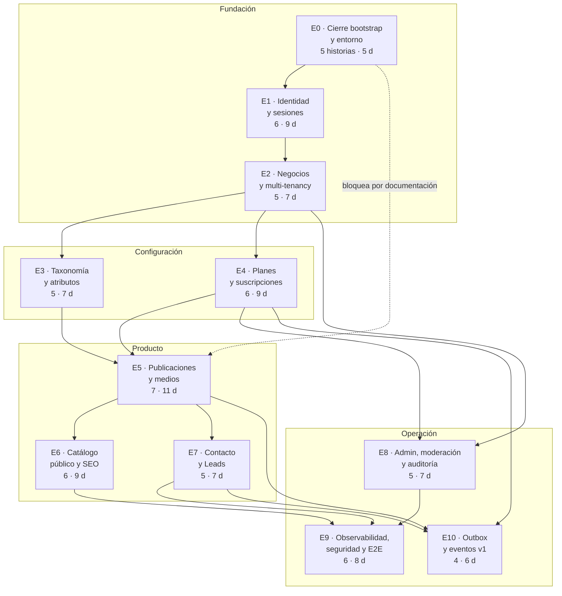
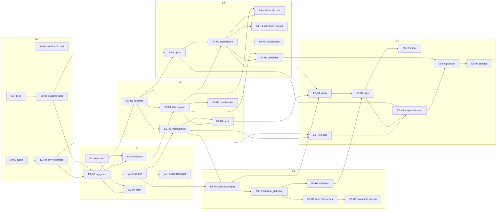

# 23 — Diagrama de dependencias entre épicas e historias

- **Estado:** APROBADO (C-13, 2026-11-12, junto con el roadmap)
- **Fecha:** 2026-11-12
- **Complementa:** `docs/22-implementation-roadmap.md`
- **Uso:** ordenar el trabajo y detectar qué se puede paralelizar. Si una flecha no existe, no hay
  dependencia: dos historias sin camino entre ellas pueden ejecutarse en cualquier orden.

---

## 1. Dependencias entre épicas



Lectura:

- **E3 y E4 son paralelizables.** Ambas dependen de E2, ninguna depende de la otra y E5 espera a las
  dos. Es el único punto del plan donde dos perfiles rinden al 100 % sin pisarse.
- **E6 y E7 son paralelizables** una vez cerrada E5: E6 es mayoritariamente frontend y lectura,
  E7 añade escritura de leads y panel.
- **E8 depende de E2 y E4**, no de E5: la moderación de publicaciones usa `Listings.ArchiveListing`, que
  ya existe al cerrar E5. En la práctica E8 arranca después de E5 por disponibilidad de contenido que
  moderar, no por bloqueo técnico.
- **E9 cierra el MVP**: no aporta funcionalidad nueva, consolida calidad y observabilidad.
- **E10 es opcional** para el MVP: si el tiempo aprieta, se entrega E10-H1/H3 (contrato y outbox) y se
  deja E10-H2/H4 para después.

---

## 2. Camino crítico

```
E0-H1 → E0-H3 → E0-H4 → E1-H1 → E1-H2 → E2-H1 → E2-H2 → E4-H1 → E4-H2 → E4-H3 → E4-H6
      → E5-H1 → E5-H2 → E5-H4 → E5-H5 → E5-H6 → E6-H1 → E6-H2 → E6-H4 → E7-H2 → E7-H3
      → E9-H6 → E9-H4
```

Duración del camino: **~52 días** de los 85 totales. La diferencia (33 días) es el margen que permite
paralelizar E3, E7, E8 y E9-H1…H5 con un segundo perfil. Con dos perfiles, la estimación realista del
MVP es **11–12 semanas**.

---

## 3. Dependencias por historia

Solo se listan las dependencias que **bloquean**. Las dependencias «de conveniencia» (misma pantalla,
mismo DTO) no aparecen.



---

## 4. Olas de ejecución (un perfil)

| Ola | Historias | Duración acumulada |
| --- | --------- | ------------------ |
| 1 | E0-H1…H5 | 5 d |
| 2 | E1-H1, E1-H6, E1-H2, E1-H3, E1-H4, E1-H5 | 14 d |
| 3 | E2-H1…H5 | 21 d |
| 4 | E3-H1…H5 y E4-H1…H6 (secuencial en un perfil) | 37 d |
| 5 | E5-H1…H7 | 48 d |
| 6 | E6-H1…H6 | 57 d |
| 7 | E7-H1…H5 | 64 d |
| 8 | E8-H1…H5 | 71 d |
| 9 | E9-H1…H6 | 79 d |
| 10 | E10-H1…H4 | 85 d |

---

## 5. Olas con dos perfiles

| Ola | Perfil A (backend) | Perfil B (frontend/QA) |
| --- | ------------------ | ---------------------- |
| 1 | E0-H1, E0-H3, E0-H4, E0-H5 | E0-H2, plantilla de PR, revisión de `.gitignore` |
| 2 | E1-H1, E1-H2, E1-H4, E1-H6 | E1-H3, E1-H5, pantallas de auth |
| 3 | E2-H1, E2-H2, E2-H3 | E2-H4, E2-H5, panel de negocio |
| 4 | E4-H1…H6 | E3-H1…H5 (API y seed) + pantallas de taxonomía |
| 5 | E5-H1, E5-H2, E5-H4, E5-H6 | E5-H3, E5-H5, E5-H7, UI de publicación |
| 6 | E7-H1, E7-H2, E7-H4 | E6-H1…H6 (catálogo y SEO) |
| 7 | E8-H1…H5 | E7-H3, E7-H5, panel de leads |
| 8 | E9-H1…H4, E10 | E9-H5, E9-H6 |

Con dos perfiles el camino crítico cae a ~11 semanas; el cuello es la secuencia
E1 → E2 → E4 → E5 → E6 → E9-H6.

---

## 6. Puntos de sincronización (puertas)

| Puerta | Qué debe estar cerrado | Impide |
| ------ | ---------------------- | ------ |
| P1 — fin E0 | Bootstrap sin workarounds, Neon creado, Postgres local sano | Empezar identidad con entorno inestable |
| P2 — fin E2 | Aislamiento probado con T-01…T-12 | Cualquier épica con datos de negocio |
| P3 — fin E4 | Suscripción visible y límites aplicados | Publicar sin control de plan |
| P4 — fin E5 | Máquina de estados completa y pruebas E2E de publicación | Catálogo con datos inconsistentes |
| P5 — fin E8 | Moderación y auditoría operativas | Lanzamiento sin capacidad de reacción |
| P6 — fin E9 | Suite E2E verde, logs y límites activos | Declarar «MVP listo» |

---

## 7. Cómo actualizar este documento

1. Si una historia se divide, se añade con un sufijo (`E5-H4b`) y se actualizan las flechas.
2. Si cambia una dependencia, se corrige aquí **y** en `docs/22` §3; ambos deben coincidir.
3. Toda épica nueva entra con su nodo y su arista; no se permiten nodos huérfanos.
4. El diagrama se valida con el editor Mermaid antes de cada puerta de épica.
