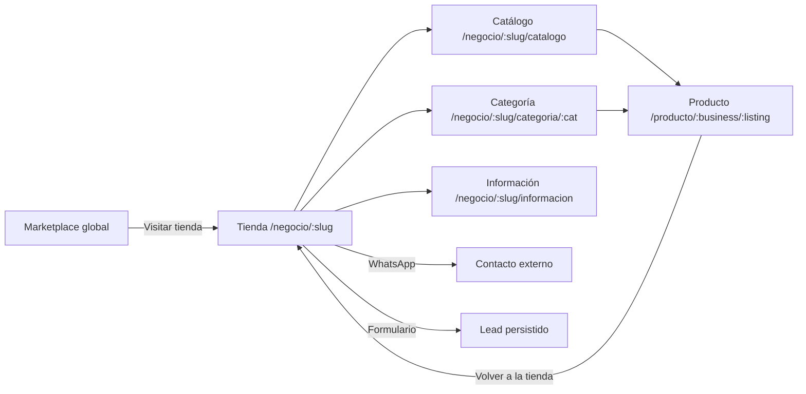
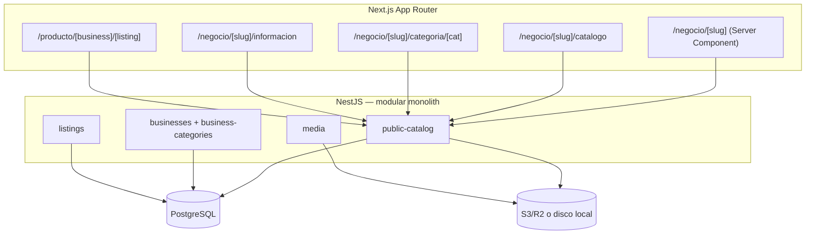

# 27 — Tiendas digitales individuales: auditoría y propuesta

**Estado:** PROPUESTA para revisión humana. No implementada.
**Base:** `docs/26-future-vision-digital-stores.md` (visión), código real de E1–E7.
**Alcance de este documento:** auditoría de la tienda actual, inventario de reutilización, propuesta de UX por vertical, rutas, contratos y arquitectura, dividida en fases verificables.

> Este documento no autoriza cambios de código, esquema ni contratos. Cada fase requiere aprobación explícita antes de empezar.

---

## 1. Resumen ejecutivo

La tienda individual **ya existe en su mínima expresión**: `apps/web/app/negocio/[businessSlug]/page.tsx` (131 líneas) es una página de perfil con cabecera, botones de contacto y una rejilla de hasta 24 publicaciones. Funciona, es indexable y respeta la política de visibilidad de E6, pero hoy se lee como *otra vista del marketplace*, no como *el sitio del negocio*.

El 70 % de lo necesario está construido: visibilidad pública, tarjetas, contacto (WhatsApp + formulario con Lead), taxonomía con categorías propias por negocio, atributos dinámicos, imágenes con almacenamiento intercambiable, sitemap y metadatos. Lo que falta no es infraestructura nueva, son **cinco piezas concretas**:

1. **Identidad comercial**: el modelo `Business` no tiene descripción, logo ni portada.
2. **Navegación propia**: la tienda no tiene pestañas, categorías ni búsqueda dentro de su inventario.
3. **Catálogo filtrable**: `GET /public/businesses/:slug` solo pagina; no filtra por categoría, texto ni condición.
4. **Categorías públicas del negocio**: las categorías propias solo se leen autenticado (`GET /businesses/me/categories`); un comprador no puede verlas.
5. **Diferenciación por vertical**: todas las tiendas se ven idénticas porque la plantilla no consume la vertical salvo para escribir su nombre.

La propuesta mantiene **una sola aplicación y un solo backend**. La "independencia" de cada tienda se consigue con una URL propia, un tema derivado de su vertical y un catálogo aislado por `businessId` resuelto en el servidor.

---

## 2. Auditoría de la tienda actual

### 2.1 Archivo y composición

`apps/web/app/negocio/[businessSlug]/page.tsx`

| Línea | Qué hace |
|---|---|
| `:16` | `export const dynamic = 'force-dynamic'` — sin caché compartida |
| `:22-44` | `generateMetadata`: título, descripción, canonical `/negocio/<slug>`, Open Graph |
| `:46-53` | Server Component: `fetchPublicBusiness(slug, 1, 24)` + `fetchPublicVerticals()` en paralelo; `notFound()` si no hay negocio visible |
| `:56` | Envuelve en `PublicShell` (header y footer globales) |
| `:58-71` | Migas Inicio / vertical / negocio |
| `:73-107` | Cabecera: nombre, vertical, ciudad, dirección, conteo, WhatsApp, botón de formulario y aviso de no intermediación |
| `:109-112` | Sección «Publicaciones» con `ListingGrid` |
| `:114-127` | Bloque de captación «¿También vendes artículos usados?» → `/register` |

Dependencias directas: `PublicShell` (`apps/web/src/components/public-shell.tsx`), `ListingGrid`/`ListingCard` (`apps/web/src/components/marketplace/listing-card.tsx`), `ContactBusinessButton` (`apps/web/src/components/contact-business-form.tsx`), helpers de `apps/web/src/lib/public-catalog.ts`.

### 2.2 Contrato que consume hoy

`GET /public/businesses/:businessSlug?page=&limit=` — respuesta real de `marketcentral_dev`:

```json
{
  "slug": "prenderia-centro-1",
  "name": "prenderia centro 1",
  "city": "MEDELLIN",
  "addressLine": "medellin",
  "whatsapp": "+573105147725",
  "verticalName": "Prenderías",
  "verticalSlug": "prenderias",
  "listings": {
    "items": [
      {
        "businessSlug": "prenderia-centro-1",
        "businessName": "prenderia centro 1",
        "listingSlug": "nevera-aceb-6bxc3l",
        "title": "NEVERA ACEB",
        "priceAmount": 450000,
        "currency": "COP",
        "condition": "NEW",
        "city": "MEDELLIN",
        "categoryId": "01a1db28-…",
        "categoryName": "Neveras",
        "categorySlug": "neveras",
        "featured": false,
        "publishedAt": "2026-11-19T00:23:39.494Z",
        "image": { "url": "http://127.0.0.1:3001/media/…", "width": 800, "height": 960, "alt": "NEVERA ACEB — prenderia centro 1" }
      }
    ],
    "page": 1, "limit": 2, "total": 1, "totalPages": 1
  }
}
```

Implementación: `apps/api/src/modules/public-catalog/infrastructure/prisma-public-catalog.repository.ts:407-477` (`findBusiness` + `listBusinessListings`), que aplican `visibleBusinessWhere(now)` y `visibleListingWhere(now)` — la misma política de E6: publicación `PUBLISHED`, negocio `APPROVED`, suscripción `TRIALING|ACTIVE` con `currentPeriodEnd > now`.

### 2.3 Qué funciona y no hay que rehacer

- Aislamiento: el negocio se resuelve por slug en el servidor y las publicaciones se filtran por su `id` (`:443-446`). **No** se acepta `businessId` del navegador.
- Visibilidad: negocio suspendido, publicación archivada o suscripción vencida → `notFound()`/404, igual que el catálogo.
- Contacto: WhatsApp con mensaje prellenado y formulario que persiste Lead (E7), con aviso explícito de que el pago se acuerda fuera.
- SEO mínimo: canonical propio, OG, entrada en `sitemap.xml` (`listSitemap` incluye un registro por negocio con `listingSlug: null`).
- Rejilla responsive y accesible, con estado vacío.

### 2.4 Limitaciones detectadas

| # | Limitación | Evidencia | Impacto |
|---|---|---|---|
| L1 | Sin descripción comercial, logo ni portada | `apps/api/prisma/schema.prisma:152-182`: `Business` solo tiene `name`, `slug`, `city`, `addressLine`, `whatsapp`, `fingerprint`, `verticalId`, `ownerUserId`, `flaggedForReview`, `status` | La tienda no puede presentarse; se ve igual que una ficha de directorio |
| L2 | Sin navegación propia ni pestañas | `page.tsx:73-112`: una cabecera y una rejilla | No hay sensación de "sitio del negocio" |
| L3 | Catálogo no filtrable | `findBusiness`/`listBusinessListings` solo reciben `page`/`limit` | Con 20+ publicaciones el comprador no puede acotar |
| L4 | Categorías propias invisibles al comprador | Único endpoint: `GET /businesses/me/categories` (`business-category.controller.ts:46`), con `SessionGuard` | Las categorías que el negocio pagó (0/3/5) no se lucen en su tienda |
| L5 | Tope duro de 24 publicaciones sin "ver más" | `page.tsx:49` (`limit = 24` = `PUBLIC_PAGE_SIZE_MAX`) | Catálogos grandes quedan truncados sin aviso |
| L6 | Todas las tiendas idénticas | La vertical solo alimenta texto y migas | La visión §4 (adaptación por vertical) no se cumple |
| L7 | Sin destacados dentro de la tienda | El orden del API ya pone `featured desc`, pero no hay sección propia | Se pierde la palanca comercial de E4/E5 |
| L8 | Estado vacío genérico | `ListingGrid` muestra «No encontramos publicaciones con esos filtros» | Mensaje incorrecto en una tienda sin catálogo |
| L9 | Sin enlace de vuelta desde el detalle | `producto/[businessSlug]/[listingSlug]/page.tsx` no ofrece "volver a la tienda" | Se rompe el flujo §5 paso 8→9 |
| L10 | SEO de tienda plano | Título y OG sin `LocalBusiness`/`Store` JSON-LD; sin categorías indexables | Menos descubrimiento local |
| L11 | Datos de baja calidad visibles | `addressLine: "medellin"` | Percepción de abandono; requiere validación de contenido, no de código |

---

## 3. Inventario de reutilización

| Componente / helper | Ruta | Reutilización en la tienda | Cambio necesario |
|---|---|---|---|
| `PublicShell` | `apps/web/src/components/public-shell.tsx` | Header/footer globales; mantiene contexto de marketplace | Ninguno |
| `ListingCard` | `apps/web/src/components/marketplace/listing-card.tsx:12-66` | Tarjeta base del catálogo de la tienda | Prop opcional `context`/`variant` para ocultar «Ver tienda: …» cuando ya estás en ella |
| `ListingGrid` | `…/listing-card.tsx:69-106` | Rejilla 1/2/3/4 | Aceptar `emptyState` propio; hoy el mensaje es del catálogo global |
| `VerticalIcon` | `apps/web/src/components/marketplace/vertical-icon.tsx` | Icono del vertical en hero y migas | Mapa ampliable por palabra clave del slug |
| `CatalogFilters` | `apps/web/src/components/marketplace/catalog-filters.tsx` | Filtros del catálogo de la tienda | Prop `scope: 'global' \| 'store'` (oculta vertical/ciudad, muestra categoría/búsqueda/condición/precio) |
| `ContactBusinessButton` + `ContactForm` | `apps/web/src/components/contact-business-form.tsx` | Contacto persistente (Lead) | Ninguno |
| `Badge`, `StatCard`, `SearchField`, `EmptyState`, `SkeletonList`, `Banner`, `buttonStyles`, `inputStyles` | `apps/web/src/components/taxonomy-ui.tsx` | Sistema visual de la tienda | Ninguno |
| `Modal` | `apps/web/src/components/modal.tsx` | Formulario de contacto y futuros paneles | Ninguno |
| `formatCop`, `conditionLabel`, `cityLabel`, `whatsappHref`, `filtersToQuery`, `SITE_URL` | `apps/web/src/lib/public-catalog.ts` | Formato y URLs | `formatCop` ya soporta COP/USD |
| `fetchPublicBusiness`, `fetchPublicListings`, `fetchPublicVerticalDetail` | `apps/web/src/lib/public-catalog.ts:199-247` | Datos de la tienda | Nueva función `fetchBusinessCategories` y filtros en `fetchPublicBusiness` |
| Catálogo de detalle | `apps/web/app/producto/[businessSlug]/[listingSlug]/page.tsx` | Ficha que la tienda enlaza | Añadir migas «← Volver a <negocio>» y JSON-LD `Product` ya existente |
| Sitemap | `apps/web/app/sitemap.ts` | Alta de la tienda ya incluida | Añadir categorías de tienda con ≥1 publicación |

**No se reutiliza** (y no hace falta): el catálogo global con chips de verticales (`page.tsx` de la landing), porque la tienda no mezcla negocios.

---

## 4. Principios de diseño

1. **Dos niveles, no dos aplicaciones.** MarketCentral aporta chrome, confianza y navegación de retorno; el negocio aporta identidad, catálogo y tono.
2. **La vertical define el tema, no el negocio.** Sin editor de colores en el MVP (lo pide `docs/26 §6`): un mapa estático `vertical → acento + densidad + orden por defecto` evita el hardcode por tienda y mantiene el JIT de Tailwind seguro.
3. **Una URL por entidad.** Tienda = `/negocio/<slug>`; producto = `/producto/<businessSlug>/<listingSlug>` (sin cambios); categoría de tienda = `/negocio/<slug>/categoria/<categorySlug>`.
4. **El aislamiento es del servidor.** Ningún parámetro del navegador decide de quién es el catálogo.
5. **Los datos salen de la taxonomía.** Categorías, atributos y filtros vienen de `Vertical`/`Category`/`AttributeDefinition`, incluidas las categorías propias del negocio (E5-F2).
6. **Nada de funcionalidades de reserva.** Sin carrito, sin checkout, sin pagos: el contacto sigue siendo WhatsApp + formulario.

---

## 5. Propuesta de experiencia

### 5.1 Mapa de la tienda



### 5.2 Estructura de la tienda (home)

```
┌ PublicShell: logo MC · Catálogo · verticales · Ingresar · Publica tu negocio ┐
│ Migas: Inicio / Prenderías / prenderia centro 1                              │
│                                                                              │
│ HERO (portada + logo + identidad)                                            │
│  [imagen de portada 21:9, si existe]                                         │
│  ┌ logo 64px ┐  prenderia centro 1                     [WhatsApp] [Mensaje]   │
│  │           │  Prenderías · Medellín · dirección                            │
│  │           │  Descripción comercial (2–3 líneas)                           │
│  │           │  12 publicaciones · 3 en destacados · Actualizado hoy         │
│  └───────────┘                                                               │
│                                                                              │
│ NAV TIENDA   [Todo] [Destacados] [Celulares] [Computadores] [+3 propias]     │
│                                                                              │
│ DESTACADOS DE LA TIENDA  (máx. 4, solo si existen)                           │
│ CATÁLOGO  buscador + condición + precio + orden   ·  rejilla 1/2/3/4         │
│ PAGINACIÓN (12 por página, «Ver más»)                                        │
│                                                                              │
│ BLOQUE DE CONFIANZA: pago y entrega fuera de la plataforma · reportar        │
│ FOOTER global                                                                │
└──────────────────────────────────────────────────────────────────────────────┘
```

Cambios de sensación frente a hoy: portada que ocupa ancho completo, logo junto al nombre, descripción legible, pestañas propias y catálogo con filtros. El chrome global se mantiene para no perder la confianza de marca ni la vuelta al marketplace.

### 5.3 Catálogo de la tienda (`/negocio/:slug/catalogo`)

- Encabezado compacto con el nombre y el conteo.
- Filtros: búsqueda por texto, categoría (globales usadas + propias), condición, rango de precio, orden (`Relevancia` = destacados primero; `Recientes`; `Precio: menor`; `Precio: mayor`).
- Estado vacío propio: «Este negocio todavía no tiene publicaciones con esos filtros» + «Ver todo su catálogo».
- Paginación de 12 con `?page=`, sin scroll infinito (SEO y accesibilidad).

### 5.4 Página de categoría (`/negocio/:slug/categoria/:categorySlug`)

- H1 «Celulares en prenderia centro 1», texto breve generado con la vertical, rejilla paginada.
- Solo para categorías con ≥1 publicación visible; si no, `notFound()`.
- `canonical` a la propia URL; entra al sitemap cuando tiene contenido.

### 5.5 Información (`/negocio/:slug/informacion`)

- Dirección, ciudad, WhatsApp, horario (si se añade en F3), política de garantía declarada por el negocio (texto libre corto), y aviso legal de no intermediación.
- Datos estructurados `LocalBusiness` con `address`, `telephone`, `areaServed`.

### 5.6 Adaptación por vertical

Sin duplicar plantillas: un mapa de tema + variantes de tarjeta.

| Vertical | Acento | Densidad | Orden por defecto | Qué destaca la tarjeta | Copy del hero |
|---|---|---|---|---|---|
| `prenderias` | `brand-700` (verde actual) | Cómoda | Destacados → recientes | Precio, condición, categoría | «Artículos usados verificados en Medellín» |
| `joyerias` | `amber-700` | Amplia (imágenes 1:1) | Destacados → precio alto | Material, peso, quilates si existen como atributos | «Piezas con historia, compradas con confianza» |
| nueva vertical | `stone-800` por defecto | Cómoda | Destacados → recientes | Precio, condición | Texto neutro con el nombre de la vertical |

Reglas:

- El tema vive en `apps/web/src/lib/vertical-theme.ts` (nuevo) como `Record<string, VerticalTheme>` con **clases literales** para que Tailwind las incluya en el build; si el slug no está, `DEFAULT_THEME`.
- El tema no cambia la estructura ni los datos: solo acento, radios, densidad de rejilla y copy.
- Las **categorías y atributos nunca se hardcodean**: salen de la vertical del negocio.
- Personalización por negocio (paleta propia, tipografía) queda **fuera del MVP** y se evalúa como beneficio de plan Pro (D-45).

### 5.7 Estados

| Estado | Comportamiento |
|---|---|
| Negocio visible sin publicaciones | La tienda se muestra con hero, descripción y estado vacío propio con CTA de contacto |
| Suscripción vencida / negocio suspendido | `notFound()` (404) — coherente con E6; no se revela la tienda |
| Categoría sin publicaciones | 404 en su URL; no se enlaza desde la nav |
| API caída | Página degrada a estado vacío con aviso (`role="status"`), nunca error 500 |
| Imagen rota | Marcador «Sin imagen» ya implementado en `ListingCard` |

### 5.8 Móvil y accesibilidad

- Hero apilado, logo 56 px, botones de contacto a ancho completo en `sm` inferior.
- Nav de tienda con `overflow-x-auto` y `aria-current="page"`.
- Filtros en `<details>` colapsable en móvil, visibles en `lg`.
- Foco visible en todos los controles, `aria-label` en iconos, contraste AA sobre `brand-50`/`stone-50`.
- Imágenes con `alt` descriptivo ya generado por el API (`title — business`).

---

## 6. Rutas propuestas

| Ruta | Estado | Indexable | Canonical | Notas |
|---|---|---|---|---|
| `/negocio/[businessSlug]` | existe | sí | propia | Home de la tienda; se conserva la URL ya compartida |
| `/negocio/[businessSlug]/catalogo` | nueva | sí (sin filtros) | propia | Con filtros activos: `noindex, follow` y canonical a la versión limpia |
| `/negocio/[businessSlug]/categoria/[categorySlug]` | nueva | sí | propia | Solo si hay publicaciones |
| `/negocio/[businessSlug]/informacion` | nueva | sí | propia | `LocalBusiness` JSON-LD |
| `/producto/[businessSlug]/[listingSlug]` | existe | sí | propia | Sin cambios de URL; se añade «Volver a la tienda» |
| `/marketplace`, `/marketplace/[verticalSlug]` | existen | sí/noindex con filtros | — | Sin cambios |

**Descartado para el MVP:** subdominios o dominios por negocio (`docs/26 §8`). Añaden TLS, cookies, canonical y soporte; se reevalúan cuando exista demanda comercial. Con la ruta actual el enlace ya es compartible.

---

## 7. Arquitectura técnica

### 7.1 Diagrama



La tienda es **una vista del mismo `public-catalog`**: no hay módulo nuevo de backend, ni endpoint de escritura, ni base por negocio.

### 7.2 Cambios de modelo (F1)

`Business` gana tres columnas opcionales y auditables:

```prisma
model Business {
  description String? @db.VarChar(600)   // texto comercial, público
  logoKey     String? @map("logo_key") @db.VarChar(300)
  coverKey    String? @map("cover_key") @db.VarChar(300)
  // …resto igual
}
```

- Migración aditiva, sin backfill: `NULL` = sin identidad extendida y la tienda cae al diseño actual.
- CHECKs: `description` con `btrim` entre 20 y 600 o `NULL`; claves con el mismo patrón de `listing_image.storage_key`.
- Las imágenes se guardan con `MediaStorage` (puerto existente) bajo `businesses/{businessId}/logo-{ts}.{ext}` y `…/cover-{ts}.{ext}`; una sola de cada tipo, reemplazo borra la anterior.
- Validación con el mismo `inspectImage` (JPEG/PNG/WebP, magic bytes): logo ≤ 2 MB y mínimo 200×200; portada ≤ 5 MB y mínimo 1200×600.
- Motivo de no crear tabla `business_media`: son dos imágenes fijas, no una galería; una tabla añadiría joins y estados sin beneficio (D-43).

### 7.3 Contratos

**Aditivo sobre lo existente** (no rompe a nadie):

`GET /public/businesses/:businessSlug` añade campos y filtros:

```jsonc
// nuevos campos de la respuesta
"description": "Compramos y vendemos…",   // null si no hay
"logoImage":  { "url": "…", "width": 512, "height": 512, "alt": "…" } | null,
"coverImage": { "url": "…", "width": 1600, "height": 700, "alt": "…" } | null,
"featuredCount": 3,

// nuevos query params (todos opcionales)
?category=<slug>&searchText=<texto≤100>&condition=<enum>&minPrice=&maxPrice=&sort=<featured|recent|price_asc|price_desc>&page=&limit=
```

`GET /public/businesses/:businessSlug/categories` (nuevo):

```json
[
  { "id": "…", "name": "Celulares", "slug": "celulares", "isOwn": false, "listingCount": 7 },
  { "id": "…", "name": "Repuestos raros", "slug": "repuestos-raros", "isOwn": true, "listingCount": 2 }
]
```

- Devuelve solo categorías con ≥1 publicación visible del negocio (globales usadas + propias activas), ordenadas por `listingCount desc`.
- 404 `PUBLIC_BUSINESS_NOT_FOUND` si el negocio no es visible.
- `Cache-Control: public, max-age=0, s-maxage=60`.

`GET /businesses/me` y `PATCH /businesses/me` (ya existen) aceptan `description`; se añaden dos endpoints multipart de propiedad: `POST /businesses/me/logo` y `POST /businesses/me/cover` (y `DELETE` de cada uno), con `SessionGuard`, rol `OWNER|MANAGER`, validación por magic bytes y reemplazo atómico del archivo anterior.

**Sin cambios:** `GET /public/listings/:business/:listing` (el detalle), visibilidad, leads, suscripciones.

### 7.4 Capa web

| Archivo | Acción |
|---|---|
| `apps/web/src/lib/vertical-theme.ts` | nuevo: `VerticalTheme`, `DEFAULT_THEME`, `themeFor(verticalSlug)` |
| `apps/web/src/lib/public-catalog.ts` | `PublicBusinessProfile` con `description`/`logoImage`/`coverImage`/`featuredCount`; `fetchPublicBusiness(slug, filters)`; `fetchBusinessCategories(slug)` |
| `apps/web/components/store/store-hero.tsx` | nuevo: portada, logo, nombre, descripción, contacto |
| `apps/web/components/store/store-nav.tsx` | nuevo: pestañas con `aria-current` |
| `apps/web/components/store/store-catalog.tsx` | nuevo: rejilla + filtros + paginación (reutiliza `ListingCard`) |
| `apps/web/app/negocio/[businessSlug]/page.tsx` | reescritura sobre los componentes anteriores |
| `apps/web/app/negocio/[businessSlug]/catalogo/page.tsx` | nueva |
| `apps/web/app/negocio/[businessSlug]/categoria/[categorySlug]/page.tsx` | nueva |
| `apps/web/app/negocio/[businessSlug]/informacion/page.tsx` | nueva |
| `apps/web/app/producto/[businessSlug]/[listingSlug]/page.tsx` | añade «← Volver a la tienda» y `Store` en JSON-LD |
| `apps/web/app/sitemap.ts` | añade categorías de tienda con contenido |
| `apps/web/app/dashboard/negocio/page.tsx` | editor de descripción + subida de logo/portada |

Todo sigue siendo Server Component salvo el editor del panel y el formulario de contacto.

### 7.5 SEO

- Store home: canonical propia, `title` «<Negocio> — <Vertical> en <Ciudad> | MarketCentral», OG con portada si existe, JSON-LD `Store`/`LocalBusiness` (`name`, `image`, `address`, `telephone`, `areaServed`, `url`).
- Catálogo con filtros: `noindex, follow` para no generar combinaciones infinitas; canonical a `/negocio/<slug>/catalogo`.
- Categoría de tienda: indexable, `ItemList` con las publicaciones de la primera página.
- Detalle: conserva su canonical actual; no se duplica contenido entre tienda y detalle porque la tienda muestra tarjetas, no el texto completo.
- Enlazado interno: tarjeta del marketplace → tienda; tienda → detalle; detalle → tienda; sitemap → tienda y categorías.

### 7.6 Rendimiento y caché

- Las páginas siguen `force-dynamic` porque la visibilidad depende de la hora (suscripción vencida). El API ya responde con `s-maxage` corto en listas; se mantiene.
- `fetchPublicBusiness` y `fetchBusinessCategories` se piden en paralelo en la misma petición.
- Portada y logo se sirven desde el almacenamiento (local/R2), no desde el optimizador de Next.
- Tope de 12 por página: el catálogo de una tienda pequeña cabe en una sola consulta.

### 7.7 Aislamiento multi-tenant

- El `businessId` se obtiene en el servidor desde el slug; nunca del query del navegador.
- Las tres consultas nuevas (`findBusiness`, `listBusinessListings`, `listBusinessCategories`) aplican `visibleBusinessWhere(now)` y `businessId` explícito.
- Las mutaciones del panel (descripción, logo, portada) usan `ActorContext`, como el resto de E2/E5.
- Pruebas negativas obligatorias: subir logo a un negocio ajeno → 404; pedir categorías de un negocio suspendido → 404; intentar acceder a `/negocio/<slug>/catalogo?businessId=<otro>` → el parámetro se ignora y el catálogo sigue siendo el del slug.

---

## 8. Fases de implementación

| Fase | Contenido | Criterio de aceptación |
|---|---|---|
| **F1 — Identidad** | Columnas `description`/`logoKey`/`coverKey`, migración, endpoints `POST/PATCH/DELETE` de logo y portada, editor en `/dashboard/negocio`, campos nuevos en `GET /public/businesses/:slug` | Un negocio puede guardar descripción y ambas imágenes; se ven en el API; borrar reemplaza el objeto anterior; 413/400 con código propio |
| **F2 — Tienda base** | `store-hero`, `store-nav`, pestañas, categorías públicas (`/categories`), catálogo filtrable y paginado, estado vacío propio | `/negocio/<slug>` muestra identidad real, pestañas y catálogo filtrable; con 0 publicaciones sigue siendo presentable |
| **F3 — Rutas y SEO** | `/catalogo`, `/categoria/[slug]`, `/informacion`, JSON-LD `Store`, sitemap con categorías, `noindex` en filtros | Cada URL responde 200/404 correctamente; Rich Results válido; sitemap sin URLs vacías |
| **F4 — Vertical** | `vertical-theme.ts`, variantes de tarjeta y copy, orden por defecto por vertical | Prenderías y Joyerías se perciben distintas sin duplicar páginas; una vertical nueva cae al tema por defecto |
| **F5 — Detalle y lazos** | «Volver a la tienda» en el detalle, badge de tienda, destacados de la tienda, enlaces desde el marketplace | Flujo §5 completo: marketplace → tienda → producto → tienda |

Cada fase es un commit propio en `main`, con verificación (`tsc`, `eslint`, Jest, smoke HTTP) y sin tocar fases anteriores.

---

## 9. Riesgos

| Riesgo | Prob. | Impacto | Mitigación |
|---|---|---|---|
| Canibalización SEO entre tienda y detalle | media | alto | Tienda = tarjetas; detalle = contenido; canonical explícito por URL |
| Explosión de combinaciones indexables | alta | medio | `noindex` en filtros y en categorías vacías |
| Personalización visual ilimitada | media | alto | Tema por vertical, no por negocio; paleta propia solo como decisión de plan |
| Imágenes de portada/logo sin moderar | media | alto | Reutilizar moderación de E8 y límites de tamaño; reportar desde la tienda |
| Portada pesada degrada LCP | media | medio | ≤5 MB en origen, servida ya redimensionada por el cliente antes de subir (F1) |
| Complejidad de categorías propias + globales | media | medio | Un solo endpoint que devuelve ambas con `isOwn` y conteo |
| Tienda vacía parece abandonada | alta | bajo | Estado vacío con CTA de contacto y aviso «publica tu primer artículo» |
| Migración con negocios existentes | baja | medio | Columnas nullable, sin backfill |

---

## 10. Decisiones abiertas

- **D-42 — Alcance de la identidad visual por negocio.** Recomendado: tema por vertical en el MVP; color propio como beneficio Pro en fase posterior.
- **D-43 — Almacenamiento de logo y portada.** Recomendado: dos columnas de clave en `business` reutilizando `MediaStorage`, sin tabla nueva.
- **D-44 — Horarios y políticas del negocio.** Recomendado: dejarlos fuera de F1–F3; si se añaden, `openingHours` estructurado y texto de garantía como campos propios, no JSON libre.
- **D-45 — Contenido generado por vertical.** Recomendado: copy y orden por defecto desde `vertical-theme.ts`; nunca texto por negocio hardcodeado.
- **D-46 — Subdominios.** Recomendado: no en el MVP; reevaluar con tracción comercial.
- **D-47 — Moderación de descripción/logo.** Recomendado: publicar de inmediato y confiar en denuncia (E8), con capacidad de admin para ocultar; alternativa: revisión previa, que frena el alta.

---

## 11. Lo que este documento NO propone

- No propone carrito, checkout, pagos ni envíos.
- No propone un backend ni una base de datos por negocio.
- No propone duplicar endpoints del catálogo: la tienda reutiliza `public-catalog`.
- No propone cambiar las URLs de producto ya indexadas.
- No propone implementar nada todavía: cada fase espera aprobación.

---

## 12. Siguiente paso sugerido

Aprobar (o corregir) D-42 a D-47 y el alcance de F1. Con eso, la primera entrega sería la migración aditiva de identidad y el editor del panel, que es la pieza que desbloquea todo lo visual y no depende de ninguna decisión de diseño posterior.
