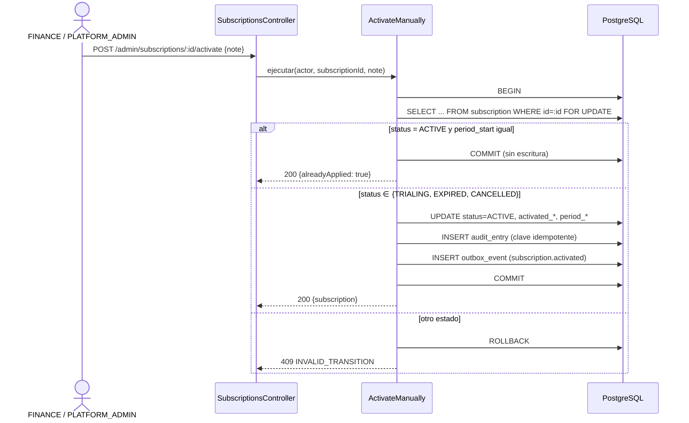

# ADR-010 — Suscripciones, entitlements y cobro manual

- **Estado:** **APROBADA** en su totalidad (**C-14**, 2026-11-12): cinco estados, constraint e idempotencia (C-11.2), forma clave/valor de `PlanEntitlement` y límites por plan (Free 10 / Base 30 / Pro 50). La decisión de negocio de cobro manual ya estaba **APROBADA** en C-10 (Q-06).
- **Fecha:** 2026-11-12
- **Decisores:** Producto + arquitectura de datos/backend
- **Ámbito:** `plan`, `plan_entitlement`, `subscription`
- **Relacionados:** [ADR-008](ADR-008-domain-data-model.md), [06 §11](../06-core-flows-and-state-machines.md), [12 §8.1](../12-risks-and-open-decisions.md), R-32

---

## 1. Contexto

C-10 fijó: **sin pasarela de pago en el MVP**; el dueño paga por transferencia o Nequi y un administrador activa la suscripción. Planes: Free (2 meses, 10 publicaciones, $0), Base (30, $30.000 COP/mes), Pro (50, $50.000 COP/mes), un usuario por negocio, 5 imágenes por publicación, panel de leads en todos los planes. La suscripción controla límites y visibilidad; el pago de artículos está fuera de la plataforma.

El riesgo R-32 es la **doble activación** por error humano: clic repetido, doble pago no verificado, o dos administradores a la vez.

---

## 2. Decisión

1. **`Plan` + `PlanEntitlement` (clave/valor).** Los límites se modelan como datos, no como columnas: `max_active_listings`, `max_images_per_listing`, `max_members`, `leads_panel`. Cada plan tiene `code` (`FREE`, `BASE`, `PRO`) y `version`; cambiar límites crea una versión nueva.
2. **`Subscription` con cinco estados:** `TRIALING`, `ACTIVE`, `SUSPENDED`, `EXPIRED`, `CANCELLED` ([18 §4](../18-state-transition-matrix.md)). El alta crea la suscripción Free en `TRIALING` con `trial_end = now() + 60 días`. **No hay `PENDING_ACTIVATION`**: el negocio paga fuera del sistema y el admin activa en una sola transacción; tampoco `PAST_DUE`, porque no existe cobro automático que pueda fallar.
3. **Cobro manual registrado en la propia suscripción:** `activated_by_admin_id`, `activated_at`, `activation_note` (obligatoria) y `suspension_reason` (opcional). **No** existen `PaymentProviderAccount`, `PaymentWebhookEvent`, `SubscriptionPayment`, `BillingAttempt` ni `Invoice`.
4. **Una sola suscripción viva por negocio:** índice único parcial `(business_id) WHERE status IN ('TRIALING','ACTIVE')`. Las filas `EXPIRED`/`CANCELLED` son historial.
5. **Idempotencia de la activación (R-32):** constraint + transacción con `FOR UPDATE` + clave de auditoría `(action, entity_id, period_start)`; repetición devuelve `200` con `alreadyApplied: true`.
6. **La visibilidad no se materializa:** vencer o suspender **no** cambia `listing.status`; la `VisibilityPolicy` excluye las publicaciones del catálogo. Al reactivar, vuelven a ser visibles sin intervención.
7. **Los límites se aplican en backend:** el conteo de publicaciones y la lectura del entitlement ocurren en la misma transacción que la publicación ([19 §7](../19-indexing-and-integrity.md)).

---

## 3. Por qué clave/valor y no columnas fijas

| Aspecto | Columnas fijas (`max_listings`, `max_images`…) | Clave/valor (elegido) |
|---------|-----------------------------------------------|------------------------|
| Nuevo límite | Migración + cambio de código | Insertar fila |
| Planes por vertical | Requiere duplicar columnas | Mismo esquema |
| Lectura | Tipada y directa | Requiere `EntitlementReader` |
| Validación | `CHECK` por columna | Tipo declarado en `value` |
| Reporte comparativo | Fácil | Requiere pivot |

**Decisión:** el costo de un lector único (`EntitlementReader`) es menor que el costo de migrar cada vez que producto ajuste un límite durante el piloto, y los valores de C-10 están explícitamente sujetos a validación comercial.

**Riesgo asumido:** `value` es JSONB y su tipo se valida en aplicación (`{"type":"integer","value":10}`). Mitigación: catálogo cerrado de claves y prueba de contrato por clave.

---

## 4. Justificación de cada estado

| Estado | Necesidad que cubre | Qué pasa si se elimina |
|--------|---------------------|------------------------|
| `TRIALING` | Periodo Free de 60 días | Sin él, el alta tendría que nacer `ACTIVE`, y el negocio Free contaría como suscripción pagada en métricas y reportes |
| `ACTIVE` | Periodo pagado vigente; habilita límites del plan y visibilidad | — |
| `SUSPENDED` | Bloqueo administrativo conservando datos (denuncia o impago) | Se confundiría con `EXPIRED` y no habría motivo auditable |
| `EXPIRED` | Terminó el periodo sin renovación | Se perdería la distinción entre "nunca pagó" y "dejó de pagar" |
| `CANCELLED` | El dueño canceló; no se renueva | No se distinguiría de expiración y se perdería la intención |

**Decisión C-11.2 (APROBADA):** se descartan `PENDING_ACTIVATION` y `PAST_DUE`.
- Sin `PAST_DUE`: no hay cobro automático, por tanto no existe el estado "el proveedor intentó cobrar y falló".
- Sin `PENDING_ACTIVATION`: el cobro manual no crea una fila intermedia. El flujo es *dueño paga por fuera → admin confirma → `TRIALING`/`EXPIRED`/`CANCELLED` → `ACTIVE`* en **una** transacción. Una fila "pendiente" solo añadiría un estado que ninguna consulta del catálogo puede usar y que habría que limpiar si el negocio nunca paga.

La intención de pago no se modela: se gestiona fuera del sistema (conversación con el admin) y la primera evidencia es la activación auditada.

---

## 5. Idempotencia de la activación manual (R-32)

| Capa | Mecanismo | Qué evita |
|------|-----------|-----------|
| Base de datos | Índice único parcial de vigencia | Dos filas `ACTIVE` simultáneas |
| Transacción | `SELECT ... FOR UPDATE` sobre la suscripción | Dos admins leyendo el mismo estado a la vez |
| Auditoría | Clave `(action='subscription.activate', entity_id, period_start)` | Dos entradas idénticas por doble clic |
| API | Respuesta idempotente `alreadyApplied` | Error visible al usuario por una operación ya hecha |

**No se usa idempotency key del cliente:** la operación es administrativa y el estado es la fuente de verdad. Una clave de cliente añadiría una tabla sin beneficio.

---

## 6. Vencimiento, cancelación y datos

| Situación | Negocio | Publicaciones | Suscripción |
|-----------|---------|---------------|-------------|
| Fin de `trial_end` | Sigue en panel; no publica | Invisibles; intactas | `TRIALING → EXPIRED` por job |
| Fin de `current_period_end` + 5 días de gracia (PROPUESTA) | Panel en lectura | Invisibles; intactas | `ACTIVE → EXPIRED` |
| Cancelación del dueño | Acceso hasta fin de periodo | Intactas | `→ CANCELLED` |
| Suspensión administrativa | Panel en lectura | Invisibles; intactas | `→ SUSPENDED` con motivo |
| Reactivación | Vuelve a operar | Vuelven las que seguían `PUBLISHED` | `→ ACTIVE` con nota |

**No se borra inventario, ni se cambia el estado de las publicaciones.** La razón es que el estado de la publicación pertenece al negocio (`PUBLISHED` vs `PAUSED`); la vigencia de la suscripción es un predicado externo. Materializarlo obligaría a recordar el estado previo y a revertirlo, con riesgo de pérdida.

---

## 7. Aplicación de límites

| Límite | Dónde se aplica | Error |
|--------|-----------------|-------|
| `max_active_listings` | `PublishListing` y `ResumeListing`, contando `PUBLISHED` + `PAUSED` en la misma transacción | `PLAN_LIMIT_REACHED` (409) |
| `max_images_per_listing` | Al asociar imagen en `listing_image` | `MEDIA_LIMIT_REACHED` (422) |
| `max_members` | En el MVP no se usa (un solo miembro); se conserva para fase 2 | `PLAN_LIMIT_REACHED` |
| `leads_panel` | Nunca se desactiva en el MVP; el panel está en todos los planes | — |

**Regla dura:** el frontend puede mostrar el límite, pero **nunca** decide si se superó. El backend cuenta y rechaza.

---

## 8. Consecuencias

### 8.1 Positivas

- Cambiar precios o límites durante el piloto no exige migración.
- La activación manual queda auditada con quién, cuándo y por qué.
- Vencer no destruye inventario; reactivar es inmediato.
- No hay dependencia de un proveedor de pago en el MVP.

### 8.2 Negativas

| Costo | Mitigación |
|-------|------------|
| Conciliación manual del pago | Nota obligatoria + búsqueda por negocio en Admin; conciliación mensual documentada |
| Riesgo de activar sin pago confirmado | Doble control: nota + auditoría; revisión semanal de activaciones (P1, R-32) |
| Sin reintentos automáticos de cobro | Aviso por correo antes del vencimiento (fase 2: n8n) |
| `PlanEntitlement` sin tipo fuerte en BD | Catálogo cerrado de claves + prueba de contrato |
| Estados adicionales respecto al encargo | Resuelto en C-11.2: cinco estados, sin `PENDING_ACTIVATION` ni `PAST_DUE` |

### 8.3 Impacto en otros módulos

| Módulo | Impacto |
|--------|---------|
| `Billing` | Se reduce a registro de activaciones manuales y consulta de pendientes; sin SDK |
| `Admin` | Nueva capacidad `ActivateSubscriptionManually` con nota y auditoría |
| `Notifications` | Aviso de vencimiento próximo (fase 2) |
| `PublicCatalog` | La vigencia entra en `VisibilityPolicy` como predicado, no como estado de `listing` |
| `Events` | `subscription.activated`, `renewed`, `cancelled`, `expired`, `suspended`, `reactivated`; sin eventos de pasarela |

---

## 9. Criterios para revisar esta decisión

1. Se adopta pasarela (Wompi/Mercado Pago): habrá que añadir entidades de proveedor y webhooks, y este ADR se sustituye.
2. El volumen de negocios hace inviable la activación manual (> 50 activaciones/mes).
3. Producto decide límites por vertical o planes con límites variables por temporada.
4. Se requiere facturación electrónica: entra un proveedor y un modelo de documentos.
5. Se necesita prorrateo o cambios de plan a mitad de periodo.

---

## 10. Historial

| Fecha | Cambio |
|-------|--------|
| 2026-11-12 | Creación del ADR como PROPUESTA sobre la decisión APROBADA de cobro manual (C-10, Q-06) |
| 2026-11-12 | **C-11.2:** se fijan cinco estados (`TRIALING`, `ACTIVE`, `SUSPENDED`, `EXPIRED`, `CANCELLED`), se elimina `PENDING_ACTIVATION` y el constraint queda en `('TRIALING','ACTIVE')` |
| 2026-11-12 | **C-14:** aprobación total; se confirma la forma clave/valor de `PlanEntitlement` y los límites Free 10 / Base 30 / Pro 50 |
